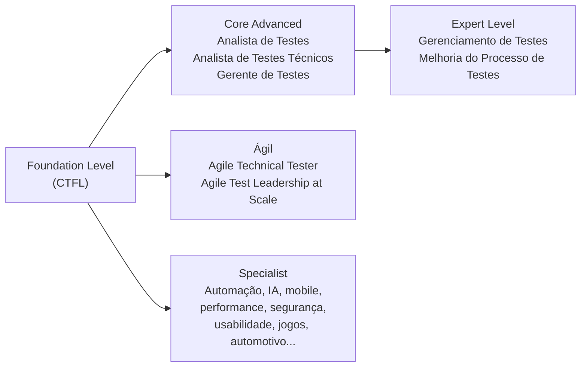

> Esta parte **não cai no exame**. Ela existe para você entender o que está estudando e por que o syllabus é escrito do jeito que é.

## O que é o syllabus

O **syllabus** é o documento oficial que define tudo o que pode ser cobrado na prova **ISTQB® Certified Tester Foundation Level (CTFL)**. Pense nele como o "edital" da certificação: se um assunto não está no syllabus, não cai; se está, pode cair, mesmo que apareça numa frase só.

Quem publica é o **ISTQB** (International Software Testing Qualifications Board), uma organização sem fins lucrativos que mantém um esquema de certificações em teste de software reconhecido no mundo todo. Cada país tem um **conselho membro** que traduz o material e aplica as provas. No Brasil, esse papel é do **BSTQB** (Brazilian Software Testing Qualifications Board), e é a tradução dele que estas notas seguem.

O syllabus é usado por vários públicos ao mesmo tempo:

| Quem | Para quê |
|---|---|
| Conselhos membros (BSTQB) | Traduzir o syllabus e credenciar provedores de treinamento |
| Órgãos de certificação | Escrever as questões do exame |
| Provedores de treinamento | Montar cursos e material didático |
| Candidatos (você) | Estudar para a prova, com curso ou por conta própria |
| Comunidade de engenharia de software | Servir de base para livros, artigos e vocabulário comum |

Esse último ponto é mais importante do que parece. Boa parte do valor do CTFL é ter um **vocabulário comum**: quando alguém fala em "teste de confirmação", "critério de saída" ou "partição inválida", todo mundo certificado entende a mesma coisa. Por isso a prova é tão rigorosa com terminologia.

## Para quem é a certificação

A certificação Foundation Level é para **qualquer pessoa envolvida com teste de software**, não só para quem tem "testador" no crachá. O syllabus cita:

- Testadores, analistas de teste, engenheiros de teste, consultores e gerentes de teste
- Desenvolvedores e membros de times de desenvolvimento
- Pessoas que só precisam entender o básico de teste: gerentes de projeto, gerentes de qualidade, Product Owners, gerentes de desenvolvimento, analistas de negócio, diretores de TI e consultores de gestão

Não existe pré-requisito. Você não precisa de experiência prévia nem de outra certificação para fazer a prova.

## Onde o CTFL entra na carreira

O CTFL é a porta de entrada do esquema do ISTQB. Depois dele, os caminhos se abrem:

- **Core Advanced** aprofunda os papéis clássicos: quem projeta testes funcionais (Analista de Testes), quem cuida de aspectos técnicos como performance e segurança (Analista de Testes Técnicos) e quem gerencia (Gerente de Testes).
- **Expert Level** é para quem já tem bastante estrada em gestão ou melhoria de processo.
- A trilha **Ágil** foca em times ágeis e em escala.
- A trilha **Specialist** mergulha em áreas específicas: automação, teste de IA, teste baseado em modelos, mobile, performance, usabilidade, aceite, segurança, ou domínios como automotivo e jogos.

O mapa atualizado fica no site do ISTQB e no do BSTQB (links nas referências).

## Os 14 resultados de negócio

O syllabus lista 14 **resultados de negócio** (*Business Outcomes*, códigos FL-BO1 a FL-BO14). São as coisas que uma empresa pode esperar de alguém certificado. Eles não caem diretamente na prova, mas cada objetivo de aprendizagem dos capítulos existe para sustentar um ou mais deles.

| Código | Uma pessoa certificada consegue... | Onde é trabalhado |
|---|---|---|
| FL-BO1 | Compreender o que é teste e por que ele é benéfico | Capítulo 1 |
| FL-BO2 | Compreender os conceitos fundamentais de teste | Capítulo 1 |
| FL-BO3 | Identificar a abordagem e as atividades de teste adequadas ao contexto | Capítulos 1 e 2 |
| FL-BO4 | Avaliar e melhorar a qualidade da documentação | Capítulo 3 |
| FL-BO5 | Aumentar a eficácia e a eficiência dos testes | Capítulo 4 |
| FL-BO6 | Alinhar o processo de teste ao ciclo de vida de desenvolvimento | Capítulo 2 |
| FL-BO7 | Compreender os princípios de gerenciamento de testes | Capítulo 5 |
| FL-BO8 | Escrever e comunicar relatórios de defeitos claros | Capítulo 5 |
| FL-BO9 | Compreender o que influencia prioridades e esforço de teste | Capítulo 5 |
| FL-BO10 | Trabalhar como parte de um time multifuncional | Capítulos 1 e 4 |
| FL-BO11 | Conhecer riscos e benefícios da automação de testes | Capítulo 6 |
| FL-BO12 | Identificar as habilidades essenciais para testar | Capítulo 1 |
| FL-BO13 | Compreender o impacto do risco nos testes | Capítulo 5 |
| FL-BO14 | Relatar com eficácia o progresso e a qualidade do teste | Capítulo 5 |

A coluna "Onde é trabalhado" é uma leitura destas notas, não uma tabela oficial. O syllabus tem uma matriz de rastreabilidade no Apêndice B se você quiser a versão exata.

## Normas citadas

O syllabus menciona várias normas: ISO/IEC/IEEE 29119 (processo de teste e documentação), ISO/IEC 25010 (características de qualidade), ISO/IEC 20246 (revisões), ISO/IEC 14764 (manutenção) e ISO 31000 (gestão de risco), entre outras.

Elas servem como estrutura ou leitura complementar. **O conteúdo das normas não cai na prova**, só o que o próprio syllabus resume delas. Você não precisa ler nenhuma norma para passar.

## Teste seu conhecimento

1. Uma pessoa sem nenhuma experiência em teste pode fazer a prova CTFL?

Sim. O CTFL não tem pré-requisitos. Ele é justamente a porta de entrada do esquema ISTQB.

2. O conteúdo da norma ISO/IEC 25010 pode ser cobrado na prova?

Só o que o syllabus resume dela (por exemplo, a lista de características de qualidade não funcionais que aparece no capítulo 2). O texto da norma em si não é examinável.

3. Qual organização aplica a prova CTFL em português no Brasil?

O BSTQB, que é o conselho membro do ISTQB no Brasil.

## Referências

- [CTFL - Certified Tester Foundation Level](https://bstqb.online/ctfl) - BSTQB, português
- [Certified Tester Foundation Level (CTFL) v4.0](https://istqb.org/certifications/certified-tester-foundation-level-ctfl-v4-0/) - ISTQB, inglês
- [Glossário ISTQB](https://glossary.istqb.org/pt-br/search/) - ISTQB, português
