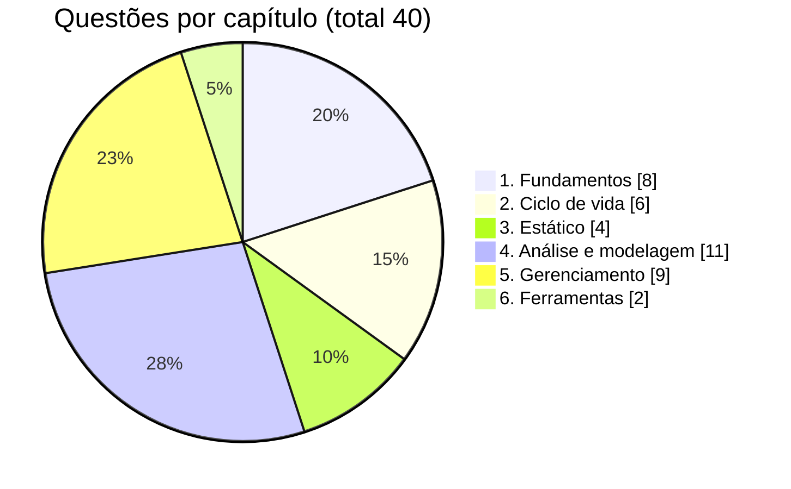
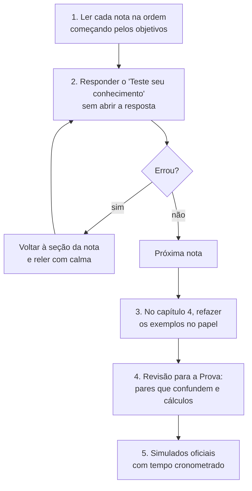

> Esta nota também **não cai na prova**, mas é a que mais ajuda a estudar do jeito certo.

## Formato da prova

Segundo a ficha do exame publicada pelo BSTQB:

| Item | Valor |
|---|---|
| Questões | 40, de múltipla escolha |
| Pontuação | 1 ponto por questão, 40 no total |
| Aprovação | 26 pontos (65%) |
| Tempo | 60 minutos |
| Tempo extra | +25% para quem faz a prova fora da língua nativa, se informado na inscrição |
| Pré-requisitos | Nenhum |

Ao final da prova presencial em papel, há 10 minutos extras para passar as respostas para o gabarito. Regras como formato on-line, valores e datas mudam com o tempo, então confira sempre a página do CTFL no site do BSTQB antes de se inscrever.

Uma questão pode exigir conhecimento de **mais de uma seção** do syllabus ao mesmo tempo. Por exemplo: uma pergunta sobre teste de regressão em DevOps mistura o capítulo 2 (tipos de teste e DevOps) com o capítulo 6 (automação).

## Quantas questões cada capítulo tem

A distribuição oficial ajuda a decidir onde gastar mais tempo:

| Capítulo | Tema | Questões | Tempo de estudo no syllabus |
|---|---|---|---|
| 1 | Fundamentos de Teste | 8 | 180 min |
| 2 | Testes ao longo do ciclo de vida | 6 | 130 min |
| 3 | Teste Estático | 4 | 80 min |
| 4 | Análise e Modelagem de Teste | 11 | 390 min |
| 5 | Gerenciamento das Atividades de Teste | 9 | 335 min |
| 6 | Ferramentas de Teste | 2 | 20 min |

Os capítulos 4 e 5 somam 20 questões, metade da prova. São também os que têm objetivos de nível **K3**, onde você precisa calcular ou aplicar uma técnica, e não só reconhecer um conceito.

## Níveis cognitivos (K-levels)

Cada **objetivo de aprendizagem** (LO, de *Learning Objective*) tem um nível cognitivo, chamado de **K-level**. Ele diz que tipo de pergunta pode aparecer sobre aquele assunto.

| Nível | Significa | Verbos típicos | Como a pergunta costuma ser |
|---|---|---|---|
| **K1** | Lembrar | identificar, relembrar, reconhecer | "Qual destas é uma definição de...?" |
| **K2** | Compreender | classificar, comparar, diferenciar, distinguir, exemplificar, explicar, resumir | "Qual destas afirmações descreve melhor a diferença entre X e Y?" |
| **K3** | Aplicar | aplicar, implementar, preparar, usar | "Dado este cenário, quantos casos de teste são necessários para...?" |

Duas regras do syllabus que valem ouro:

- **Toda palavra-chave** listada no início de um capítulo pode ser cobrada em nível **K1**, mesmo que nenhum objetivo de aprendizagem fale dela. Por isso cada nota destas tem a lista de palavras-chave da seção.
- **Todo o conteúdo** dos capítulos 1 a 6 é examinável. Ficam de fora só a Introdução (capítulo 0) e os Apêndices.

Como ler um código de objetivo: `FL-4.2.2` é **F**oundation **L**evel, capítulo 4, seção 2, objetivo 2. Nas notas, cada código aparece junto do assunto que ele cobre.

## Roteiro de estudo com estas notas

Algumas dicas práticas:

1. **Siga a ordem.** O capítulo 1 define o vocabulário que todo o resto usa. Pular para o capítulo 4 sem saber a diferença entre condição de teste e caso de teste costuma dar errado.
2. **Gaste mais tempo onde há mais questões e mais K3.** Capítulo 4 (técnicas) e capítulo 5 (estimativas, priorização, risco, defeitos) merecem pelo menos metade do seu tempo de estudo.
3. **Refaça os cálculos à mão.** Partições de equivalência, valores limite, tabelas de decisão, transição de estado, cobertura e estimativas aparecem como exercícios. Ler o exemplo não é o mesmo que saber fazer.
4. **Treine o vocabulário.** Muitas questões erradas vêm de confundir pares de termos (erro e defeito, verificação e validação, teste de confirmação e teste de regressão). A seção de revisão tem uma lista desses pares.
5. **Faça os simulados oficiais.** Os exemplos de exame A, B, C e D estão nos [simulados interativos](https://zacarias96.github.io/ctfl-content/mock-exams/), com justificativa de cada alternativa. Faça pelo menos um no modo prova, cronometrado, antes da prova real.

## Teste seu conhecimento

1. Um termo aparece na lista de palavras-chave do capítulo 3, mas nenhum objetivo de aprendizagem fala dele. Ele pode cair na prova?

Pode, em nível K1. Todas as palavras-chave são examináveis pelo menos no nível de lembrar.

2. Qual é o nível cognitivo de um objetivo que pede "Aplicar a análise de valor limite para derivar casos de teste"?

K3 (aplicar). O verbo "aplicar" é a pista.

3. Quantos acertos são necessários para passar?

26 de 40, ou seja, 65%.

## Referências

- [CTFL - Certified Tester Foundation Level](https://bstqb.online/ctfl) - BSTQB, português (ficha do exame, syllabus e exemplos de prova)
- [Certified Tester Foundation Level (CTFL) v4.0](https://istqb.org/certifications/certified-tester-foundation-level-ctfl-v4-0/) - ISTQB, inglês
