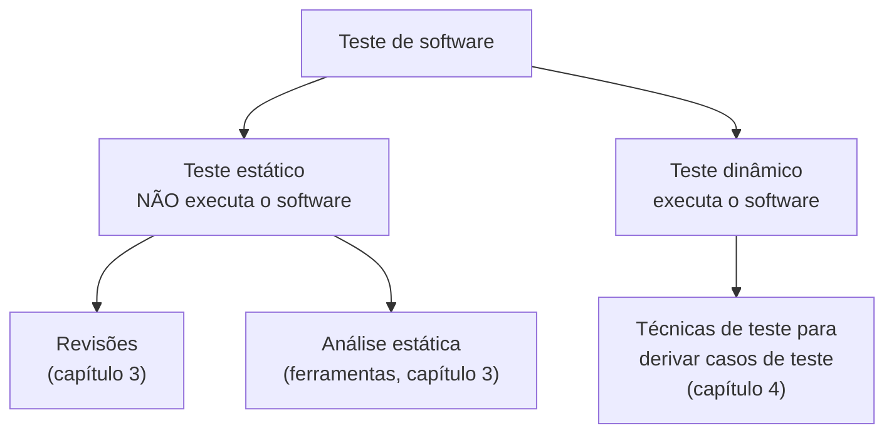
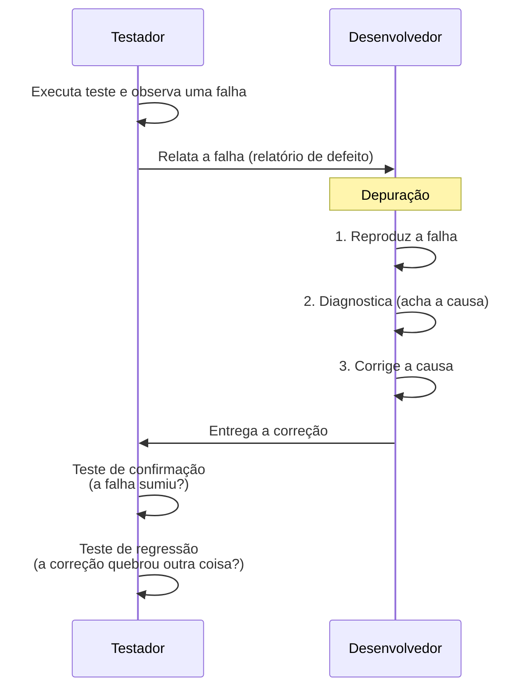

> **Seção 1.1 do syllabus.** Capítulo 1 vale 8 questões na prova.

## Objetivos de aprendizagem

| Código | Nível | O que você precisa saber fazer |
|---|---|---|
| FL-1.1.1 | K1 | Identificar objetivos típicos de teste |
| FL-1.1.2 | K2 | Diferenciar teste de depuração |

## Palavras-chave

Definições do [Glossário ISTQB](https://glossary.istqb.org/pt-br/search/) em português, com uma leitura "em outras palavras" para fixar. Todas podem cair na prova em nível K1.

| Termo | Definição (Glossário ISTQB) | Em outras palavras |
|---|---|---|
| teste | O processo no ciclo de vida do desenvolvimento de software que avalia a qualidade de um componente ou sistema e dos produtos de trabalho relacionados. | Vai muito além de "executar o sistema": inclui revisar, planejar, analisar... |
| objeto de teste | O produto de trabalho a ser testado. | Muda conforme o nível (componente, sistema...). |
| objetivo de teste | O propósito do teste. | Por que estou testando (achar defeitos, reduzir risco...). |
| verificação | O processo de confirmar se um produto final atende às suas especificações. | "Fizemos **conforme a especificação**?" |
| validação | Confirmação, por meio de análise, de que um produto do trabalho atende às necessidades de uma parte interessada. | "Fizemos **o que o usuário precisa**?" |
| depuração | O processo de encontrar, analisar e remover as causas de falhas em um componente ou sistema. | Teste **mostra** a falha; depuração **corrige** a causa (tarefa do dev). |

## Por que isso importa

Todo mundo já passou raiva com um software que não funcionou: o app do banco que trava no Pix, o site que cobra duas vezes, a nota fiscal que sai com valor errado. Em sistemas comuns, isso custa dinheiro, tempo e reputação. Em sistemas críticos (aviação, saúde, automóveis), pode custar vidas.

O teste de software existe para **avaliar a qualidade** do software e **reduzir o risco** de ele falhar quando estiver em uso.

## A definição do syllabus

> **Teste de software** é um conjunto de atividades para descobrir defeitos e avaliar a qualidade dos artefatos de software.

Dois detalhes dessa frase caem muito na prova:

- **"Conjunto de atividades"**: teste não é um momento único, é um processo com várias etapas (você vai ver as sete atividades na nota [Processo de teste](04-processo-de-teste.md)).
- **"Artefatos de software"**: não é só código. Requisitos, histórias de usuário, desenhos de arquitetura e até os próprios scripts de teste podem ser testados. O artefato que está sendo testado no momento se chama **objeto de teste**.

## Dois equívocos clássicos

### "Testar é só executar o sistema"

Errado. Executar o software e conferir o resultado é só uma das atividades (a **execução do teste**). Antes disso vêm planejar, analisar o que testar, modelar os casos, preparar ambiente e dados. E depois vem concluir, registrar, aprender. Tudo isso é teste, e tudo isso precisa estar alinhado ao **ciclo de vida de desenvolvimento** (o SDLC, assunto do capítulo 2).

### "Testar é só verificar se atende ao requisito"

Também errado. Teste envolve duas perguntas diferentes:

| | Verificação | Validação |
|---|---|---|
| Pergunta | O sistema atende aos **requisitos especificados**? | O sistema atende às **necessidades dos usuários e stakeholders** no ambiente real? |
| Frase para decorar | "Construímos o produto **do jeito certo**?" | "Construímos o produto **certo**?" |
| Exemplo | O requisito diz "o botão Salvar grava o formulário". O teste confirma que grava. | Os usuários na verdade queriam salvamento automático e acham o botão inútil. |

Um sistema pode passar em toda a verificação e ainda assim falhar na validação. Essa ideia volta no princípio da **falácia da ausência de defeitos** (nota [Os sete princípios de teste](03-principios-de-teste.md)).

## Teste estático e teste dinâmico

- **Teste dinâmico** roda o software. Você dá uma entrada, observa a saída e compara com o esperado.
- **Teste estático** examina o artefato sem executá-lo. Uma revisão de requisitos em reunião e um linter apontando variável não usada são exemplos.

Os dois são teste. Um erro comum é achar que revisão "não é teste de verdade". Para o syllabus, é.

Além do lado técnico, teste também é **gerenciado**: ele precisa ser planejado, estimado, monitorado e controlado (capítulo 5). E apesar das ferramentas (capítulo 6), teste é principalmente uma **atividade intelectual**, que pede conhecimento especializado, análise, pensamento crítico e pensamento sistêmico.

## Objetivos do teste (FL-1.1.1)

Os objetivos típicos listados no syllabus são:

1. Avaliar produtos de trabalho, como requisitos, histórias de usuário, projetos e código
2. Detectar falhas e defeitos
3. Garantir a cobertura necessária de um objeto de teste
4. Reduzir o nível de risco de qualidade inadequada do software
5. Verificar se os requisitos especificados foram atendidos
6. Verificar se o objeto de teste está em conformidade com requisitos contratuais, legais e normativos
7. Fornecer informações aos stakeholders para que tomem decisões informadas
8. Criar confiança na qualidade do objeto de teste
9. Validar se o objeto de teste está completo e funciona como os stakeholders esperam

Não precisa decorar a lista palavra por palavra. Questões K1 costumam trazer quatro alternativas em que três são objetivos e uma é uma "pegadinha", como "provar que o software não tem defeitos" (impossível, veja o princípio 1) ou "corrigir os defeitos encontrados" (isso é depuração, não teste).

### Os objetivos mudam com o contexto

O peso de cada objetivo varia conforme:

- o produto de trabalho testado
- o **nível de teste** (num teste de componente o foco é achar defeitos; num teste de aceite, criar confiança)
- os riscos
- o SDLC seguido
- fatores de negócio, como estrutura da empresa, concorrência e *time-to-market*

Um exemplo concreto: num app de delivery que precisa sair antes do concorrente, o objetivo pode ser "dar informação para o PO decidir se lança". Num software de marca-passo, "verificar conformidade com normas regulatórias" pesa muito mais.

## Teste e depuração (FL-1.1.2)

Teste e depuração são **atividades diferentes**, e a prova adora confundir as duas.

| | Teste | Depuração (*debugging*) |
|---|---|---|
| O que faz | Provoca **falhas** (dinâmico) ou encontra **defeitos** direto no artefato (estático) | Encontra a **causa** da falha, analisa e **elimina** |
| Quem costuma fazer | Testadores, mas também devs, analistas, usuários | Normalmente desenvolvedores |
| É uma atividade de teste? | Sim | **Não** |

### O fluxo depois de uma falha no teste dinâmico

- O **teste de confirmação** verifica se a correção resolveu o problema. De preferência, quem faz é **a mesma pessoa** que fez o teste original, porque ela sabe exatamente como reproduzir.
- O **teste de regressão** verifica se a correção causou falhas em outras partes. Os dois tipos estão detalhados na nota [Tipos de teste, confirmação e regressão](../02-testes-no-ciclo-de-vida/05-tipos-de-teste-confirmacao-e-regressao.md).

### E quando o teste estático acha o defeito?

Aí a depuração é mais simples: basta **remover o defeito**. Não precisa reproduzir nem diagnosticar, porque o teste estático aponta o defeito diretamente (por exemplo, "o requisito 3 contradiz o requisito 7"). E como nada foi executado, o teste estático **não causa falhas**.

## Teste seu conhecimento

1. Qual destas NÃO é um objetivo típico de teste? (a) Detectar defeitos (b) Criar confiança na qualidade (c) Remover os defeitos encontrados (d) Fornecer informação para decisões

**(c).** Remover defeitos é depuração, que não é uma atividade de teste. O teste contribui para a qualidade de forma indireta, encontrando o que precisa ser corrigido.

2. Uma analista revisa a especificação de requisitos e encontra uma regra contraditória. Isso é teste? De que tipo?

Sim, é **teste estático**: o artefato foi examinado sem execução. Para corrigir, basta ajustar o requisito, sem etapa de reprodução ou diagnóstico.

3. Todos os requisitos foram verificados e passaram, mas os usuários reclamam que o sistema não resolve o problema deles. O que faltou?

**Validação.** A verificação confirmou que o sistema segue a especificação, mas ninguém checou se ele atende às necessidades reais dos usuários.

4. Depois de uma correção, quem idealmente executa o teste de confirmação?

A mesma pessoa que executou o teste original e encontrou a falha.

## Referências

- [Syllabus CTFL v4.0 em português](https://bstqb.online/ctfl) - BSTQB, português (seção 1.1)
- [Glossário ISTQB](https://glossary.istqb.org/pt-br/search/) - ISTQB, português (termos "teste", "verificação", "validação", "depuração")
- *The Art of Software Testing*, 3ª ed. - Glenford Myers, Corey Sandler e Tom Badgett, Wiley, 2011 (citado no syllabus), inglês
