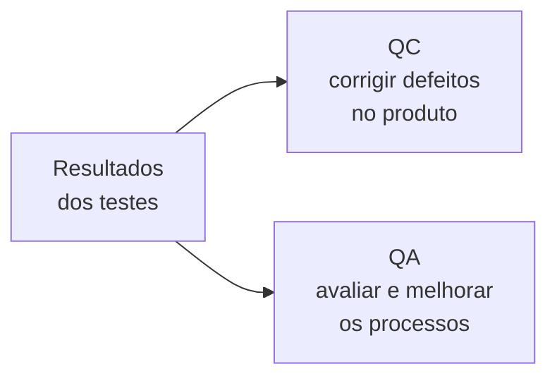
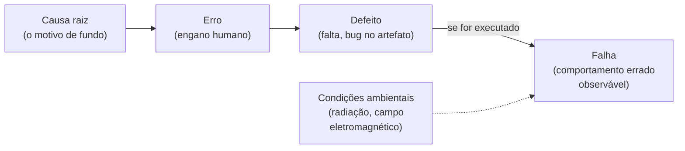

> **Seção 1.2 do syllabus.**

## Objetivos de aprendizagem

| Código | Nível | O que você precisa saber fazer |
|---|---|---|
| FL-1.2.1 | K2 | Exemplificar por que os testes são necessários |
| FL-1.2.2 | K1 | Relembrar a relação entre teste e garantia da qualidade |
| FL-1.2.3 | K2 | Distinguir causa raiz, erro, defeito e falha |

## Palavras-chave

Definições do [Glossário ISTQB](https://glossary.istqb.org/pt-br/search/) em português, com uma leitura "em outras palavras" para fixar. Todas podem cair na prova em nível K1.

| Termo | Definição (Glossário ISTQB) | Em outras palavras |
|---|---|---|
| qualidade | O grau em que um produto de trabalho atende aos requisitos declarados e implícitos. | Não é só o que está escrito: o implícito também conta. |
| garantia de qualidade | Atividades focadas em proporcionar confiança de que os requisitos de qualidade serão cumpridos. | QA = **processo**, preventivo. Teste é QC (produto, corretivo). |
| causa raiz | Uma fonte de um defeito tal que, se ele for removido, a ocorrência do tipo do defeito é reduzida ou removida. | O "porquê" do erro (pressa, falta de treino...). |
| erro | Uma ação humana que resulta em um defeito. | Engano de **uma pessoa**. |
| defeito | Uma imperfeição ou deficiência em um produto de trabalho que não atende aos seus requisitos ou especificações ou prejudica o uso pretendido. | O "bug" **no artefato** (código, requisito, doc). |
| falha | Uma situação em que um componente ou sistema não atende aos requisitos dentro dos limites especificados durante sua execução. | O defeito **se manifestando em execução**. |

> Cadeia: **causa raiz → erro → defeito → falha**. Nem todo defeito gera falha (o trecho pode nunca ser executado), e falhas também podem vir de condições ambientais (radiação, campo magnético).

## Teste como forma de controle de qualidade

O syllabus enquadra o teste como uma forma de **controle de qualidade**: ele ajuda o projeto a cumprir o que foi combinado dentro das restrições de **escopo, tempo, qualidade e orçamento**.

E a contribuição não é exclusiva do time de teste. **Qualquer stakeholder** que use habilidades de teste ajuda o projeto a chegar mais perto do sucesso. Um PO que questiona um critério de aceite ambíguo está, na prática, testando.

## Como o teste contribui para o sucesso (FL-1.2.1)

O syllabus lista quatro contribuições. Vale entender cada uma com um exemplo, porque a questão K2 costuma pedir "qual destes é um exemplo de...".

| Contribuição | O que significa | Exemplo |
|---|---|---|
| **Detectar defeitos de forma econômica** | Achar defeitos antes do usuário custa menos. Os defeitos são removidos pela depuração (que não é teste), então o teste melhora a qualidade **indiretamente**. | Um teste de integração mostra que o cálculo de frete ignora CEPs da região Norte. O dev corrige antes do lançamento. |
| **Avaliar a qualidade diretamente** | O teste mede a qualidade do objeto em vários pontos do SDLC. Essas medidas alimentam decisões de projeto, como liberar ou não uma versão. | O relatório mostra 2 defeitos críticos abertos e o comitê adia o lançamento em uma semana. |
| **Representar os usuários** | O testador leva a visão do usuário para dentro do projeto. A alternativa (envolver muitos usuários reais) costuma ser cara e inviável. | O testador percebe que o fluxo de cadastro pede o CPF três vezes e abre um defeito de usabilidade. |
| **Atender exigências contratuais, legais ou normativas** | Às vezes o teste é obrigatório. | Um sistema bancário precisa comprovar testes de segurança para um órgão regulador. |

## Teste não é QA (FL-1.2.2)

Muita gente usa "teste" e "QA" como sinônimos. Até vagas de emprego fazem isso. Para o syllabus, **não são a mesma coisa**:

- **Teste é uma forma de controle de qualidade (QC).**
- **Garantia da qualidade (QA)** é outra coisa, mais ampla e voltada ao processo.

| | Controle de Qualidade (QC) | Garantia da Qualidade (QA) |
|---|---|---|
| Natureza | **Corretiva** | **Preventiva** |
| Foco | **Produto** | **Processo** |
| Ideia central | Atividades que ajudam a atingir níveis adequados de qualidade no produto | Se um bom processo for seguido corretamente, ele gera um bom produto |
| Exemplos | Testes, métodos formais (verificação de modelos, prova de corretude), simulação, prototipagem | Definir e melhorar processos de desenvolvimento e de teste |
| De quem é a responsabilidade | Das pessoas que fazem as atividades de QC | **De todos** no projeto |
| Como usa os resultados de teste | Para **corrigir defeitos** | Como **feedback sobre como os processos estão funcionando** |

Uma forma de lembrar: QC olha **para a coisa que foi feita**; QA olha **para o jeito como as coisas são feitas**. Se 40% dos defeitos de uma sprint vieram de requisitos mal escritos, o QC corrige esses defeitos e o QA muda o processo de refinamento para que isso não se repita.

## Erro, defeito, falha e causa raiz (FL-1.2.3)

Esse é um dos assuntos mais cobrados do capítulo 1. A cadeia é:

### Erro (equívoco, engano)

Uma **ação humana** que produz um resultado incorreto. Pessoas erram por vários motivos: pressão de prazo, complexidade (do produto, do processo, da infraestrutura, das interações), cansaço ou falta de treinamento.

### Defeito (falta, bug)

A **imperfeição dentro de um artefato**. Pode estar:

- na documentação: um requisito errado, um script de teste com passo faltando
- no código-fonte
- num artefato de suporte, como um arquivo de build

Defeitos em artefatos do começo do ciclo (requisitos, desenho), se não forem detectados, costumam gerar mais defeitos nos artefatos derivados. Um requisito errado vira código errado, teste errado e manual errado.

### Falha

O que acontece quando um defeito no código é **executado** e o sistema faz algo que não deveria, ou deixa de fazer algo que deveria. É o efeito **observável**.

Nem todo defeito vira falha:

- alguns **sempre** falham quando executados
- outros só falham em **circunstâncias específicas** (um dado particular, uma data, uma carga alta)
- alguns **nunca** falham (por exemplo, código morto que nunca é chamado)

E nem toda falha vem de um defeito: **condições ambientais**, como radiação ou campos eletromagnéticos, podem causar defeitos em firmware e, a partir deles, falhas.

### Causa raiz

O **motivo fundamental** que levou ao problema, normalmente a situação que fez a pessoa errar. Ela é encontrada pela **análise de causa raiz**, feita quando ocorre uma falha ou quando um defeito é identificado. Atacar a causa raiz evita que defeitos parecidos voltem a aparecer, ou pelo menos reduz a frequência deles.

### Um exemplo completo

> Uma fintech lança uma funcionalidade de cálculo de juros às pressas por causa de uma campanha de marketing (**causa raiz**: pressão de prazo e ausência de revisão de regras de negócio). O analista entende errado a regra de juros compostos (**erro**) e escreve o requisito com a fórmula de juros simples (**defeito** no requisito). O dev implementa o requisito como está (**defeito** no código). Em produção, clientes recebem boletos com valor menor que o devido (**falha**).

Corrigir só o código resolve a falha de hoje. Atacar a causa raiz (por exemplo, incluir revisão das regras financeiras no processo) evita as próximas.

## Teste seu conhecimento

1. Um programador digita "&lt;" em vez de "&lt;=" numa condição. Em produção, clientes com exatamente 18 anos não conseguem se cadastrar. Classifique cada parte.

O engano do programador é o **erro**. O "&lt;" errado no código é o **defeito**. O cadastro recusado para quem tem 18 anos é a **falha**.

2. Qual afirmação sobre QA está correta? (a) QA é o mesmo que testar (b) QA é corretiva e focada no produto (c) QA é preventiva, focada no processo e responsabilidade de todos (d) QA é responsabilidade exclusiva do time de teste

**(c).** As alternativas (a), (b) e (d) descrevem confusões comuns. Teste é uma forma de QC, que é corretivo e focado no produto.

3. Um defeito pode existir sem nunca causar uma falha?

Sim. Se o trecho com defeito nunca for executado, ou se só falhar em condições que nunca acontecem, a falha nunca aparece.

4. Uma falha pode acontecer sem nenhum defeito no software?

Sim. O syllabus cita condições ambientais (radiação, campos eletromagnéticos) que podem causar defeitos em firmware e, a partir deles, falhas.

## Referências

- [Syllabus CTFL v4.0 em português](https://bstqb.online/ctfl) - BSTQB, português (seção 1.2)
- [Glossário ISTQB](https://glossary.istqb.org/pt-br/search/) - ISTQB, português (termos "erro", "defeito", "falha", "causa raiz", "garantia da qualidade")
- [Quality Assurance vs. Quality Control](https://asq.org/quality-resources/quality-assurance-vs-control) - ASQ, inglês
