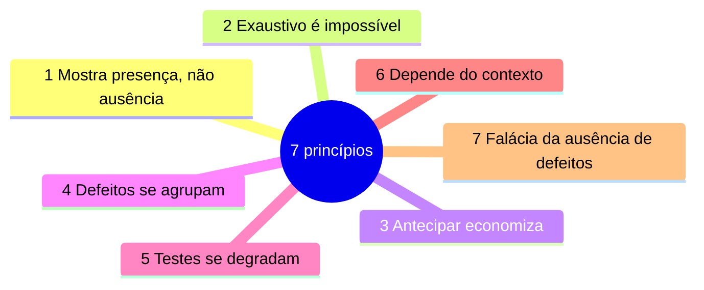

> **Seção 1.3 do syllabus.** Questão garantida em quase toda prova.

## Objetivo de aprendizagem

| Código | Nível | O que você precisa saber fazer |
|---|---|---|
| FL-1.3.1 | K2 | Explicar os sete princípios de teste |

Por ser K2, a prova não pede para você recitar os princípios. Ela descreve uma **situação** e pergunta qual princípio se aplica. Por isso, cada princípio abaixo vem com o "cheiro" típico da questão.

## Visão geral

## 1. O teste mostra a presença, não a ausência de defeitos

Testes conseguem mostrar que **existem** defeitos. Não conseguem provar que **não existem**. Mesmo que nenhum teste falhe, isso não prova que o objeto de teste está correto. O que o teste faz é **reduzir a probabilidade** de sobrarem defeitos não descobertos.

A ideia vem de uma frase famosa de Dijkstra, registrada por Buxton em 1970: testes mostram a presença de bugs, nunca a ausência.

**Cheiro na prova:** "O gerente afirma que, como todos os testes passaram, o sistema está livre de defeitos." A afirmação está errada por causa deste princípio.

## 2. Testes exaustivos são impossíveis

Testar todas as combinações de entradas e condições só é viável em casos triviais. Um formulário com 10 campos, cada um aceitando 100 valores diferentes, já tem 100¹⁰ combinações.

Em vez de tentar testar tudo, o syllabus manda **concentrar o esforço** com:

- **técnicas de teste** (capítulo 4), que escolhem casos representativos
- **priorização de casos de teste** (nota [Priorização, pirâmide e quadrantes](../05-gerenciamento-das-atividades-de-teste/03-priorizacao-piramide-e-quadrantes.md))
- **teste baseado em risco** (nota [Gerenciamento de risco](../05-gerenciamento-das-atividades-de-teste/04-gerenciamento-de-risco.md))

**Cheiro na prova:** "O cliente quer que todas as combinações de entrada sejam testadas antes da entrega." Ou: "Como decidir o que testar se não há tempo para tudo?"

## 3. Testes antecipados economizam tempo e dinheiro

Um defeito removido cedo não gera defeitos derivados nos artefatos seguintes. Um requisito errado corrigido na revisão custa uma conversa; o mesmo erro descoberto em produção custa retrabalho de código, testes, documentação e talvez reembolso a clientes. Isso reduz o **custo da qualidade** (Boehm, 1981).

Para isso, tanto o **teste estático** (capítulo 3) quanto o **teste dinâmico** (capítulo 4) devem começar o mais cedo possível. Essa ideia é a base do **shift-left** (nota [DevOps, shift-left e retrospectivas](../02-testes-no-ciclo-de-vida/03-devops-shift-left-e-retrospectivas.md)).

**Cheiro na prova:** "O testador participa da revisão das histórias de usuário antes do início do desenvolvimento." Ou qualquer frase com "o quanto antes".

## 4. Os defeitos se agrupam

Um pequeno número de componentes costuma concentrar a maioria dos defeitos encontrados, ou a maioria das falhas em produção (Enders, 1975). É uma ilustração do **Princípio de Pareto** (a regra do 80/20).

Os agrupamentos **previstos** (por exemplo, "o módulo de pagamentos é o mais complexo") e os **observados** (por exemplo, "70% dos bugs da última versão vieram do checkout") são uma entrada importante para o **teste baseado em risco**.

**Cheiro na prova:** "A maioria dos defeitos das últimas releases veio de dois módulos. Onde concentrar os testes?"

## 5. Os testes se degradam

Repetir os mesmos testes muitas vezes faz com que eles fiquem cada vez menos eficazes para encontrar **novos** defeitos (Beizer, 1990). É como um pesticida que deixa de funcionar porque as pragas ficam resistentes. Nas versões anteriores do syllabus este princípio se chamava **"paradoxo do pesticida"**.

Para contornar:

- modificar os testes e os dados de teste existentes
- escrever testes novos

**A exceção que cai na prova:** em alguns casos, repetir os mesmos testes é **benéfico**, como nos **testes de regressão automatizados**. Ali o objetivo não é achar defeitos novos, e sim garantir que o que funcionava continua funcionando.

**Cheiro na prova:** "A suíte de testes roda há um ano e não encontra mais defeitos, mas os usuários continuam relatando problemas."

## 6. Os testes dependem do contexto

Não existe uma abordagem de teste que sirva para tudo. Testar o software de controle de um avião é muito diferente de testar um jogo casual ou um site de campanha que fica no ar por duas semanas (Kaner, 2011).

**Cheiro na prova:** "A empresa quer aplicar no app de marketing exatamente o mesmo processo de teste usado no sistema de dispositivos médicos."

## 7. Falácia da ausência de defeitos

É um **engano** esperar que só a verificação garanta o sucesso de um sistema. Dá para testar todos os requisitos especificados, corrigir todos os defeitos encontrados e ainda assim entregar um sistema que:

- não atende às necessidades e expectativas dos usuários
- não ajuda a atingir os objetivos de negócio do cliente
- é pior que os concorrentes

Por isso, além da **verificação**, é preciso fazer **validação** (Boehm, 1981).

**Cheiro na prova:** "O sistema foi entregue sem nenhum defeito conhecido, mas os usuários o abandonaram porque ele era difícil de usar."

## Como diferenciar os princípios parecidos

| Se a situação fala de... | O princípio é... |
|---|---|
| "Os testes passaram, então não há defeitos" | 1. Presença, não ausência |
| "Testar todas as combinações" | 2. Exaustivo é impossível |
| Envolver teste cedo, revisar requisitos antes de codificar | 3. Antecipar economiza |
| Poucos módulos concentram a maioria dos bugs | 4. Defeitos se agrupam |
| Testes antigos que não acham mais nada novo | 5. Testes se degradam |
| Processos diferentes para produtos diferentes | 6. Depende do contexto |
| Produto sem defeitos que ninguém quer usar | 7. Falácia da ausência de defeitos |

Os princípios 1 e 7 são os que mais confundem. O 1 fala sobre o que **o teste consegue provar** (nunca a ausência de defeitos). O 7 fala sobre **o produto certo** (um produto sem defeitos ainda pode ser o produto errado).

## Teste seu conhecimento

1. A equipe roda a mesma suíte de regressão automatizada a cada build há dois anos. Isso viola o princípio "os testes se degradam"?

Não. O próprio syllabus cita a regressão automatizada como exceção em que repetir os mesmos testes é benéfico. O objetivo dela é detectar regressões, não descobrir defeitos novos.

2. Uma análise mostra que 80% das falhas em produção vieram do módulo de faturamento. Qual princípio isso ilustra e como usar essa informação?

**Os defeitos se agrupam.** A informação deve alimentar o teste baseado em risco: mais esforço de teste no módulo de faturamento.

3. "Corrigimos todos os 312 defeitos encontrados, então o lançamento será um sucesso." Qual princípio contradiz essa frase?

**Falácia da ausência de defeitos.** Sem validação, o sistema pode estar livre de defeitos conhecidos e mesmo assim não atender aos usuários nem ao negócio.

4. Qual princípio justifica usar técnicas de teste como particionamento de equivalência?

**Testes exaustivos são impossíveis.** As técnicas escolhem um subconjunto representativo de casos em vez de testar todas as combinações.

## Referências

- [Syllabus CTFL v4.0 em português](https://bstqb.online/ctfl) - BSTQB, português (seção 1.3)
- [Glossário ISTQB](https://glossary.istqb.org/pt-br/search/) - ISTQB, português
- *Software Testing Techniques*, 2ª ed. - Boris Beizer, Van Nostrand Reinhold, 1990 (origem do "paradoxo do pesticida"), inglês
