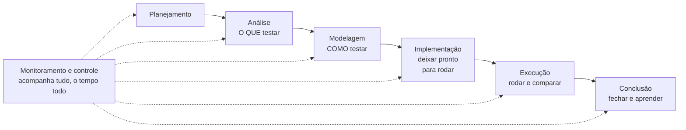

> **Seções 1.4.1 e 1.4.2 do syllabus.**

## Objetivos de aprendizagem

| Código | Nível | O que você precisa saber fazer |
|---|---|---|
| FL-1.4.1 | K2 | Resumir as diferentes atividades e tarefas de teste |
| FL-1.4.2 | K2 | Explicar o impacto do contexto no processo de teste |

## Palavras-chave

Definições do [Glossário ISTQB](https://glossary.istqb.org/pt-br/search/) em português, com uma leitura "em outras palavras" para fixar. Todas podem cair na prova em nível K1.

| Termo | Definição (Glossário ISTQB) | Em outras palavras |
|---|---|---|
| planejamento de teste | Atividade de criação ou atualização de um plano de teste. | É contínuo: o plano é revisto ao longo do projeto. |
| monitoramento de teste | A atividade que verifica o status das atividades de teste, identifica quaisquer desvios do planejado ou esperado e relata o status aos stakeholders. | Coletar informação. |
| controle de teste | A atividade que desenvolve e aplica ações corretivas para colocar um projeto de teste no caminho certo quando ele se desvia do que foi planejado. | Usar a informação para agir. |
| análise de teste | A atividade que identifica as condições de teste, analisando a base do teste. | **O que** testar. |
| base de teste | O conjunto de conhecimentos usado como base para a análise e o modelagem de teste. | **De onde** tiro os testes (requisitos, histórias, código...). |
| condição de teste | Um aspecto testável de um componente ou sistema que se pretenda testar. | Resultado da **análise**. |
| modelagem de teste | Atividade que deriva e especifica os casos e condições de teste. | **Como** testar. |
| caso de teste | Um conjunto de pré-condições, entradas, ações (quando aplicável), resultados esperados e pós-condições, desenvolvidos com base nas condições de teste. | Resultado da **modelagem**. |
| cobertura | O grau em que os itens de uma abrangência específica são executados por um conjunto de testes, expresso como uma porcentagem. | itens exercitados ÷ itens identificados × 100%. |
| implementação de teste | A atividade que prepara o testware necessário para a execução do teste. | Deixar **tudo pronto** para rodar (procedimentos, dados, ambiente). |
| dados de teste | Dados necessários para a execução de um teste. | Valores concretos usados nos casos. |
| execução de teste | Atividade que executa um teste em um componente ou sistema produzindo resultados reais. | Rodar e comparar real x esperado. |
| conclusão do teste | A atividade que torna o testware disponível para uso posterior, deixando o ambiente de teste em condições satisfatórias e comunicando os resultados obtidos aos stakeholders. | Arquivar, limpar, lições aprendidas. |

## O que é o processo de teste

Teste depende do contexto, mas existe um conjunto de atividades que aparece em praticamente qualquer projeto. Sem elas, é pouco provável que o teste atinja seus objetivos. Esse conjunto forma o **processo de teste**.

O processo é **adaptado** a cada situação. Quais atividades entram, como são feitas e quando acontecem é decidido no **planejamento do teste**.

## As sete atividades (FL-1.4.1)

Apesar do desenho em sequência, o syllabus é claro: na prática as atividades costumam ser **iterativas ou paralelas**. Num time ágil, a análise da próxima história acontece enquanto a execução da história atual ainda está rolando.

### Planejamento

Definir os **objetivos do teste** e escolher a **abordagem** que melhor atinge esses objetivos dentro das restrições do contexto (prazo, orçamento, pessoas, ferramentas). Detalhes na nota [Plano de teste e critérios](../05-gerenciamento-das-atividades-de-teste/01-plano-de-teste-e-criterios.md).

### Monitoramento e controle

São duas coisas que andam juntas:

- **Monitoramento**: verificar continuamente as atividades de teste e **comparar o progresso real com o plano**.
- **Controle**: **tomar as ações** necessárias para atingir os objetivos do teste.

Monitorar é olhar o painel do carro; controlar é virar o volante. Detalhes na nota [Monitoramento, controle e conclusão](../05-gerenciamento-das-atividades-de-teste/05-monitoramento-controle-e-conclusao.md).

### Análise de teste: "o que testar?"

- Analisar a **base de teste** (requisitos, histórias, desenhos, código, qualquer coisa que diga como o sistema deve se comportar) para identificar **funcionalidades testáveis**.
- Definir e **priorizar as condições de teste**, junto com os riscos associados.
- Avaliar a base de teste e o objeto de teste para encontrar **defeitos** neles e avaliar a **testabilidade**. Sim, a análise também acha defeitos, por exemplo um requisito ambíguo.

A análise costuma usar técnicas de teste e responde **"o que testar?"** em termos de **critérios de cobertura mensuráveis**.

> **Condição de teste** é um aspecto testável do objeto de teste. Exemplo: "o desconto de aniversário é aplicado só no mês do aniversário".

### Modelagem de teste: "como testar?"

- Transformar as condições de teste em **casos de teste** e outros materiais, como **cartas de teste** (usadas em teste exploratório).
- Identificar os **itens de cobertura**, que guiam a escolha das entradas dos casos de teste.
- Definir os **requisitos de dados de teste**, projetar o **ambiente de teste** e identificar outras infraestruturas e ferramentas necessárias.

A modelagem responde **"como testar?"**.

> **Caso de teste** é um conjunto de pré-condições, entradas, ações, resultados esperados e pós-condições. Exemplo: "Dado um cliente nascido em março, quando ele compra em 15 de março, então o desconto de 10% é aplicado."

### Implementação de teste: "está tudo pronto para rodar?"

- Criar ou adquirir o **testware** necessário para executar, como **dados de teste**.
- Organizar os casos de teste em **procedimentos de teste** e agrupá-los em **conjuntos de teste** (suítes).
- Criar **scripts de teste** manuais e automatizados.
- Priorizar os procedimentos e organizá-los num **cronograma de execução de teste**.
- **Montar o ambiente de teste** e verificar se ele está configurado corretamente.

### Execução de teste: "rodar"

- Executar os testes conforme o cronograma, de forma manual ou automatizada. A execução pode tomar várias formas, como **teste contínuo** ou **sessões em pares**.
- **Comparar** os resultados reais com os esperados.
- **Registrar** os resultados.
- **Analisar as anomalias** para identificar as causas prováveis e **relatar** os defeitos com base nas falhas observadas.

### Conclusão do teste

Acontece nos **marcos** do projeto: lançamento, fim de iteração, fim de um nível de teste.

- Tratar defeitos não resolvidos, solicitações de mudança ou itens de backlog criados.
- Identificar o testware que pode ser útil no futuro e **arquivar** ou **entregar** para as equipes certas.
- **Desligar o ambiente** de teste num estado acordado.
- Analisar as atividades para tirar **lições aprendidas** e melhorias (ligação com as retrospectivas, nota [DevOps, shift-left e retrospectivas](../02-testes-no-ciclo-de-vida/03-devops-shift-left-e-retrospectivas.md)).
- Criar e comunicar o **relatório de conclusão do teste**.

### Um exemplo atravessando todas as atividades

> História: "Como cliente, quero recuperar minha senha por e-mail."

| Atividade | O que acontece |
|---|---|
| Planejamento | Decide-se testar a história nesta sprint, com testes automatizados de API e um teste exploratório manual na interface. |
| Análise | Condições: link enviado para e-mail cadastrado; mensagem neutra para e-mail não cadastrado; link expira em 30 min; link só funciona uma vez. O analista nota que a história não diz o que acontece com e-mail em maiúsculas e pergunta ao PO. |
| Modelagem | Casos de teste para cada condição, incluindo o limite de 29, 30 e 31 minutos. Requisito de dados: um usuário com e-mail válido e outro bloqueado. |
| Implementação | Scripts de API escritos, massa de dados criada, servidor de e-mail falso configurado no ambiente. |
| Execução | Testes rodados. O link funciona duas vezes: falha registrada e relatada. |
| Monitoramento e controle | O teste de expiração está atrasado porque o ambiente caiu. O líder realoca uma pessoa para ajudar. |
| Conclusão | Fim da sprint: um defeito de baixa prioridade vai para o backlog, os scripts entram na suíte de regressão, e a lição "pedir servidor de e-mail falso desde o planejamento" vai para a retrospectiva. |

### Atalho para questões "a qual atividade pertence?"

| Se a tarefa fala em... | A atividade é... |
|---|---|
| objetivos e abordagem do teste | Planejamento |
| comparar progresso com o plano / tomar ações corretivas | Monitoramento / Controle |
| **condições de teste**, avaliar testabilidade, defeitos na base de teste | **Análise** |
| **casos de teste**, **itens de cobertura**, requisitos de dados e de ambiente | **Modelagem** |
| **procedimentos**, **scripts**, **suítes**, **dados de teste**, cronograma de execução, montar ambiente | **Implementação** |
| rodar, comparar real e esperado, registrar, relatar anomalias | **Execução** |
| arquivar testware, lições aprendidas, relatório final | **Conclusão** |

A confusão mais comum é entre modelagem e implementação. Uma regra prática: **requisitos** de dados e ambiente são definidos na modelagem; **criar** os dados e **montar** o ambiente acontece na implementação.

## O processo de teste no contexto (FL-1.4.2)

O teste não acontece isolado. Ele é parte dos processos de desenvolvimento da organização e é **pago pelos stakeholders** para atender às necessidades de negócio deles. Por isso, o jeito de testar depende de vários fatores de contexto:

| Fator | Exemplos do que pesa |
|---|---|
| **Stakeholders** | necessidades, expectativas, requisitos, disposição para cooperar |
| **Membros da equipe** | habilidades, conhecimento, experiência, disponibilidade, necessidade de treinamento |
| **Domínio do negócio** | criticidade do objeto de teste, riscos, necessidades do mercado, normas legais |
| **Fatores técnicos** | tipo de software, arquitetura, tecnologia |
| **Restrições do projeto** | escopo, tempo, orçamento, recursos |
| **Fatores organizacionais** | estrutura, políticas, práticas existentes |
| **SDLC** | práticas de engenharia, métodos de desenvolvimento |
| **Ferramentas** | disponibilidade, usabilidade, conformidade |

Esses fatores influenciam a **estratégia de teste**, as **técnicas** usadas, o **grau de automação**, o **nível de cobertura** exigido, o **nível de detalhe da documentação** e os **relatórios**.

Exemplo: uma startup com três devs, sem testador dedicado, entregando várias vezes por dia, tende a investir em testes automatizados escritos pelos próprios devs e documentação mínima. Um fornecedor de software para hospitais, sujeito a regulação, vai precisar de rastreabilidade formal, documentação detalhada e testes independentes.

## Teste seu conhecimento

1. Em qual atividade são definidos os requisitos de dados de teste? E em qual os dados são criados?

Os **requisitos** de dados são definidos na **modelagem**. Os dados em si são criados (ou adquiridos) na **implementação**.

2. Durante a análise, o testador percebe que dois requisitos se contradizem. Isso faz parte da análise de teste?

Sim. A análise inclui avaliar a base de teste para identificar defeitos e avaliar a testabilidade.

3. O líder de teste percebe que a execução está 30% atrasada e decide reduzir o escopo dos testes de baixa prioridade. Quais atividades são essas?

Perceber o atraso comparando com o plano é **monitoramento**. Decidir e aplicar a ação corretiva é **controle**.

4. Qual atividade responde "o que testar?" e qual responde "como testar?"

A **análise** responde "o que testar?". A **modelagem** responde "como testar?".

## Referências

- [Syllabus CTFL v4.0 em português](https://bstqb.online/ctfl) - BSTQB, português (seções 1.4.1 e 1.4.2)
- [Glossário ISTQB](https://glossary.istqb.org/pt-br/search/) - ISTQB, português (termos "condição de teste", "caso de teste", "base de teste")
- ISO/IEC/IEEE 29119-2 - Software and systems engineering, Software testing, Part 2: Test processes, inglês (referência citada no syllabus, não examinável)
