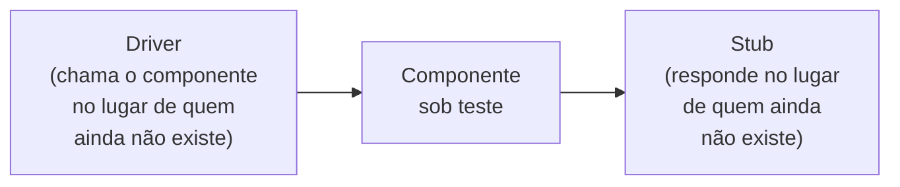
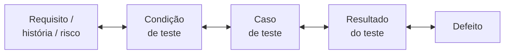
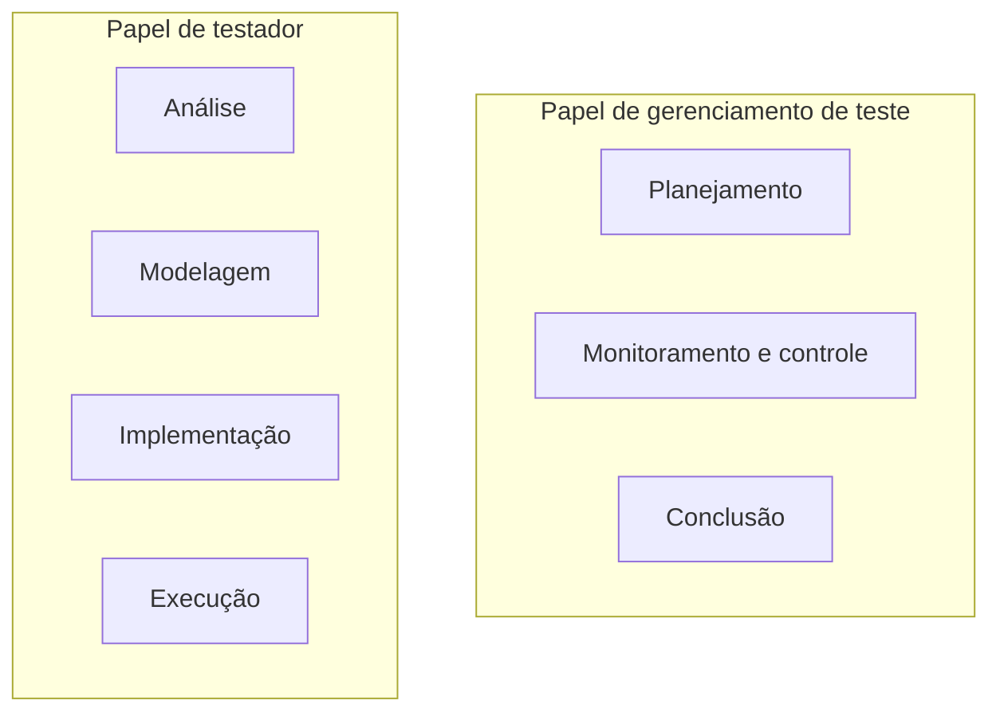

> **Seções 1.4.3, 1.4.4 e 1.4.5 do syllabus.**

## Objetivos de aprendizagem

| Código | Nível | O que você precisa saber fazer |
|---|---|---|
| FL-1.4.3 | K2 | Diferenciar o testware que apoia as atividades de teste |
| FL-1.4.4 | K2 | Explicar o valor de manter a rastreabilidade |
| FL-1.4.5 | K2 | Comparar os diferentes papéis no teste |

## Palavras-chave

Definições do [Glossário ISTQB](https://glossary.istqb.org/pt-br/search/) em português, com uma leitura "em outras palavras" para fixar. Todas podem cair na prova em nível K1.

| Termo | Definição (Glossário ISTQB) | Em outras palavras |
|---|---|---|
| testware | Produtos de trabalho produzidos durante o processo de teste para uso no planejamento, projeto, execução, avaliação e relatório de testes. | **Tudo** o que o teste produz. |
| procedimento de teste | Uma sequência de casos de teste em ordem de execução e quaisquer ações associadas que possam ser necessárias para estabelecer as pré-condições iniciais e quaisquer atividades de encerramento após a execução. | Resultado da **implementação**. |
| resultado de teste | O status da execução de um teste. | Passou, falhou, bloqueado... |

## Testware (FL-1.4.3)

**Testware** é o nome para todos os **produtos de trabalho** gerados pelas atividades de teste. Cada organização produz, nomeia e organiza esses artefatos de um jeito diferente, então não existe "o formato certo". O que garante que eles fiquem consistentes e íntegros é um bom **gerenciamento de configuração** (nota [Gerenciamento de configuração](../05-gerenciamento-das-atividades-de-teste/06-gerenciamento-de-configuracao.md)).

A lista do syllabus (que ele mesmo diz não ser completa) liga cada atividade aos seus produtos:

| Atividade | Testware produzido |
|---|---|
| **Planejamento** | Plano de teste, cronograma de teste, **registro de riscos**, critérios de entrada e de saída |
| **Monitoramento e controle** | Relatórios de progresso, documentação das diretrizes de controle, informações sobre riscos |
| **Análise** | **Condições de teste** priorizadas (por exemplo, critérios de aceite) e relatórios de defeitos sobre a base de teste (quando não corrigidos na hora) |
| **Modelagem** | **Casos de teste** priorizados, **cartas de teste**, **itens de cobertura**, requisitos de dados de teste, requisitos de ambiente de teste |
| **Implementação** | **Procedimentos de teste**, scripts automatizados, **conjuntos de teste**, **dados de teste**, cronograma de execução, elementos do ambiente de teste |
| **Execução** | **Registros de teste** (logs) e relatórios de defeitos |
| **Conclusão** | Relatório de conclusão, itens de ação para melhoria, lições aprendidas, solicitações de mudança (por exemplo, itens de backlog) |

Alguns termos que aparecem na tabela e merecem uma definição rápida:

- **Registro de riscos**: lista de riscos com probabilidade, impacto e informações sobre como mitigar cada um. O cronograma, o registro de riscos e os critérios de entrada e saída costumam fazer parte do próprio plano de teste.
- **Elementos do ambiente de teste**: **stubs** (substituem um componente chamado pelo objeto de teste), **drivers** (chamam o objeto de teste), **simuladores** e **virtualização de serviços** (imitam serviços externos, como um gateway de pagamento).
- **Carta de teste** (*test charter*): o "roteiro de missão" de uma sessão de teste exploratório, por exemplo "explorar o carrinho com cupons combinados para descobrir problemas de cálculo".

### Stub e driver num desenho

A regra para não confundir: o **driver fica acima** e chama; o **stub fica abaixo** e responde.

## Rastreabilidade (FL-1.4.4)

**Rastreabilidade** é a ligação entre os elementos da base de teste, o testware que nasceu deles, os resultados dos testes e os defeitos encontrados. Ela precisa ser **estabelecida e mantida** ao longo de todo o processo.

### Para que serve

O syllabus destaca que a rastreabilidade sustenta a **avaliação de cobertura**, por isso é útil que a base de teste tenha **critérios de cobertura mensuráveis**. Esses critérios podem até funcionar como **indicadores-chave de desempenho** (KPIs). Dois exemplos do syllabus:

- **Casos de teste ligados aos requisitos** mostram se todos os requisitos estão cobertos por algum teste.
- **Resultados de teste ligados aos riscos** permitem avaliar o **risco residual**, isto é, quanto risco ainda sobra no objeto de teste.

Além da cobertura, uma boa rastreabilidade:

- permite analisar o **impacto de mudanças** ("se o requisito 12 mudar, quais testes preciso refazer?")
- facilita **auditorias** e ajuda a cumprir critérios de **governança de TI**
- deixa os relatórios de progresso e de conclusão mais **compreensíveis**, mostrando o status de cada elemento da base de teste
- ajuda a explicar aspectos técnicos do teste para stakeholders que não são técnicos
- fornece informação para avaliar a **qualidade do produto**, a **capacidade do processo** e o **progresso do projeto** em relação aos objetivos de negócio

Um exemplo do dia a dia: a auditoria pergunta "como vocês sabem que a regra de bloqueio por cinco tentativas de senha foi testada?". Com rastreabilidade, a resposta é um link do requisito para o caso de teste, a execução de ontem e o defeito corrigido na semana passada. Sem rastreabilidade, a resposta é "acho que alguém testou".

## Papéis no teste (FL-1.4.5)

O syllabus trabalha com **dois papéis principais**:

| | Papel de gerenciamento de teste | Papel de testador |
|---|---|---|
| Responsável por | Processo de teste como um todo, equipe de teste e liderança das atividades | Aspecto de engenharia (técnico) do teste |
| Atividades em que mais atua | **Planejamento, monitoramento e controle, conclusão** | **Análise, modelagem, implementação e execução** |

Pontos que a prova cobra:

- **Papel não é cargo.** O papel de gerenciamento pode ser exercido por um líder de equipe, um gerente de teste, um gerente de desenvolvimento etc.
- **A mesma pessoa pode ter os dois papéis ao mesmo tempo**, e pessoas diferentes podem assumir os papéis em momentos diferentes.
- **No ágil**, parte das tarefas de gerenciamento pode ficar com o próprio time. Tarefas que envolvem vários times ou a organização inteira podem ficar com gerentes de teste de fora do time.

## Teste seu conhecimento

1. Cartas de teste e itens de cobertura são produzidos em qual atividade?

Na **modelagem** de teste.

2. Qual testware é produzido na execução?

**Registros de teste** (logs) e **relatórios de defeitos**.

3. Um requisito mudou e a equipe precisa saber quais testes refazer. Que benefício da rastreabilidade é esse?

**Análise de impacto de mudanças.**

4. Num time ágil, quem cuida das tarefas de gerenciamento de teste?

Parte delas pode ser feita pelo próprio time ágil. Tarefas que abrangem vários times ou a organização podem ficar com gerentes de teste de fora do time.

5. Um componente de pedidos chama um serviço de estoque que ainda não está pronto. O que usar no lugar do serviço de estoque: stub ou driver?

**Stub.** O stub fica "abaixo" do componente sob teste e responde no lugar do serviço que ainda não existe.

## Referências

- [Syllabus CTFL v4.0 em português](https://bstqb.online/ctfl) - BSTQB, português (seções 1.4.3 a 1.4.5)
- [Glossário ISTQB](https://glossary.istqb.org/pt-br/search/) - ISTQB, português (termos "testware", "rastreabilidade", "stub", "driver")
- [Mocks Aren't Stubs](https://martinfowler.com/articles/mocksArentStubs.html) - Martin Fowler, inglês
