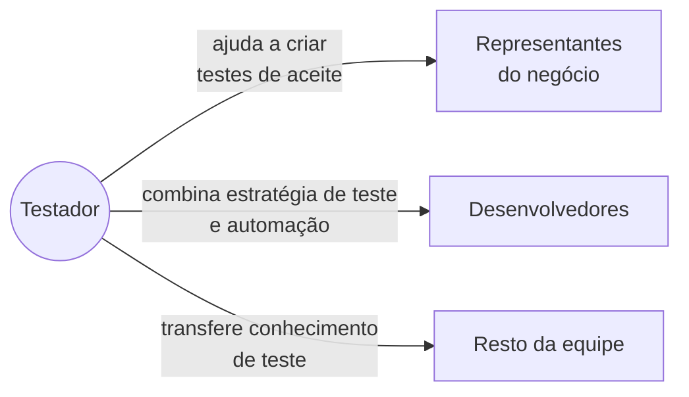

> **Seção 1.5 do syllabus.**

## Objetivos de aprendizagem

| Código | Nível | O que você precisa saber fazer |
|---|---|---|
| FL-1.5.1 | K2 | Dar exemplos das habilidades genéricas necessárias para testar |
| FL-1.5.2 | K1 | Relembrar as vantagens da abordagem de equipe completa |
| FL-1.5.3 | K2 | Distinguir os benefícios e as desvantagens da independência dos testes |

## O que o syllabus chama de habilidade

**Habilidade** é a capacidade de fazer algo bem, e ela vem de **conhecimento, prática e aptidão**. Um bom testador precisa de algumas habilidades essenciais, precisa funcionar bem em equipe e precisa conseguir testar em diferentes **níveis de independência**.

## Habilidades genéricas para testar (FL-1.5.1)

Repare que o syllabus liga cada habilidade a **para que ela serve**. Isso costuma aparecer na prova, especialmente a diferença entre **eficácia** e **eficiência**.

| Habilidade | Para que serve |
|---|---|
| **Conhecimento sobre teste** | Aumentar a **eficácia** dos testes (por exemplo, usando técnicas de teste) |
| **Meticulosidade, cuidado, curiosidade, atenção aos detalhes, ser metódico** | Encontrar defeitos, especialmente os difíceis |
| **Comunicação, escuta ativa, trabalho em equipe** | Interagir com stakeholders, passar informação, ser compreendido, relatar e discutir defeitos |
| **Pensamento analítico, pensamento crítico, criatividade** | Aumentar a **eficácia** dos testes |
| **Conhecimento técnico** | Aumentar a **eficiência** dos testes (por exemplo, usando as ferramentas certas) |
| **Conhecimento do domínio** | Entender e conversar com usuários finais e representantes do negócio |

> **Eficácia** é fazer a coisa certa (achar os defeitos que importam). **Eficiência** é fazer com menos esforço (achar esses defeitos mais rápido, com ferramentas).

### O testador como portador de más notícias

Testadores costumam ser quem traz a notícia ruim, e é humano "culpar o mensageiro". Alguns motivos pelos quais a comunicação pesa tanto:

- O resultado do teste pode ser percebido como **crítica ao produto e ao autor**.
- O **viés de confirmação** faz as pessoas resistirem a informações que contrariam o que elas já acreditam ("meu código está certo").
- Algumas pessoas veem teste como uma atividade **destrutiva**, quando na verdade ele contribui muito para o sucesso do projeto.

A recomendação do syllabus: comunicar defeitos e falhas de forma **construtiva**. Na prática, isso significa falar do comportamento do sistema e não da pessoa, trazer evidências (passos, logs, prints) e lembrar que o objetivo é o mesmo para todos: um produto melhor.

| Em vez de... | Prefira... |
|---|---|
| "Seu código de login está quebrado de novo." | "Ao tentar login com e-mail em maiúsculas, recebo 'usuário não encontrado'. Passos e log no relatório." |
| "Ninguém testou isso antes de subir?" | "Esse cenário não estava nos critérios de aceite. Vale incluir na regressão?" |

## Abordagem de equipe completa (FL-1.5.2)

A **abordagem de equipe completa** (*whole team approach*) vem do **Extreme Programming (XP)**. As ideias centrais:

- **Qualquer membro** da equipe que tenha o conhecimento e as habilidades necessárias pode fazer **qualquer tarefa**.
- **Todos são responsáveis pela qualidade**, não só quem testa.
- A equipe compartilha o **mesmo espaço de trabalho**, físico ou virtual, porque estar junto facilita a comunicação.

As **vantagens** que o syllabus lista (e que são o foco do objetivo K1):

- melhora a **dinâmica da equipe**
- melhora a **comunicação e a colaboração**
- gera **sinergia**, porque aproveita os diferentes conjuntos de habilidades do time em benefício do projeto

### O que o testador faz numa equipe completa

Assim o testador influencia o desenvolvimento do produto em vez de só receber o que foi feito.

### Quando não é a melhor escolha

Equipe completa **nem sempre é adequada**. Em contextos **críticos para a segurança** (*safety-critical*), como aviação ou equipamentos médicos, pode ser necessário um **alto nível de independência** dos testes, o que leva ao próximo tópico.

## Independência dos testes (FL-1.5.3)

Autor e testador têm **vieses cognitivos diferentes**. Por isso, algum grau de independência ajuda a encontrar defeitos que o autor não veria. Mas independência **não substitui familiaridade**: desenvolvedores encontram com eficiência muitos defeitos no próprio código.

### Níveis de independência

Na maioria dos projetos, o melhor é **combinar vários níveis**. O exemplo do syllabus:

| Quem | Faz quais testes | Independência |
|---|---|---|
| Desenvolvedores | Teste de componente e de integração de componentes | Nenhuma ou alguma |
| Equipe de teste | Teste de sistema e de integração de sistemas | Alta |
| Representantes do negócio | Teste de aceite | Alta ou muito alta |

### Benefícios e desvantagens

| Benefícios | Desvantagens |
|---|---|
| Testadores independentes tendem a reconhecer **tipos diferentes** de falhas e defeitos, por terem outra formação, outra perspectiva técnica e outros vieses | Testadores podem ficar **isolados** do time de desenvolvimento: falta de colaboração, problemas de comunicação, relação de rivalidade |
| Podem **verificar, contestar ou refutar suposições** que os stakeholders fizeram na especificação e na implementação | Desenvolvedores podem **perder o senso de responsabilidade** pela qualidade ("o QA pega") |
| | Testadores independentes podem ser vistos como **gargalo** ou ser culpados por atrasos no lançamento |

## Teste seu conhecimento

1. Qual habilidade aumenta a eficiência dos testes, segundo o syllabus?

**Conhecimento técnico**, por exemplo para usar as ferramentas de teste adequadas. Conhecimento sobre teste e pensamento analítico aumentam a **eficácia**.

2. Qual é uma vantagem da abordagem de equipe completa? (a) Testadores totalmente independentes (b) Melhor comunicação e colaboração (c) Menos testes de aceite (d) Responsabilidade pela qualidade concentrada no time de teste

**(b).** Na equipe completa, todos são responsáveis pela qualidade, o que descarta (d).

3. Uma empresa terceiriza todo o teste para uma consultoria externa e, meses depois, os desenvolvedores param de escrever testes unitários. Que desvantagem da independência é essa?

**Perda do senso de responsabilidade pela qualidade** por parte dos desenvolvedores.

4. Qual o nível de independência de um teste feito por um colega da mesma equipe do autor?

**Alguma** independência.

## Referências

- [Syllabus CTFL v4.0 em português](https://bstqb.online/ctfl) - BSTQB, português (seção 1.5)
- *Agile Testing: A Practical Guide for Testers and Agile Teams* - Lisa Crispin e Janet Gregory, Addison-Wesley, 2008 (citado no syllabus), inglês
