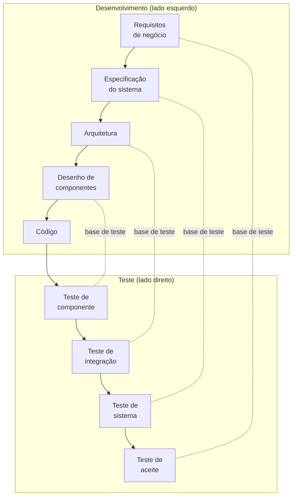

> **Seções 2.1, 2.1.1 e 2.1.2 do syllabus.** Capítulo 2 vale 6 questões na prova.

## Objetivos de aprendizagem

| Código | Nível | O que você precisa saber fazer |
|---|---|---|
| FL-2.1.1 | K2 | Explicar o impacto do SDLC escolhido nos testes |
| FL-2.1.2 | K1 | Relembrar as boas práticas de teste que valem para todos os SDLCs |

## O que é um modelo de SDLC

**SDLC** (*Software Development Lifecycle*, ciclo de vida de desenvolvimento de software) é uma representação abstrata e de alto nível do processo de desenvolvimento. Um **modelo** de SDLC define como as fases e as atividades se relacionam, tanto na lógica quanto no tempo.

O syllabus agrupa os modelos assim:

| Família | Exemplos | Ideia |
|---|---|---|
| **Sequencial** | Cascata, modelo em V | Uma fase depois da outra. O código só existe nas fases finais. |
| **Iterativo** | Espiral, prototipagem | O produto é refinado em ciclos repetidos. |
| **Incremental** | Processo Unificado (RUP) | O produto é construído em pedaços que se somam. |

Além dos modelos, existem **métodos e práticas** mais detalhados, muitos deles ágeis: ATDD, BDD, DDD (*domain-driven design*), XP (*extreme programming*), FDD (*feature-driven development*), Kanban, Lean IT, Scrum e TDD. Eles descrevem *como* fazer certas atividades dentro de um modelo.

### O modelo em V num desenho

O modelo em V é o exemplo clássico de modelo sequencial e ajuda a visualizar a relação entre fases de desenvolvimento e níveis de teste:

Cada fase da esquerda é a **base de teste** do nível correspondente na direita. A análise e a modelagem de cada nível podem começar assim que a fase correspondente da esquerda existir, mesmo que a execução só aconteça muito depois.

## Como o SDLC muda o teste (FL-2.1.1)

Para dar certo, o teste precisa ser **adaptado ao SDLC**. A escolha do modelo afeta:

- o **escopo e o cronograma** das atividades de teste (quais níveis e tipos de teste, e quando)
- o **nível de detalhe** da documentação de teste
- a escolha das **técnicas** e da **abordagem** de teste
- o **grau de automação**
- o **papel e as responsabilidades** do testador

### Modelos sequenciais

Nas fases iniciais, os testadores participam de **revisões de requisitos**, **análise** e **modelagem** de teste. Como o código executável só aparece nas fases finais, **teste dinâmico não dá para fazer no começo** do ciclo.

### Modelos iterativos e incrementais

Muitas vezes cada iteração entrega um protótipo funcional ou um incremento do produto. Isso significa que, **em cada iteração**, dá para fazer teste estático e dinâmico em **todos os níveis**. Entregas frequentes exigem **feedback rápido** e **muito teste de regressão**.

### Desenvolvimento ágil

O ágil parte do pressuposto de que **mudanças vão acontecer** durante o projeto. Por isso, ele favorece:

- **documentação leve** dos produtos de trabalho
- **muita automação**, para facilitar a regressão
- teste manual feito principalmente com **técnicas baseadas na experiência** (nota [Técnicas baseadas na experiência](../04-analise-e-modelagem-de-teste/07-baseadas-na-experiencia.md)), que não exigem análise e modelagem prévias extensas

| | Sequencial | Iterativo / incremental | Ágil |
|---|---|---|---|
| Teste dinâmico no início? | Não (não há código) | Sim, a cada iteração | Sim, a cada iteração |
| Documentação de teste | Mais detalhada | Varia | Leve |
| Automação | Varia | Importante para regressão | Extensa |
| Teste manual | Baseado em especificação | Varia | Muito baseado em experiência |

## Boas práticas que valem para qualquer SDLC (FL-2.1.2)

Esta lista é K1 e costuma cair como "qual destas é uma boa prática de teste independente do SDLC?". São quatro:

1. **Para cada atividade de desenvolvimento existe uma atividade de teste correspondente**, para que tudo o que é produzido passe por controle de qualidade.
2. **Níveis de teste diferentes têm objetivos diferentes e específicos**, o que deixa o teste abrangente sem redundância.
3. **A análise e a modelagem de teste de um nível começam durante a fase de desenvolvimento correspondente**, seguindo o princípio do teste antecipado.
4. **Os testadores participam da revisão dos produtos de trabalho assim que existe um rascunho**, apoiando o teste antecipado e a estratégia de shift-left.

Uma pegadinha comum é trocar "níveis com objetivos diferentes" por "todos os níveis com o mesmo objetivo, para garantir redundância". A ideia do syllabus é justamente **evitar** redundância.

## Teste seu conhecimento

1. Num projeto em cascata, por que não é possível fazer teste dinâmico nas fases iniciais?

Porque o código executável só é criado nas fases finais. No início, o testador participa de revisões, análise e modelagem.

2. Por que projetos ágeis favorecem automação extensa?

Porque mudanças são esperadas e as entregas são frequentes, o que exige muito teste de regressão com feedback rápido.

3. Qual destas NÃO é uma boa prática do syllabus? (a) Cada atividade de desenvolvimento tem uma atividade de teste correspondente (b) A modelagem do teste de sistema começa quando o sistema está pronto (c) Testadores revisam rascunhos de documentos (d) Níveis de teste têm objetivos diferentes

**(b).** A boa prática é começar a análise e a modelagem durante a fase de desenvolvimento correspondente, não depois.

## Referências

- [Syllabus CTFL v4.0 em português](https://bstqb.online/ctfl) - BSTQB, português (seções 2.1.1 e 2.1.2)
- [Manifesto para Desenvolvimento Ágil de Software](https://agilemanifesto.org/iso/ptbr/manifesto.html) - Beck et al., português
- [Glossário ISTQB](https://glossary.istqb.org/pt-br/search/) - ISTQB, português
