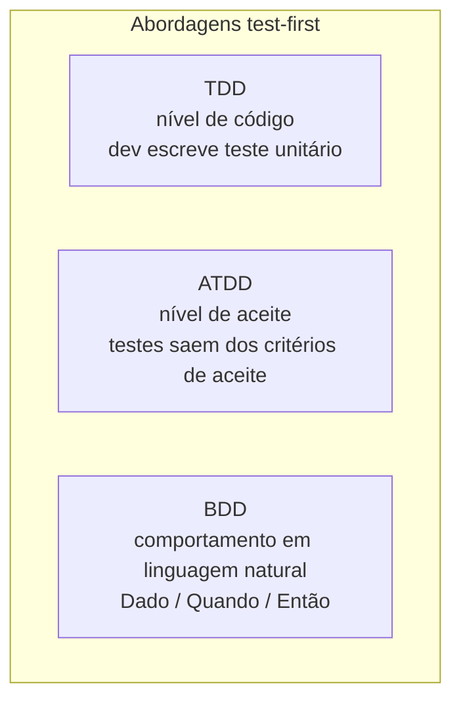

> **Seção 2.1.3 do syllabus.**

## Objetivo de aprendizagem

| Código | Nível | O que você precisa saber fazer |
|---|---|---|
| FL-2.1.3 | K1 | Relembrar exemplos de abordagens de desenvolvimento que priorizam o teste |

## A ideia geral

Em vez de escrever o código e depois pensar em como testar, essas abordagens **escrevem o teste primeiro** e usam o teste para **direcionar** o desenvolvimento. Por isso são chamadas de *test-first*.

O que as três têm em comum, segundo o syllabus:

- aplicam o princípio do **teste antecipado** e seguem a abordagem **shift-left**, porque os testes existem antes do código
- apoiam um modelo de desenvolvimento **iterativo**
- os testes podem **continuar existindo como testes automatizados**, protegendo o código em futuras mudanças e refatorações



## TDD: Desenvolvimento Orientado por Testes

- Direciona a codificação por meio de **casos de teste**, em vez de um projeto de software extenso feito antes (Beck, 2003).
- O ciclo é: escrever o teste, escrever o código para o teste passar, e então **refatorar** teste e código.


Um exemplo bem pequeno, em JavaScript:

```js
// 1. Vermelho: o teste vem primeiro e falha, porque a função ainda não existe
test('frete é grátis acima de 200 reais', () => {
  expect(calcularFrete(250)).toBe(0);
});

// 2. Verde: o código mínimo para o teste passar
function calcularFrete(valorPedido) {
  return valorPedido > 200 ? 0 : 15;
}

// 3. Refatorar: por exemplo, extrair 200 e 15 para constantes com nome,
//    rodando o teste de novo para garantir que nada quebrou
```

## ATDD: Desenvolvimento Orientado por Teste de Aceite

- Os testes são **derivados dos critérios de aceite** como parte do processo de desenho do sistema (Gärtner, 2011).
- Os testes são escritos **antes** de a parte da aplicação correspondente ser desenvolvida para atender a eles.

O ATDD é bem colaborativo: negócio, desenvolvimento e teste se reúnem para entender a história e escrever os testes de aceite juntos. Ele volta com mais detalhe no capítulo 4, na nota [Abordagens colaborativas](../04-analise-e-modelagem-de-teste/08-abordagens-colaborativas.md).

## BDD: Desenvolvimento Orientado pelo Comportamento

- Expressa o **comportamento desejado** da aplicação com casos de teste escritos numa **linguagem natural simples**, fácil para os stakeholders entenderem, geralmente no formato **Dado / Quando / Então** (*Given / When / Then*) (Chelimsky, 2010).
- Esses casos de teste são depois **traduzidos automaticamente em testes executáveis** (por ferramentas como Cucumber, SpecFlow ou Behave).

```gherkin
Funcionalidade: Frete grátis

  Cenário: Pedido acima do valor mínimo
    Dado que o carrinho tem R$ 250,00 em produtos
    Quando o cliente calcula o frete
    Então o frete deve ser R$ 0,00

  Cenário: Pedido abaixo do valor mínimo
    Dado que o carrinho tem R$ 150,00 em produtos
    Quando o cliente calcula o frete
    Então o frete deve ser R$ 15,00
```

## Comparando as três

| | TDD | ATDD | BDD |
|---|---|---|---|
| De onde vêm os testes | Do entendimento do dev sobre o que o código deve fazer | Dos **critérios de aceite** | Do **comportamento desejado**, descrito com os stakeholders |
| Nível típico | Componente (unitário) | Aceite / sistema | Aceite / sistema |
| Linguagem | Código | Varia (tabelas, texto, código) | **Linguagem natural estruturada** (Dado/Quando/Então) |
| Quem participa | Principalmente o desenvolvedor | Negócio, desenvolvimento e teste | Negócio, desenvolvimento e teste |
| Referência citada no syllabus | Beck 2003 | Gärtner 2011 | Chelimsky 2010 |

A pista mais forte em questões: **Dado/Quando/Então = BDD**; **critérios de aceite = ATDD**; **vermelho, verde, refatorar / teste unitário antes do código = TDD**.

## Teste seu conhecimento

<details>
<summary>1. Qual abordagem usa cenários no formato Dado/Quando/Então que são convertidos em testes executáveis?</summary>

**BDD.**

</details>

<details>
<summary>2. No TDD, qual é a ordem correta? (a) código, teste, refatoração (b) teste, código, refatoração (c) refatoração, teste, código (d) teste, refatoração, código</summary>

**(b).** Primeiro o teste (que falha), depois o código para ele passar, depois a refatoração.

</details>

<details>
<summary>3. Qual princípio de teste as três abordagens aplicam?</summary>

**Testes antecipados economizam tempo e dinheiro**, já que os testes são definidos antes do código. Por isso elas também são exemplos de shift-left.

</details>

## Referências

- [Syllabus CTFL v4.0 em português](https://bstqb.online/ctfl) - BSTQB, português (seção 2.1.3)
- [Test Driven Development](https://martinfowler.com/bliki/TestDrivenDevelopment.html) - Martin Fowler, inglês
- [Introducing BDD](https://dannorth.net/introducing-bdd/) - Dan North, inglês
- *Test Driven Development: By Example* - Kent Beck, Addison-Wesley, 2003 (citado no syllabus), inglês
