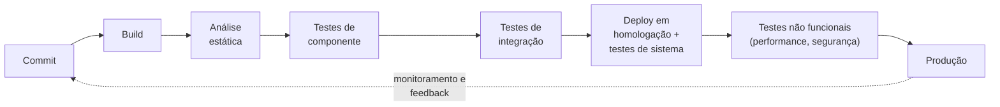
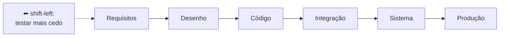

> **Seções 2.1.4, 2.1.5 e 2.1.6 do syllabus.**

## Objetivos de aprendizagem

| Código | Nível | O que você precisa saber fazer |
|---|---|---|
| FL-2.1.4 | K2 | Resumir como o DevOps pode impactar os testes |
| FL-2.1.5 | K2 | Explicar a abordagem shift-left |
| FL-2.1.6 | K2 | Explicar como as retrospectivas podem ser usadas para melhorar processos |

## Palavras-chave

Definições do [Glossário ISTQB](https://glossary.istqb.org/pt-br/search/) em português, com uma leitura "em outras palavras" para fixar. Todas podem cair na prova em nível K1.

| Termo | Definição (Glossário ISTQB) | Em outras palavras |
|---|---|---|
| shift-left | Uma abordagem de teste para realizar atividades de teste e garantia de qualidade o mais cedo possível no ciclo de vida de desenvolvimento de software. | Testar **antes** = defeito mais barato. Contraponto: _shift right_ (testar continuamente em produção). |

## DevOps e testes (FL-2.1.4)

**DevOps** é uma **abordagem organizacional** que junta desenvolvimento (incluindo teste) e operações para trabalharem por objetivos comuns. Mais do que ferramentas, ele exige uma **mudança cultural**: diminuir a distância entre quem desenvolve e quem opera, tratando as duas funções com o **mesmo valor**.

DevOps promove:

- autonomia da equipe
- feedback rápido
- cadeias de ferramentas integradas
- práticas técnicas como **Integração Contínua (CI)** e **Entrega Contínua (CD)**

Com isso, os times conseguem construir, testar e liberar código de qualidade mais rápido, por meio de um **pipeline de entrega** (Kim, 2016).

### Benefícios para o teste

| Benefício | Explicação |
|---|---|
| Feedback rápido | Sobre a qualidade do código e sobre se uma mudança quebrou algo que já existia |
| CI promove shift-left | Incentiva os devs a enviar código acompanhado de testes de componente e análise estática |
| Ambientes de teste estáveis | Processos automatizados de CI/CD facilitam montar ambientes de teste confiáveis |
| Mais visibilidade do não funcional | Características como performance e confiabilidade ficam mais visíveis |
| Menos teste manual repetitivo | A automação no pipeline assume o trabalho repetitivo |
| Menos risco de regressão | Por causa da escala e do alcance dos testes de regressão automatizados |

### Riscos e desafios

- O **pipeline de entrega** precisa ser definido e estabelecido.
- As **ferramentas de CI/CD** precisam ser introduzidas e mantidas.
- A **automação de testes** exige recursos adicionais e pode ser difícil de estabelecer e manter.

E um ponto que cai muito: **mesmo com muita automação, o teste manual continua necessário**, principalmente na perspectiva do usuário (usabilidade, exploração, "isso faz sentido?").

## Abordagem shift-left (FL-2.1.5)

**Shift-left** é outro nome para o princípio do **teste antecipado**: levar o teste para mais cedo no SDLC, ou seja, "para a esquerda" numa linha do tempo que vai de requisitos (esquerda) até produção (direita).

Shift-left **não** significa abandonar o teste das fases finais. O syllabus deixa claro que testes mais tarde no SDLC **não devem ser negligenciados**.

### Boas práticas de shift-left citadas no syllabus

1. **Revisar a especificação com olhar de teste.** Essas revisões costumam encontrar ambiguidades, informações incompletas e inconsistências.
2. **Escrever casos de teste antes do código** e rodar o código contra esses testes durante a implementação (o espírito do TDD).
3. **Usar CI, e melhor ainda CD**, com feedback rápido e testes de componente automatizados rodando a cada envio de código.
4. **Fazer análise estática** do código antes do teste dinâmico, ou como parte de um processo automatizado.
5. **Começar testes não funcionais já no nível de componente**, quando possível. Normalmente esses testes ficam para o fim, quando existe um sistema completo e um ambiente representativo. Um exemplo é medir o tempo de resposta de uma função crítica já no teste unitário.

### O custo do shift-left

Shift-left pode exigir **treinamento, esforço ou custo extra no começo**, mas a expectativa é **economizar no final**. Por isso, é importante **convencer os stakeholders** a aceitarem a ideia.

## Retrospectivas e melhoria de processo (FL-2.1.6)

**Retrospectivas** (também chamadas de reuniões pós-projeto ou retrospectivas de projeto) acontecem normalmente no fim de um projeto ou iteração, num marco de lançamento, ou sempre que necessário. Quando e como acontecem depende do SDLC.

Participam **não só testadores**: devs, arquitetos, Product Owner, analistas de negócio. A conversa gira em torno de três perguntas:

Os resultados devem ser **registrados** e normalmente entram no **relatório de conclusão do teste**. Retrospectivas são essenciais para a **melhoria contínua**, e é importante **acompanhar** se as melhorias combinadas foram de fato feitas. Sem acompanhamento, a retrospectiva vira só desabafo.

### Benefícios para o teste

| Benefício | Exemplo do syllabus |
|---|---|
| Mais eficácia e eficiência nos testes | Implementando sugestões de melhoria de processo |
| Mais qualidade do testware | Revisando juntos os processos de teste |
| União e aprendizado da equipe | Oportunidade de levantar problemas e propor melhorias |
| Melhor base de teste | Tratando deficiências na extensão e na qualidade dos requisitos |
| Melhor cooperação entre desenvolvimento e teste | Revisando e otimizando a colaboração regularmente |

## Teste seu conhecimento

1. Com DevOps e muita automação, o teste manual deixa de ser necessário?

Não. O syllabus diz que o teste manual, especialmente da perspectiva do usuário, continua necessário.

2. Qual destas é uma prática de shift-left? (a) Deixar o teste de performance para depois da integração completa (b) Executar análise estática como parte do pipeline de CI (c) Eliminar o teste de sistema (d) Revisar requisitos só depois do código pronto

**(b).** A alternativa (c) é uma pegadinha: shift-left não significa negligenciar testes posteriores.

3. Qual é um desafio do DevOps citado no syllabus?

Definir e estabelecer o pipeline de entrega; introduzir e manter as ferramentas de CI/CD; ou o esforço para estabelecer e manter a automação de testes.

4. Onde os resultados das retrospectivas costumam ser registrados?

No **relatório de conclusão do teste**.

## Referências

- [Syllabus CTFL v4.0 em português](https://bstqb.online/ctfl) - BSTQB, português (seções 2.1.4 a 2.1.6)
- [Continuous Integration](https://martinfowler.com/articles/continuousIntegration.html) - Martin Fowler, inglês
- [Guia do Scrum 2020](https://scrumguides.org/docs/scrumguide/v2020/2020-Scrum-Guide-PortugueseBR-3.0.pdf) - Ken Schwaber e Jeff Sutherland, português (definição da retrospectiva da sprint)
- *The DevOps Handbook* - Gene Kim, Jez Humble, Patrick Debois e John Willis, IT Revolution, 2016 (citado no syllabus), inglês
