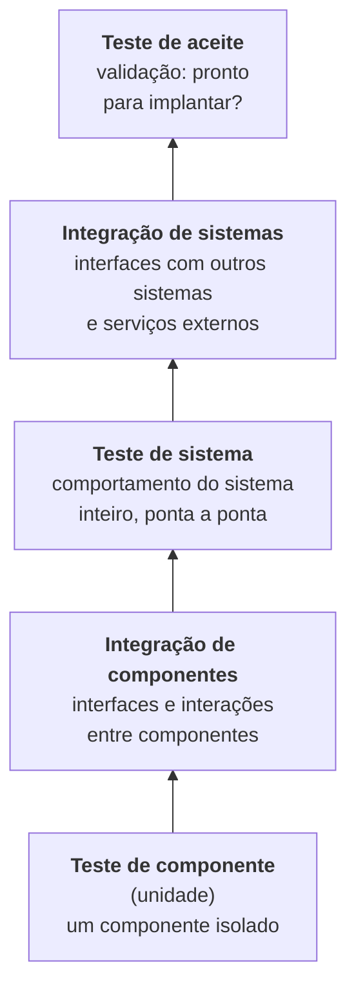

> **Seções 2.2 e 2.2.1 do syllabus.**

## Objetivo de aprendizagem

| Código | Nível | O que você precisa saber fazer |
|---|---|---|
| FL-2.2.1 | K2 | Distinguir os diferentes níveis de teste |

## Palavras-chave

Definições do [Glossário ISTQB](https://glossary.istqb.org/pt-br/search/) em português, com uma leitura "em outras palavras" para fixar. Todas podem cair na prova em nível K1.

| Termo | Definição (Glossário ISTQB) | Em outras palavras |
|---|---|---|
| nível de teste | Uma instância específica de um processo de teste. | Um "estágio" com objetivo, base e objeto próprios. |
| teste de componentes | Um nível de teste que se concentra em componentes individuais de hardware ou software. | Também chamado **teste de unidade**; geralmente feito pelo dev. |
| teste de integração | Um nível de teste que se concentra nas interações entre componentes ou sistemas. | Termo "guarda-chuva" para os dois abaixo. |
| teste de integração de componentes | Testes de integração de componentes. | Interfaces **internas** entre componentes. |
| teste de sistemas | Nível de teste que se concentra na verificação de que um sistema como um todo atenda aos requisitos especificados. | Visão **ponta a ponta** do sistema; costuma ter equipe independente. |
| teste de integração de sistemas | Um nível de teste que se concentra na integração de sistemas. | Interfaces com **sistemas externos** (APIs, serviços de terceiros). |
| teste de aceite | Nível de teste que se concentra na determinação de aceitar o sistema. | Foco em **validação** e prontidão para implantação (UAT, operacional, contratual, regulatório, alfa/beta). |
| objeto de teste | O produto de trabalho a ser testado. | Muda conforme o nível (componente, sistema...). |

## Nível de teste x tipo de teste

Antes de tudo, a distinção que mais cai no capítulo 2:

- **Nível de teste**: um grupo de atividades de teste organizadas e gerenciadas juntas, aplicado ao software num certo **estágio** de desenvolvimento (de um componente isolado até o sistema inteiro, ou até um sistema de sistemas). Cada nível é uma **instância do processo de teste**. Responde **"em que pedaço / em que momento?"**.
- **Tipo de teste**: um grupo de atividades ligadas a **características de qualidade** específicas. A maioria dos tipos pode ser aplicada em **qualquer nível**. Responde **"o que estou avaliando?"** (nota [Tipos de teste, confirmação e regressão](05-tipos-de-teste-confirmacao-e-regressao.md)).

Relação dos níveis com o SDLC:

- Em modelos **sequenciais**, os níveis costumam ser definidos de modo que os **critérios de saída de um nível façam parte dos critérios de entrada do próximo**.
- Em alguns modelos **iterativos**, isso pode não valer. Atividades de desenvolvimento podem atravessar vários níveis e os níveis podem se **sobrepor no tempo**.

## Os cinco níveis

### Teste de componente (teste de unidade)

- Foca em testar **componentes isoladamente**.
- Normalmente precisa de suporte específico, como **frameworks de teste unitário** (JUnit, pytest, Jest) e às vezes stubs e drivers.
- Geralmente feito por **desenvolvedores**, no **ambiente de desenvolvimento** deles.

Exemplo: testar a função `calcularDesconto()` sem banco de dados, sem tela e sem chamar outros serviços.

### Teste de integração de componentes (integração de unidades)

- Foca nas **interfaces e interações entre componentes**.
- Depende muito da **estratégia de integração**: bottom-up, top-down ou big-bang.

| Estratégia | Como funciona | Precisa de |
|---|---|---|
| **Top-down** | Começa pelos componentes de cima (que chamam) e desce | **Stubs** no lugar dos componentes de baixo que ainda não foram integrados |
| **Bottom-up** | Começa pelos componentes de baixo (que são chamados) e sobe | **Drivers** no lugar dos componentes de cima |
| **Big-bang** | Junta tudo de uma vez | Nada extra, mas é difícil localizar a origem de um defeito |

Exemplo: verificar se o componente de pedidos passa o formato de data correto para o componente de nota fiscal.

### Teste de sistema

- Foca no **comportamento geral** e nas funcionalidades do sistema ou produto **inteiro**.
- Costuma incluir **teste funcional de tarefas ponta a ponta** e **teste não funcional** de características de qualidade.
- Algumas características não funcionais, como **usabilidade**, são melhor testadas num **sistema completo** em um **ambiente representativo**. Também é possível usar **simulações de subsistemas**.
- Pode ser feito por uma **equipe de teste independente** e está ligado às **especificações do sistema**.

Exemplo: um cliente navega, coloca itens no carrinho, aplica cupom, paga e recebe o e-mail de confirmação, tudo num ambiente de homologação.

### Teste de integração de sistemas

- Foca nas **interfaces entre o sistema e outros sistemas e serviços externos**.
- Exige **ambientes de teste adequados**, de preferência **parecidos com o ambiente de produção**.

Exemplo: verificar a comunicação da loja com o gateway de pagamento, com a API dos Correios e com o sistema de nota fiscal da prefeitura.

> **Não confunda as duas integrações.** Integração de **componentes** = peças **dentro** do sistema conversando. Integração de **sistemas** = o sistema conversando com **outros sistemas** de fora.

### Teste de aceite

- Foca em **validação** e em demonstrar que o sistema está **pronto para ser implantado**, ou seja, que atende às necessidades de negócio do usuário.
- De preferência, é feito pelos **usuários previstos**.

As principais formas de teste de aceite:

| Forma | Quem / foco |
|---|---|
| **Teste de Aceite do Usuário (UAT)** | Usuários verificam se o sistema atende às suas necessidades num ambiente realista |
| **Teste de Aceite Operacional** | Equipe de operações/administração verifica backup, recuperação, instalação, manutenção, monitoramento |
| **Teste de Aceite Contratual e Normativo** | Verifica critérios de um contrato ou de uma regulação (legal, de segurança, setorial) |
| **Teste Alfa** | Feito por clientes ou usuários **nas instalações da organização** que desenvolve |
| **Teste Beta** | Feito por clientes ou usuários **nos locais deles**, no ambiente real |

Para não errar alfa e beta: **alfa** é "em casa" (no desenvolvedor); **beta** é "na rua" (no cliente).

## Como os níveis se diferenciam

O syllabus diz que os níveis se diferenciam por estes atributos (lista não completa), justamente para evitar sobreposição:

- objeto de teste
- objetivos do teste
- base de teste
- defeitos e falhas típicos
- abordagem e responsabilidades

Uma tabela para estudar. As colunas "base de teste" e "defeitos típicos" não estão escritas assim no syllabus 4.0, mas resumem o que a descrição de cada nível implica:

| Nível | Objeto de teste | Base de teste típica | Defeitos e falhas típicos | Quem costuma fazer |
|---|---|---|---|---|
| Componente | Módulos, classes, funções | Desenho detalhado, código, modelo de dados | Lógica errada, cálculo incorreto, fluxo de controle errado | Desenvolvedores |
| Integração de componentes | Interfaces entre componentes, banco, APIs internas | Desenho de software, arquitetura, fluxos de dados | Dados trocados no formato errado, chamadas fora de ordem, interfaces incompatíveis | Desenvolvedores ou testadores |
| Sistema | Sistema completo | Especificação de requisitos do sistema, casos de uso, histórias | Comportamento ponta a ponta errado, falhas não funcionais | Equipe de teste (às vezes independente) |
| Integração de sistemas | Interfaces com sistemas e serviços externos | Especificações de interface, contratos de API | Protocolos incompatíveis, falhas de comunicação, dados inconsistentes entre sistemas | Equipe de teste |
| Aceite | Sistema em ambiente próximo do real, processos de negócio | Requisitos de negócio, critérios de aceite, contratos, regulações | Sistema não atende ao negócio, regras de negócio erradas, não cumpre contrato ou norma | Usuários, clientes, operações, PO |

## Teste seu conhecimento

1. Um teste verifica se o sistema de RH envia corretamente a folha de pagamento para o sistema do banco. Qual é o nível?

**Teste de integração de sistemas**: interface do sistema com outro sistema externo.

2. Usuários de um cliente testam a nova versão do ERP nas próprias filiais antes do lançamento oficial. Que forma de teste de aceite é essa?

**Teste beta**: feito pelos usuários nos locais deles.

3. Na integração top-down, o que é usado no lugar dos componentes de baixo que ainda não estão prontos?

**Stubs.**

4. Qual nível de teste é preferencialmente feito pelos usuários previstos e foca em validação?

**Teste de aceite.**

5. Um time verifica se o backup noturno e a restauração do sistema funcionam antes de colocá-lo em produção. Que forma de teste é essa?

**Teste de aceite operacional.**

## Referências

- [Syllabus CTFL v4.0 em português](https://bstqb.online/ctfl) - BSTQB, português (seção 2.2.1)
- [The Practical Test Pyramid](https://martinfowler.com/articles/practical-test-pyramid.html) - Ham Vocke, martinfowler.com, inglês
- [Glossário ISTQB](https://glossary.istqb.org/pt-br/search/) - ISTQB, português (termos "teste de componente", "teste alfa", "teste beta")
