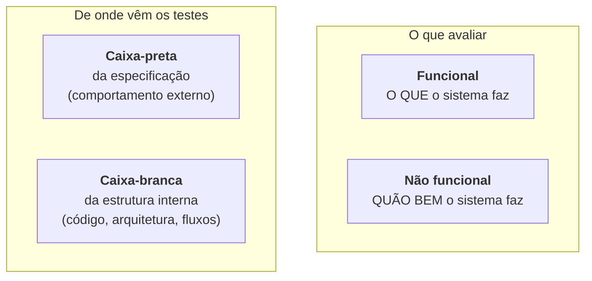
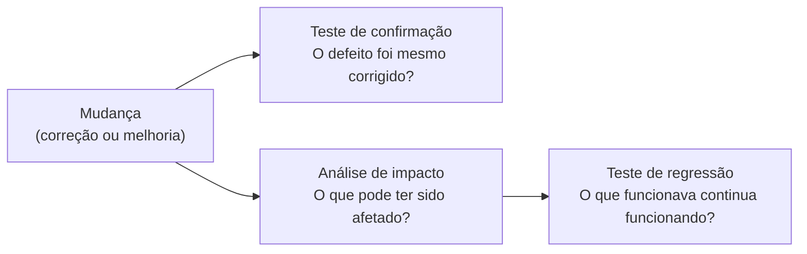

> **Seções 2.2.2 e 2.2.3 do syllabus.**

## Objetivos de aprendizagem

| Código | Nível | O que você precisa saber fazer |
|---|---|---|
| FL-2.2.2 | K2 | Distinguir os diferentes tipos de teste |
| FL-2.2.3 | K2 | Distinguir teste de confirmação de teste de regressão |

## Palavras-chave

Definições do [Glossário ISTQB](https://glossary.istqb.org/pt-br/search/) em português, com uma leitura "em outras palavras" para fixar. Todas podem cair na prova em nível K1.

| Termo | Definição (Glossário ISTQB) | Em outras palavras |
|---|---|---|
| tipo de teste | Um grupo de atividades de teste com base em objetivos específicos que visam características específicas de um componente ou sistema. | Qualquer tipo pode ocorrer em qualquer nível. |
| teste funcional | Um tipo de teste para determinar a adequação funcional de um objeto de teste. | **O que** o sistema faz. |
| teste não funcional | Um tipo de teste para avaliar se um componente ou sistema está em conformidade com os requisitos não funcionais. | **Quão bem** ele faz (desempenho, segurança, usabilidade...). |
| teste caixa-preta | Uma abordagem de teste baseada na especificação de um componente ou sistema. | Olha o **comportamento**, sem ver o código. |
| teste caixa-branca | Uma abordagem de teste baseada na estrutura interna de um componente ou sistema. | Olha a **estrutura** (código, arquitetura, fluxo). |
| teste de confirmação | Um tipo de teste relacionado à mudança realizado após a correção de um defeito para confirmar que uma falha causada por esse defeito não ocorre novamente. | "O defeito **foi corrigido**?" |
| teste de regressão | Um tipo de teste relacionado a mudanças para detectar se os defeitos foram introduzidos ou descobertos em áreas inalteradas do software. | "A mudança **quebrou algo** que funcionava?" Ótimo candidato à automação. |

## Os quatro tipos de teste (FL-2.2.2)

**Tipos de teste** são grupos de atividades ligadas a **características de qualidade** específicas. O syllabus trabalha com quatro:

### Teste funcional

- Avalia as **funções** que um componente ou sistema deve executar. Funções são **"o que"** o objeto de teste deve fazer.
- Objetivo principal: verificar a **integridade funcional** (se todas as funções necessárias existem; em inglês, *functional completeness*), a **correção funcional** e a **adequação funcional**.

Exemplo: "ao clicar em Finalizar compra, o pedido é criado com status Aguardando pagamento".

### Teste não funcional

- Avalia atributos que **não são funcionais**. É o teste de **"quão bem"** o sistema se comporta.
- Objetivo principal: verificar as **características não funcionais** de qualidade.

O syllabus usa a classificação da **ISO/IEC 25010**:

| Característica | Pergunta que ela responde | Exemplo de teste |
|---|---|---|
| **Eficiência de desempenho** | É rápido e econômico com recursos? | 1.000 usuários simultâneos, tempo de resposta abaixo de 2 s |
| **Compatibilidade** | Convive e troca dados com outros sistemas? | Funciona junto com o antivírus corporativo; exporta para o ERP |
| **Usabilidade** | É fácil de aprender e usar? | Usuário novo completa o cadastro sem ajuda em até 3 minutos |
| **Confiabilidade** | Funciona sem falhar e se recupera? | Sistema volta sozinho após queda do banco de dados |
| **Segurança** | Protege dados e acessos? | Usuário comum não acessa a tela de administrador |
| **Manutenibilidade** | É fácil de modificar? | Complexidade do código abaixo do limite combinado |
| **Portabilidade** | Roda em outros ambientes? | Instala e funciona em Windows e Linux |

> A versão de 2023 da ISO/IEC 25010 ajustou nomes e incluiu características novas (como *safety*). Para a prova, use a lista acima, que é a do syllabus.

Pontos sobre não funcional que caem na prova:

- Às vezes faz sentido começar o teste não funcional **cedo**, em revisões, no teste de componente ou no teste de sistema.
- Muitos testes não funcionais são **derivados de testes funcionais**: usam o mesmo teste, mas verificam uma restrição não funcional (por exemplo, se a função roda dentro do tempo especificado).
- **Descobrir defeitos não funcionais tarde pode ameaçar seriamente o projeto.** Mudar a arquitetura para aguentar carga no fim do projeto custa caro.
- Alguns testes não funcionais exigem um **ambiente bem específico**, como um laboratório de usabilidade.

### Teste caixa-preta

- **Baseado em especificação**: deriva os testes de documentação **externa** ao objeto de teste.
- Objetivo principal: verificar o **comportamento** do sistema em relação às suas **especificações**.
- As técnicas estão no capítulo 4 (nota [Visão geral das técnicas](../04-analise-e-modelagem-de-teste/01-visao-geral-das-tecnicas.md)).

### Teste caixa-branca

- **Baseado em estrutura**: deriva os testes da **implementação** ou da **estrutura interna** (código, arquitetura, fluxos de trabalho, fluxos de dados).
- Objetivo principal: **cobrir a estrutura** com testes até um nível aceitável.

### Tipos de teste valem para todos os níveis

Os quatro tipos podem ser aplicados em **todos os níveis de teste**, com foco diferente em cada um. E diferentes técnicas de teste podem ser usadas para derivar condições e casos de teste para qualquer tipo.

| Nível | Exemplo funcional | Exemplo não funcional | Exemplo caixa-branca |
|---|---|---|---|
| Componente | Função de cálculo devolve o valor certo | Função executa em menos de 10 ms | 100% das instruções da função executadas |
| Integração de componentes | Pedido passa o total certo para a nota fiscal | Mensagens entre serviços não se perdem sob carga | Todas as chamadas entre módulos exercitadas |
| Sistema | Fluxo completo de compra funciona | Página carrega em até 2 s | Todos os fluxos de tela exercitados |
| Integração de sistemas | Pagamento aprovado volta para a loja | Comunicação com o banco é criptografada | Todos os pontos de integração da arquitetura exercitados |
| Aceite | Processo de faturamento do cliente atendido | Usuários conseguem usar sem treinamento | Todos os fluxos de processo de negócio exercitados |

## Teste de confirmação e teste de regressão (FL-2.2.3)

Sistemas mudam por dois motivos: para **melhorar** (nova funcionalidade) ou para **corrigir** (remover um defeito). Em ambos os casos o teste deve incluir confirmação e regressão.

### Teste de confirmação

Confirma que **um defeito original foi corrigido** com sucesso. Dependendo do risco, dá para fazer de várias formas:

- executar **todos os casos de teste que falharam** por causa do defeito
- **adicionar testes novos** para cobrir as mudanças feitas na correção

Quando falta tempo ou dinheiro, o teste de confirmação pode se limitar a **executar os passos que reproduzem a falha** e ver se ela não acontece mais.

### Teste de regressão

Confirma que **nenhuma consequência ruim** foi causada por uma mudança, inclusive por uma correção que já passou no teste de confirmação. Essas consequências podem aparecer:

- no **mesmo componente** que foi alterado
- em **outros componentes** do mesmo sistema
- em **outros sistemas conectados**

O teste de regressão pode envolver também o **ambiente**, não só o objeto de teste. É recomendável fazer antes uma **análise de impacto** para dimensionar a regressão: ela mostra quais partes podem ter sido afetadas.

### Comparando

| | Teste de confirmação | Teste de regressão |
|---|---|---|
| Pergunta | O defeito original **foi corrigido**? | A mudança **quebrou algo** que funcionava? |
| Foco | O defeito específico | O resto do sistema (e sistemas conectados) |
| Gatilho | Correção de defeito | Qualquer mudança: correção, melhoria, mudança de ambiente |
| Automação | Às vezes | **Forte candidato**, desde o início do projeto |

### Por que automatizar a regressão

- As suítes de regressão rodam **muitas vezes**.
- O número de casos de regressão **cresce a cada iteração ou versão**.
- Por isso, são **fortes candidatos à automação**, e essa automação deve **começar cedo** no projeto.
- Com **CI** (como no DevOps), é boa prática incluir testes de regressão automatizados, possivelmente em vários níveis.

E por fim: confirmação e regressão são necessárias **em todos os níveis de teste** em que houver correções ou mudanças.

## Teste seu conhecimento

1. Um teste verifica se a busca de produtos retorna resultados em menos de 1 segundo com 500 usuários simultâneos. Que tipo de teste é esse?

**Não funcional**, característica **eficiência de desempenho**.

2. Depois de corrigir um defeito no cálculo de frete, a equipe roda o teste que tinha falhado e ele passa. Em seguida, roda a suíte automatizada do checkout inteiro. Quais são os dois tipos de teste?

Primeiro, **teste de confirmação** (o defeito foi corrigido?). Depois, **teste de regressão** (a correção quebrou algo no checkout?).

3. Teste caixa-branca só pode ser feito no nível de componente?

Não. Os quatro tipos de teste podem ser aplicados em todos os níveis. No nível de sistema, por exemplo, a "estrutura" pode ser o fluxo de telas ou o fluxo de processos de negócio.

4. O que deve ser feito antes do teste de regressão para dimensionar o esforço?

Uma **análise de impacto**, que mostra quais partes do software podem ter sido afetadas pela mudança.

## Referências

- [Syllabus CTFL v4.0 em português](https://bstqb.online/ctfl) - BSTQB, português (seções 2.2.2 e 2.2.3)
- [ISO/IEC 25010](https://iso25000.com/index.php/en/iso-25000-standards/iso-25010) - iso25000.com, inglês
- [Glossário ISTQB](https://glossary.istqb.org/pt-br/search/) - ISTQB, português (termos "teste de regressão", "teste de confirmação")
