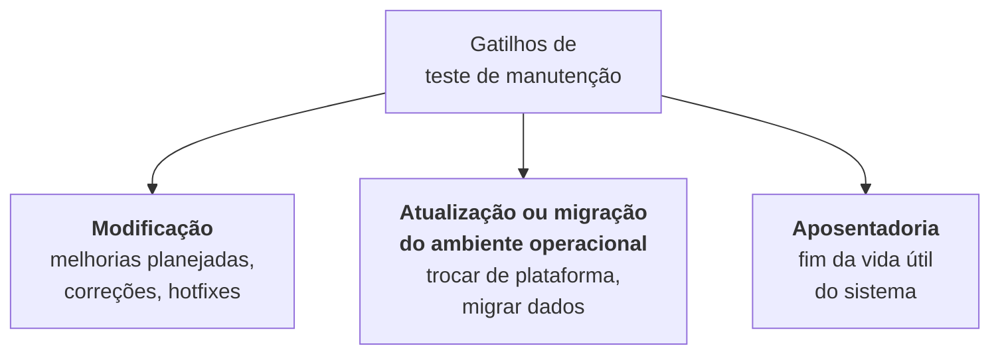

> **Seção 2.3 do syllabus.**

## Objetivo de aprendizagem

| Código | Nível | O que você precisa saber fazer |
|---|---|---|
| FL-2.3.1 | K2 | Resumir o teste de manutenção e seus gatilhos |

## Palavras-chave

Definições do [Glossário ISTQB](https://glossary.istqb.org/pt-br/search/) em português, com uma leitura "em outras palavras" para fixar. Todas podem cair na prova em nível K1.

| Termo | Definição (Glossário ISTQB) | Em outras palavras |
|---|---|---|
| teste de manutenção | Um tipo de teste que avalia o efeito das alterações feitas em um sistema operacional ou em seu ambiente. | Testes **depois que o sistema já está em produção** (correções, migração, aposentadoria). |

## O que é

Depois que o software entra em produção, ele continua mudando. **Teste de manutenção** é o teste dessas mudanças num sistema que **já está em operação**.

A manutenção pode ser de várias categorias (detalhadas na ISO/IEC 14764):

- **corretiva**: corrigir defeitos
- **adaptativa**: adaptar o sistema a mudanças no ambiente
- **de melhoria**: melhorar o desempenho ou a manutenibilidade

E pode acontecer de duas formas:

- em **versões planejadas** (a release do mês que vem)
- em **versões não planejadas**, os **hotfixes** (a correção urgente de sexta à noite)

## O que o teste de manutenção avalia

Testar uma mudança num sistema em produção envolve duas coisas:

1. avaliar se a **mudança foi implementada com sucesso**
2. verificar se houve **regressão** nas partes que **não mudaram**, que normalmente são **a maior parte do sistema**

Uma **análise de impacto** pode ser feita **antes** da mudança, para ajudar a decidir **se vale a pena fazê-la**, olhando as possíveis consequências em outras áreas do sistema.

## O que define o escopo

O tamanho do teste de manutenção depende de:

| Fator | Exemplo |
|---|---|
| **Grau de risco** da mudança | Mudar a regra de cálculo de imposto é mais arriscado que mudar a cor de um botão |
| **Tamanho do sistema** existente | Mexer num ERP de 2 milhões de linhas exige mais regressão que mexer numa landing page |
| **Tamanho da mudança** | Uma tela nova versus uma linha de código |

## Os gatilhos (os mais cobrados)

O syllabus agrupa o que dispara manutenção e teste de manutenção em três categorias:

### 1. Modificação

Melhorias planejadas (em releases), mudanças corretivas e hotfixes.

### 2. Atualização ou migração do ambiente operacional

Por exemplo, sair de servidores próprios para a nuvem, ou trocar a versão do banco de dados. Pode exigir:

- testes ligados ao **novo ambiente** e ao **software alterado**
- **testes de conversão de dados**, quando dados de outra aplicação são migrados para o sistema mantido

### 3. Aposentadoria

Quando uma aplicação chega ao **fim da vida útil** e é desativada. Pode exigir:

- **testes de arquivamento de dados**, se houver obrigação de guardar os dados por muito tempo
- **testes dos procedimentos de restauração e recuperação** depois do arquivamento, caso algum dado precise ser consultado durante o período de retenção

Um exemplo realista: um banco desliga o sistema antigo de financiamentos. A lei obriga a guardar os contratos por anos. Antes do desligamento, é preciso testar se os dados foram arquivados corretamente e se é possível recuperar um contrato específico quando um cliente ou auditor pedir.

## Teste seu conhecimento

1. A empresa vai migrar o sistema de pedidos do Oracle para o PostgreSQL. Que gatilho de teste de manutenção é esse e que testes podem ser necessários?

**Atualização ou migração do ambiente operacional.** Podem ser necessários testes no novo ambiente e **testes de conversão de dados**.

2. Por que o teste de regressão é tão importante na manutenção?

Porque as partes que não mudaram costumam ser a maior parte do sistema, e uma mudança pequena pode afetá-las.

3. Quais três fatores definem o escopo do teste de manutenção?

O **grau de risco** da mudança, o **tamanho do sistema** existente e o **tamanho da mudança**.

4. Que testes podem ser necessários quando um sistema é aposentado?

**Testes de arquivamento de dados** e testes dos **procedimentos de restauração e recuperação** dos dados arquivados.

## Referências

- [Syllabus CTFL v4.0 em português](https://bstqb.online/ctfl) - BSTQB, português (seção 2.3)
- [Glossário ISTQB](https://glossary.istqb.org/pt-br/search/) - ISTQB, português (termos "teste de manutenção", "análise de impacto")
