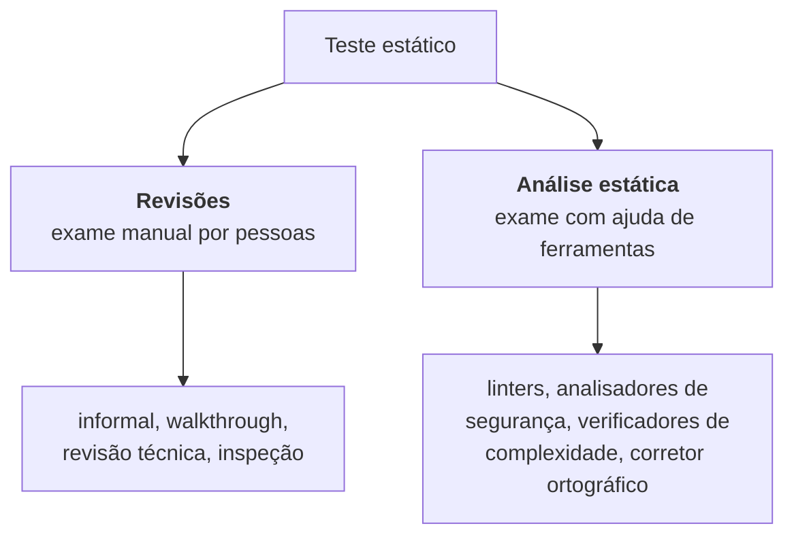

> **Seção 3.1 do syllabus.** Capítulo 3 vale 4 questões na prova.

## Objetivos de aprendizagem

| Código | Nível | O que você precisa saber fazer |
|---|---|---|
| FL-3.1.1 | K1 | Reconhecer os tipos de produto de trabalho que podem ser examinados por teste estático |
| FL-3.1.2 | K2 | Explicar o valor do teste estático |
| FL-3.1.3 | K2 | Comparar e contrastar teste estático e teste dinâmico |

## Palavras-chave

Definições do [Glossário ISTQB](https://glossary.istqb.org/pt-br/search/) em português, com uma leitura "em outras palavras" para fixar. Todas podem cair na prova em nível K1.

| Termo | Definição (Glossário ISTQB) | Em outras palavras |
|---|---|---|
| teste estático | Uma abordagem de teste que não envolve a execução de um item de teste. | Revisões + análise estática. Encontra **defeitos** diretamente. |
| teste dinâmico | Uma abordagem de teste que envolve a execução de um item de teste. | Encontra **falhas**, e daí se chega aos defeitos. |
| análise estática | O processo automatizado de avaliar um componente ou sistema sem executá-lo, com base em sua forma, estrutura, conteúdo ou documentação. | Feita por **ferramenta** (linters, analisadores de código). |

## O que é teste estático

No teste estático, **o software não é executado**. O código, a especificação de um processo, a arquitetura ou qualquer outro produto de trabalho é avaliado de duas formas:



Os objetivos do teste estático incluem **melhorar a qualidade**, **detectar defeitos** e avaliar características como **legibilidade, completude, correção, testabilidade e consistência**. E ele serve tanto para **verificação** quanto para **validação**.

### Teste estático no dia a dia ágil

Testadores, representantes do negócio e desenvolvedores trabalham juntos em sessões de **mapeamento de exemplos**, **escrita colaborativa de histórias** e **refinamento do backlog**. O objetivo é garantir que as histórias e os produtos relacionados atendam a critérios combinados, como a **Definição de Preparado** (*Definition of Ready*, DoR).

Técnicas de revisão ajudam a garantir que as histórias estejam **completas**, sejam **compreensíveis** e tenham **critérios de aceite testáveis**. Fazendo as perguntas certas, o testador explora, desafia e ajuda a melhorar as histórias. Exemplo: "a história diz 'o sistema deve ser rápido'. Rápido quanto? Em qual tela? Com quantos usuários?".

### Análise estática

- Pode identificar problemas **antes do teste dinâmico**, muitas vezes com **menos esforço**, porque não precisa de casos de teste e normalmente usa ferramentas.
- Costuma ser incorporada ao pipeline de **CI**.
- É muito usada para detectar defeitos específicos no código, mas também para avaliar **manutenibilidade** e **segurança**.
- **Corretores ortográficos** e **ferramentas de legibilidade** também são exemplos de análise estática.

```js
// Exemplos de problemas que um linter aponta sem executar nada:
function calcular(preco) {
  let desconto;            // variável usada sem valor definido
  const taxa = 0.1;        // variável declarada e nunca usada
  return preco - desconto;
  console.log('fim');      // código inalcançável depois do return
}
```

## O que pode ser examinado (FL-3.1.1)

**Quase todo produto de trabalho** pode passar por teste estático. Exemplos do syllabus:

- especificações de requisitos
- código-fonte
- planos de teste e casos de teste
- itens do backlog do produto
- cartas de teste
- documentação de projeto
- contratos
- modelos

As regras de quando dá e quando não dá:

| Para... | O produto de trabalho precisa... |
|---|---|
| **Revisão** | Poder ser **lido e compreendido** por pessoas |
| **Análise estática** | Ter uma **estrutura** contra a qual possa ser verificado (modelos, código, texto com sintaxe formal) |

**Não são adequados** para teste estático os produtos que são difíceis de interpretar por pessoas e que também não podem ser analisados por ferramentas. O exemplo do syllabus: **código executável de terceiros**, quando há impedimento **legal** para analisá-lo.

## O valor do teste estático (FL-3.1.2)

| Valor | Explicação |
|---|---|
| **Detecta defeitos cedo** | Cumpre o princípio do teste antecipado: dá para revisar um requisito antes de existir uma linha de código |
| **Encontra o que o teste dinâmico não acha** | Código inalcançável, padrões de projeto não implementados como deveriam, defeitos em produtos que não são executáveis (um contrato, um plano) |
| **Avalia qualidade e gera confiança** | Nos produtos de trabalho revisados |
| **Valida requisitos** | Ao revisar os requisitos, os stakeholders confirmam se eles descrevem as necessidades reais |
| **Cria entendimento compartilhado** | Como acontece cedo, alinha todos os envolvidos e melhora a comunicação. Por isso vale envolver participantes variados |
| **Reduz o custo total** | Revisões custam algo para fazer, mas o custo total do projeto costuma ser bem menor do que sem elas, porque corrigir depois sai mais caro |
| **Análise estática é eficiente para código** | Encontra defeitos de código de forma mais eficiente que o teste dinâmico, resultando em menos defeitos e menos esforço total |

## Estático x dinâmico (FL-3.1.3)

As duas práticas **se complementam**. Têm objetivos parecidos (detectar defeitos), mas funcionam de jeitos diferentes:

| | Teste estático | Teste dinâmico |
|---|---|---|
| Executa o software? | Não | Sim |
| O que encontra | **Defeitos**, diretamente | **Falhas**; o defeito é localizado depois, com análise |
| Caminhos de código raros ou difíceis de alcançar | Encontra com mais facilidade | Difícil de exercitar |
| Produtos não executáveis (requisitos, planos) | Pode ser aplicado | Não pode |
| Características de qualidade | As que **não dependem** de execução (ex.: manutenibilidade) | As que **dependem** de execução (ex.: eficiência de desempenho) |
| Exclusividade | Alguns defeitos só ele encontra | Alguns defeitos só ele encontra |

### Defeitos típicos que o teste estático encontra mais fácil ou mais barato

| Categoria | Exemplos |
|---|---|
| Requisitos | Inconsistências, ambiguidades, contradições, omissões, imprecisões, duplicações |
| Projeto (desenho) | Estrutura de banco de dados ineficiente, modularização ruim |
| Certos defeitos de código | Variáveis com valor indefinido, variáveis não declaradas, código inalcançável ou duplicado, complexidade excessiva |
| Desvios de padrão | Não seguir convenções de nomenclatura |
| Especificações de interface incorretas | Número, tipo ou ordem de parâmetros incompatíveis |
| Certas vulnerabilidades de segurança | Estouro de buffer (*buffer overflow*) |
| Lacunas na cobertura da base de teste | Falta de teste para um critério de aceite |

## Teste seu conhecimento

<details>
<summary>1. Qual destes produtos NÃO é adequado para análise estática? (a) Código-fonte (b) Modelo UML (c) Uma ata de reunião escrita livremente (d) Um arquivo JSON com schema definido</summary>

**(c).** Análise estática exige uma estrutura formal para ser verificada. A ata pode passar por **revisão**, mas não por análise estática.

</details>

<details>
<summary>2. Qual característica de qualidade é mais adequada para teste estático: eficiência de desempenho ou manutenibilidade?</summary>

**Manutenibilidade**, porque não depende da execução do código. Eficiência de desempenho exige execução (teste dinâmico).

</details>

<details>
<summary>3. Teste estático encontra falhas ou defeitos?</summary>

**Defeitos**, diretamente. Falhas só aparecem quando o software é executado (teste dinâmico).

</details>

<details>
<summary>4. Uma ferramenta aponta que um trecho de código nunca é alcançado. Esse defeito seria encontrado por teste dinâmico?</summary>

Dificilmente, porque nenhum teste consegue executar código inalcançável. É um exemplo de defeito que o teste estático encontra e o dinâmico não.

</details>

## Referências

- [Syllabus CTFL v4.0 em português](https://bstqb.online/ctfl) - BSTQB, português (seção 3.1)
- [Glossário ISTQB](https://glossary.istqb.org/pt-br/search/) - ISTQB, português (termos "teste estático", "análise estática", "anomalia")
- [OWASP Source Code Analysis Tools](https://owasp.org/www-community/Source_Code_Analysis_Tools) - OWASP, inglês
