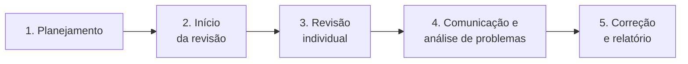

> **Seções 3.2.1, 3.2.2 e 3.2.3 do syllabus.**

## Objetivos de aprendizagem

| Código | Nível | O que você precisa saber fazer |
|---|---|---|
| FL-3.2.1 | K1 | Identificar os benefícios do feedback antecipado e frequente dos stakeholders |
| FL-3.2.2 | K2 | Resumir as atividades do processo de revisão |
| FL-3.2.3 | K1 | Relembrar as responsabilidades dos papéis principais numa revisão |

## Palavras-chave

Definições do [Glossário ISTQB](https://glossary.istqb.org/pt-br/search/) em português, com uma leitura "em outras palavras" para fixar. Todas podem cair na prova em nível K1.

| Termo | Definição (Glossário ISTQB) | Em outras palavras |
|---|---|---|
| revisão | Um tipo de teste estático no qual a qualidade de um produto ou processo de trabalho é avaliada por indivíduos. | Feita por **pessoas**. |
| anomalia | Uma condição que se desvia da expectativa. | O que a revisão registra; depois se decide se é defeito ou não. |

> Funções na revisão (glossário): **moderador** = a pessoa responsável pela realização das reuniões de revisão; **redator** = a pessoa que registra informações durante as reuniões; **revisor** = participante que identifica defeitos nos produtos de trabalho.

## Feedback antecipado e frequente (FL-3.2.1)

Feedback **cedo e com frequência** permite comunicar possíveis problemas de qualidade antes que eles cresçam.

O que acontece quando os stakeholders participam pouco do SDLC: o produto pode não corresponder à visão original ou atual deles. Não entregar o que o stakeholder quer pode resultar em:

- **retrabalho caro**
- **prazos perdidos**
- **jogo de culpa** entre as áreas
- até o **fracasso total** do projeto

Os benefícios do feedback frequente ao longo de todo o SDLC:

- **evita mal-entendidos** sobre os requisitos
- garante que **mudanças de requisitos** sejam entendidas e implementadas **mais cedo**
- melhora o **entendimento da equipe** sobre o que está sendo construído
- permite **focar nas funcionalidades de maior valor** para os stakeholders e com maior impacto positivo nos riscos identificados

Uma demo no fim de cada sprint, em que o PO e alguns usuários veem o incremento e comentam, é um exemplo simples desse feedback.

## O processo de revisão (FL-3.2.2)

A norma **ISO/IEC 20246** define um processo de revisão **genérico**: estruturado, mas flexível, para ser adaptado a cada situação. Quanto **mais formal** a revisão, **mais tarefas** de cada atividade são necessárias.

Produtos de trabalho grandes podem não caber numa única revisão. Nesse caso, o processo pode ser executado **várias vezes** até cobrir o produto inteiro.

### 1. Planejamento

Define o **escopo** da revisão:

- o objetivo
- o produto de trabalho a revisar
- as características de qualidade a avaliar
- as áreas de foco
- os **critérios de saída**
- informações de apoio, como padrões
- esforço e prazos

### 2. Início da revisão

Garante que **todos estejam prontos para começar**:

- todos os participantes têm **acesso** ao produto de trabalho
- todos **entendem seus papéis e responsabilidades**
- todos recebem **o que precisam** para revisar

### 3. Revisão individual

Cada revisor, **sozinho**, avalia a qualidade do produto de trabalho e identifica **anomalias, recomendações e perguntas**, aplicando uma ou mais **técnicas de revisão** (por exemplo, baseada em **lista de verificação** ou baseada em **cenários**). Tudo o que for encontrado é **registrado**.

### 4. Comunicação e análise de problemas

As **anomalias encontradas não são necessariamente defeitos**. Por isso, todas precisam ser analisadas e discutidas. Para cada uma, decide-se:

- o **status** (é defeito? é dúvida? é melhoria?)
- o **responsável**
- as **ações** necessárias

Isso normalmente acontece numa **reunião de revisão**, onde também se decide o **nível de qualidade** do produto revisado e as ações de acompanhamento. Pode ser preciso uma **revisão de acompanhamento** para concluir as ações.

### 5. Correção e relatório

- Para cada **defeito**, cria-se um **relatório de defeito**, para acompanhar a correção.
- Quando os **critérios de saída** são atingidos, o produto de trabalho pode ser **aceito**.
- Os **resultados da revisão são relatados**.

### Atalho para questões

| Se a questão fala em... | É a atividade... |
|---|---|
| definir escopo, objetivo, critérios de saída, esforço | Planejamento |
| garantir acesso ao material, explicar papéis | Início da revisão |
| cada revisor procurando anomalias com checklist ou cenário | Revisão individual |
| decidir se a anomalia é defeito, quem cuida, reunião de revisão | Comunicação e análise de problemas |
| relatórios de defeito, aceitar o produto, relatar resultados | Correção e relatório |

## Papéis numa revisão (FL-3.2.3)

| Papel | Responsabilidade |
|---|---|
| **Gerente** | Decide **o que** será revisado e fornece **recursos** (pessoas e tempo) |
| **Autor** | **Cria e corrige** o produto de trabalho revisado |
| **Moderador** (ou facilitador) | Garante que as **reuniões andem bem**: mediação, controle do tempo e um ambiente **seguro** em que todos possam falar livremente |
| **Relator** (ou registrador) | **Junta as anomalias** dos revisores e **registra** as informações da revisão, como decisões e anomalias novas encontradas na reunião |
| **Revisor** | **Faz a revisão**. Pode ser alguém do projeto, um especialista no assunto ou qualquer outro stakeholder |
| **Líder da revisão** | Tem a **responsabilidade geral** pela revisão: decide **quem** participa e organiza **quando e onde** ela acontece |

A ISO/IEC 20246 descreve papéis mais detalhados, mas para a prova bastam esses seis.

As duplas que mais confundem:

- **Gerente x líder da revisão**: o gerente decide **o que** revisar e dá os **recursos**. O líder organiza a revisão (**quem, quando, onde**).
- **Moderador x relator**: o moderador **conduz** a reunião. O relator **registra**.

## Teste seu conhecimento

1. Em qual atividade do processo de revisão os critérios de saída são definidos?

No **planejamento**.

2. Durante a reunião de revisão, decide-se que uma anomalia é, na verdade, uma dúvida já respondida e não um defeito. Qual atividade é essa?

**Comunicação e análise de problemas.**

3. Quem garante um ambiente seguro em que todos possam falar livremente durante a reunião?

O **moderador** (facilitador).

4. Quem decide quais participantes vão estar na revisão e quando ela acontece?

O **líder da revisão**.

5. Qual destes NÃO é um benefício do feedback antecipado e frequente? (a) Evitar mal-entendidos nos requisitos (b) Implementar mudanças de requisitos mais cedo (c) Eliminar a necessidade de teste de aceite (d) Focar nas funcionalidades de maior valor

**(c).** Feedback frequente não substitui o teste de aceite.

## Referências

- [Syllabus CTFL v4.0 em português](https://bstqb.online/ctfl) - BSTQB, português (seções 3.2.1 a 3.2.3)
- [ISO/IEC 20246:2017 - Work product reviews](https://www.iso.org/standard/68153.html) - ISO, inglês (referência citada no syllabus, não examinável)
- [Glossário ISTQB](https://glossary.istqb.org/pt-br/search/) - ISTQB, português (termos "moderador", "relator", "revisor")
