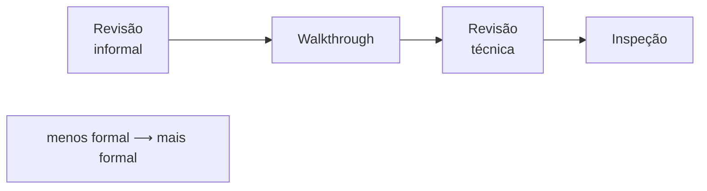

> **Seções 3.2.4 e 3.2.5 do syllabus.**

## Objetivos de aprendizagem

| Código | Nível | O que você precisa saber fazer |
|---|---|---|
| FL-3.2.4 | K2 | Comparar e contrastar os diferentes tipos de revisão |
| FL-3.2.5 | K1 | Relembrar os fatores que contribuem para uma revisão bem-sucedida |

## Palavras-chave

Definições do [Glossário ISTQB](https://glossary.istqb.org/pt-br/search/) em português, com uma leitura "em outras palavras" para fixar. Todas podem cair na prova em nível K1.

| Termo | Definição (Glossário ISTQB) | Em outras palavras |
|---|---|---|
| revisão informal | Um tipo de revisão que não segue um processo definido e que não tem saída formalmente documentada. | Ex.: pedir para um colega dar uma olhada. |
| revisão formal | Uma revisão que segue um processo definido com um resultado formalmente documentado. | Walkthrough, revisão técnica e inspeção são formais (em graus diferentes). |
| walkthrough | Um tipo de revisão formal em que o autor conduz os membros da equipe de revisão pela obra, e estes fazem perguntas e comentários. | **Autor lidera**; bom para educar e gerar consenso. |
| revisão técnica | Um tipo de revisão formal por uma equipe de pessoas tecnicamente qualificadas que examina a qualidade de um produto de trabalho e identifica discrepâncias em relação às especificações e normas. | Pares técnicos, conduzida por **moderador**; foco em decisões técnicas. |
| inspeção | Um tipo de revisão formal que usa funções e medidas definidas da equipe para identificar defeitos em um produto de trabalho e melhorar o processo de revisão e o processo de desenvolvimento de software. | A **mais formal**: autor não lidera, coleta **métricas**. |

## Escolhendo o nível de formalidade

Existem revisões que vão do **informal** ao **formal**. O nível de formalidade necessário depende de:

- o **SDLC** seguido
- a **maturidade** do processo de desenvolvimento
- a **importância** e a **complexidade** do produto de trabalho
- **exigências legais ou regulatórias**
- a necessidade de **trilha de auditoria**

O mesmo produto pode passar por **tipos diferentes** de revisão, por exemplo primeiro uma informal e depois uma mais formal.

Escolher o tipo certo é essencial para atingir os objetivos da revisão. A escolha não depende só dos objetivos, mas também das **necessidades do projeto**, dos **recursos disponíveis**, do **tipo e dos riscos** do produto, do **domínio do negócio** e da **cultura da empresa**.

## Os quatro tipos (FL-3.2.4)

### Revisão informal

- **Não segue um processo definido** e **não exige resultado formal documentado**.
- Objetivo principal: **detectar anomalias**.

Exemplo: pedir para um colega dar uma olhada no seu pull request antes de abrir para o time, ou uma "revisão por cima do ombro".

### Walkthrough

- **Conduzido pelo autor**, que apresenta o produto aos revisores.
- Pode servir a **muitos objetivos**: avaliar a qualidade e gerar confiança no produto, **instruir os revisores**, obter consenso, gerar ideias novas, motivar e capacitar os autores a melhorar, e detectar anomalias.
- Os revisores **podem** fazer revisão individual antes, mas **não é obrigatório**.

Exemplo: a analista apresenta o novo fluxo de cadastro para o time, tela a tela, explicando as regras e colhendo comentários.

### Revisão técnica

- Feita por **revisores tecnicamente qualificados** e **liderada por um moderador**.
- Objetivos: **obter consenso e tomar decisões sobre um problema técnico**, e também detectar anomalias, avaliar a qualidade, gerar confiança, gerar ideias novas e motivar os autores.

Exemplo: três arquitetos revisam a proposta de trocar o banco relacional por um banco de documentos e decidem se a mudança segue.

### Inspeção

- O tipo **mais formal**: segue o **processo genérico completo** (as cinco atividades da nota [Feedback e processo de revisão](02-processo-de-revisao.md)).
- Objetivo principal: **encontrar o maior número possível de anomalias**. Outros objetivos: avaliar qualidade, gerar confiança, motivar e capacitar os autores.
- **Métricas são coletadas** e usadas para melhorar o SDLC, incluindo o próprio processo de inspeção.
- **O autor não pode ser o líder da revisão nem o relator.**

Exemplo: o código de controle de dosagem de um equipamento hospitalar passa por inspeção com checklist, papéis definidos, coleta de métricas e critérios de saída formais.

### Tabela comparativa

| | Informal | Walkthrough | Revisão técnica | Inspeção |
|---|---|---|---|---|
| Processo definido | Não | Sim | Sim | Sim, **completo** |
| Quem conduz | Ninguém em especial | **Autor** | **Moderador** | Líder da revisão (**não** o autor) |
| Objetivo principal | Detectar anomalias | Vários: **instruir**, consenso, ideias, anomalias | **Consenso e decisões técnicas** | **Máximo de anomalias** |
| Revisão individual antes | Opcional | **Opcional** | Normalmente sim | **Sim** |
| Documentação formal | Não exigida | Varia | Sim | Sim, com **métricas** |
| Participantes | Colegas | Variados, inclusive não técnicos | **Tecnicamente qualificados** | Papéis definidos |

### Pistas para a prova

| Se a questão fala em... | O tipo é... |
|---|---|
| sem processo, sem documentação | Revisão informal |
| autor conduz, instruir os participantes, transferir conhecimento | Walkthrough |
| especialistas técnicos, decidir uma questão técnica, moderador | Revisão técnica |
| mais formal, métricas, máximo de defeitos, autor não pode ser líder nem relator | Inspeção |

## Fatores de sucesso (FL-3.2.5)

Os fatores do syllabus, com o motivo por trás de cada um:

| Fator | Por que importa |
|---|---|
| **Objetivos claros e critérios de saída mensuráveis** | Sem isso, não dá para saber se a revisão acabou. E atenção: **avaliar os participantes nunca deve ser um objetivo** |
| **Escolher o tipo de revisão adequado** | Aos objetivos, ao tipo de produto, aos participantes, às necessidades e ao contexto do projeto |
| **Revisar em partes pequenas** | Para os revisores não perderem a concentração na revisão individual ou na reunião |
| **Dar feedback** aos stakeholders e autores | Para eles melhorarem o produto e o próprio jeito de trabalhar |
| **Tempo suficiente para preparação** | Revisão individual feita às pressas encontra pouco |
| **Apoio da gerência** | Sem recursos e prioridade, a revisão vira formalidade |
| **Revisão como parte da cultura** | Para promover aprendizado e melhoria de processo |
| **Treinamento** de todos os participantes | Para cada um saber desempenhar seu papel |
| **Facilitação das reuniões** | Reuniões bem conduzidas evitam discussões improdutivas e ataques pessoais |

O item mais cobrado é o primeiro, principalmente a ressalva: **a revisão avalia o produto, nunca as pessoas.** Se a revisão vira avaliação de desempenho do autor, as pessoas passam a esconder problemas.

## Teste seu conhecimento

1. Em qual tipo de revisão o autor NÃO pode ser líder nem relator?

**Inspeção.**

2. A autora de um documento de requisitos o apresenta para a equipe de suporte, para que eles entendam o novo produto e deem sugestões. Qual tipo de revisão é mais adequado?

**Walkthrough**: conduzido pelo autor, com objetivo de instruir os participantes e colher ideias.

3. Qual destes NÃO é um fator de sucesso de revisões? (a) Critérios de saída mensuráveis (b) Usar os resultados para avaliar o desempenho dos autores (c) Revisar em partes pequenas (d) Apoio da gerência

**(b).** O syllabus diz explicitamente que avaliar os participantes nunca deve ser um objetivo.

4. Qual é o objetivo principal de uma revisão técnica?

**Obter consenso e tomar decisões sobre um problema técnico.**

## Referências

- [Syllabus CTFL v4.0 em português](https://bstqb.online/ctfl) - BSTQB, português (seções 3.2.4 e 3.2.5)
- [Glossário ISTQB](https://glossary.istqb.org/pt-br/search/) - ISTQB, português (termos "inspeção", "walkthrough", "revisão técnica", "revisão informal")
- *Software Inspection* - Tom Gilb e Dorothy Graham, Addison-Wesley, 1993, inglês
