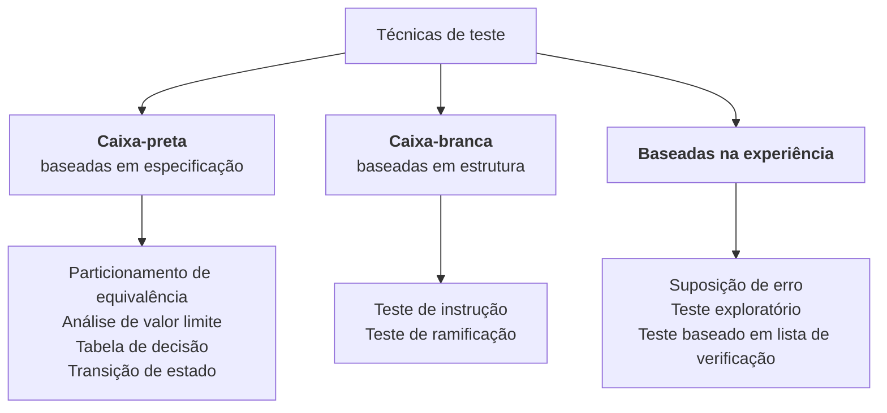

> **Seção 4.1 do syllabus.** Capítulo 4 vale **11 questões**, o maior peso da prova, e tem 5 objetivos de nível K3 (aplicar).

## Objetivo de aprendizagem

| Código | Nível | O que você precisa saber fazer |
|---|---|---|
| FL-4.1.1 | K2 | Distinguir técnicas de teste caixa-preta, caixa-branca e baseadas na experiência |

## Palavras-chave

Definições do [Glossário ISTQB](https://glossary.istqb.org/pt-br/search/) em português, com uma leitura "em outras palavras" para fixar. Todas podem cair na prova em nível K1.

| Termo | Definição (Glossário ISTQB) | Em outras palavras |
|---|---|---|
| técnica de teste | Um procedimento usado para definir condições de teste, modelar casos de teste e especificar dados de teste. | O "método" que guia análise e modelagem. |
| cobertura | O grau em que os itens de uma abrangência específica são executados por um conjunto de testes, expresso como uma porcentagem. | itens exercitados ÷ itens identificados × 100%. |
| item de cobertura | Um atributo ou combinação de atributos derivados de uma ou mais condições de teste por meio de uma técnica de teste. | **O que se conta** para medir cobertura (partições, limites, colunas, transições, instruções, ramos). |
| técnica de teste caixa-preta | Uma técnica de teste baseada na especificação de um componente ou sistema. | - |
| técnica de teste caixa-branca | Uma técnica de teste baseada na estrutura interna de um componente ou sistema. | Precisa enxergar o código. |
| técnica de teste baseada na experiência | Uma técnica de teste baseada na experiência, no conhecimento e na intuição do testador. | Complementa as técnicas sistemáticas. |

## Para que servem as técnicas de teste

Lembra do princípio "testes exaustivos são impossíveis"? As técnicas de teste são a resposta prática a ele. Elas ajudam a montar, de forma **sistemática**, um conjunto de casos de teste **relativamente pequeno, mas suficiente**.

As técnicas apoiam duas atividades do processo de teste:

- a **análise** de teste ("o que testar?"), ajudando a definir as **condições de teste**
- a **modelagem** de teste ("como testar?"), ajudando a identificar os **itens de cobertura** e os **dados de teste**

### Dois conceitos que atravessam o capítulo inteiro

- **Item de cobertura**: aquilo que a técnica manda exercitar. Em particionamento de equivalência são as partições; em tabela de decisão, as colunas; em teste de instrução, as instruções.
- **Cobertura**: quanto dos itens de cobertura foi exercitado pelos testes, em porcentagem.

```text
cobertura = (itens de cobertura exercitados / total de itens de cobertura) × 100%
```

Toda técnica do capítulo 4 segue essa mesma fórmula. O que muda de uma para outra é **o que conta como item de cobertura**.

## As três categorias



### Caixa-preta (baseadas em especificação)

- Analisam o **comportamento especificado** do objeto de teste **sem olhar a estrutura interna**.
- Os casos de teste são **independentes da implementação**. Se a implementação mudar e o comportamento exigido continuar o mesmo, **os casos de teste continuam úteis**.

Analogia: testar um micro-ondas só pelo painel e pelo manual, sem abrir a tampa.

### Caixa-branca (baseadas em estrutura)

- Analisam a **estrutura interna** e o **processamento** do objeto de teste.
- Como os casos dependem de como o software foi projetado, eles **só podem ser criados depois do projeto ou da implementação**.

Analogia: abrir o micro-ondas e garantir que cada circuito foi energizado pelo menos uma vez.

### Baseadas na experiência

- Usam o **conhecimento e a experiência** dos testadores para projetar e implementar os casos de teste.
- A eficácia **depende muito das habilidades** de quem testa.
- Podem encontrar defeitos que as técnicas caixa-preta e caixa-branca **não encontram**.
- Por isso, são **complementares** às outras duas, e não substitutas.

### Comparação rápida

| | Caixa-preta | Caixa-branca | Baseada na experiência |
|---|---|---|---|
| Base | Especificação, requisitos, histórias | Código, arquitetura, fluxos | Conhecimento e intuição do testador |
| Olha a estrutura interna? | Não | Sim | Não necessariamente |
| Quando dá para criar os casos | Assim que existe especificação | Só depois do projeto ou da implementação | Normalmente durante a execução |
| Se a implementação mudar | Casos continuam válidos | Casos podem precisar mudar | Depende |
| Depende de quem testa? | Pouco (é sistemática) | Pouco (é sistemática) | **Muito** |

## Teste seu conhecimento

<details>
<summary>1. Por que os casos de teste caixa-preta continuam úteis quando o código é reescrito?</summary>

Porque eles são derivados do comportamento especificado, não da implementação. Se o comportamento exigido não mudou, os casos continuam válidos.

</details>

<details>
<summary>2. Qual categoria de técnica só pode ser aplicada depois do projeto ou da implementação?</summary>

**Caixa-branca**, porque depende da estrutura interna do objeto de teste.

</details>

<details>
<summary>3. Qual é a principal desvantagem das técnicas baseadas na experiência?</summary>

A eficácia delas depende muito da habilidade e da experiência de quem testa.

</details>

<details>
<summary>4. Teste exploratório pertence a qual categoria?</summary>

**Baseada na experiência.**

</details>

## Referências

- [Syllabus CTFL v4.0 em português](https://bstqb.online/ctfl) - BSTQB, português (seção 4.1)
- [Glossário ISTQB](https://glossary.istqb.org/pt-br/search/) - ISTQB, português (termos "técnica de teste", "item de cobertura", "cobertura")
- *A Practitioner's Guide to Software Test Design* - Lee Copeland, Artech House, 2004 (citado no syllabus), inglês
