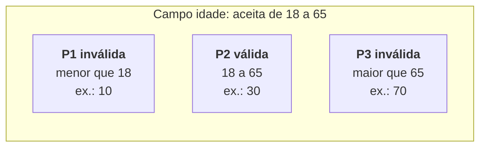

> **Seção 4.2.1 do syllabus.** Objetivo **K3**: espere questões de cálculo.

## Objetivo de aprendizagem

| Código | Nível | O que você precisa saber fazer |
|---|---|---|
| FL-4.2.1 | K3 | Usar o particionamento de equivalência para derivar casos de teste |

## Palavras-chave

Definições do [Glossário ISTQB](https://glossary.istqb.org/pt-br/search/) em português, com uma leitura "em outras palavras" para fixar. Todas podem cair na prova em nível K1.

| Termo | Definição (Glossário ISTQB) | Em outras palavras |
|---|---|---|
| particionamento de equivalência | Uma técnica de teste caixa-preta na qual as condições de teste são partições de equivalência exercidas por um membro representativo de cada partição. | Partições (válidas **e** inválidas). |

> Apoio: **partição de equivalência** = subconjunto de valores que o sistema deve tratar **da mesma forma**.

## A ideia

O **particionamento de equivalência** (EP, de *Equivalence Partitioning*) divide os dados em grupos, chamados **partições de equivalência**, partindo da expectativa de que **todos os elementos de uma partição são processados do mesmo jeito** pelo objeto de teste.

A teoria por trás: se um teste com um valor da partição encontra um defeito, **qualquer outro valor da mesma partição** também encontraria. Então **um teste por partição é suficiente**.



Testar 30, 31, 32 e 40 não acrescenta nada: todos estão em P2 e seriam tratados igual. Um valor de cada partição já basta.

## Regras das partições

- Podem ser definidas para **qualquer elemento de dados**: entradas, **saídas**, itens de configuração, valores internos, valores ligados a **tempo** e parâmetros de interface.
- Podem ser **contínuas ou discretas**, **ordenadas ou não ordenadas**, **finitas ou infinitas**.
- **Não podem se sobrepor** e **não podem ser vazias**.

Em objetos simples, particionar é fácil. Na prática, entender como o sistema trata cada valor costuma ser complicado, então o particionamento precisa ser feito com cuidado.

### Partições válidas e inválidas

- **Partição válida**: contém valores válidos.
- **Partição inválida**: contém valores inválidos.

O que é "válido" pode variar entre equipes. Algumas consideram válido o que **deve ser processado** pelo sistema; outras, o que a **especificação define** como processar. Inválido pode ser o que **deve ser ignorado ou rejeitado**, ou o que **não tem processamento definido** na especificação.

### Partições não ordenadas também existem

Nem toda partição é uma faixa de números. Exemplo: campo "forma de pagamento".

| Partição | Valores | Tipo |
|---|---|---|
| P1 | Cartão de crédito | Válida |
| P2 | Pix | Válida |
| P3 | Boleto | Válida |
| P4 | Qualquer outro valor (ex.: "cheque") | Inválida |

Se o sistema trata cartão, Pix e boleto de jeitos diferentes, cada um é uma partição separada. Se tratasse todos igual, seriam uma partição só.

## Cobertura

- **Itens de cobertura**: as **partições de equivalência**, incluindo as **inválidas**.
- **100% de cobertura**: cada partição exercitada **pelo menos uma vez**.

```text
cobertura EP = partições exercitadas / total de partições identificadas × 100%
```

Exemplo: no campo idade, se os testes usaram 30 e 70, a cobertura é 2/3 ≈ 67%. Faltou a partição "menor que 18".

## Vários parâmetros: Each Choice Coverage (ECC)

Muitos objetos de teste têm **vários conjuntos de partições** (por exemplo, mais de um campo de entrada). Um único caso de teste então cobre **uma partição de cada conjunto ao mesmo tempo**.

O critério de cobertura mais simples nesse caso é o **Each Choice Coverage (ECC)**, ou cobertura de cada escolha: cada partição de **cada conjunto** deve ser exercitada **pelo menos uma vez**. O ECC **não leva em conta as combinações** entre partições.

### Exemplo ECC

Um formulário de seguro tem dois campos:

- **Idade**: P1 (&lt; 18, inválida), P2 (18 a 65, válida), P3 (&gt; 65, inválida)
- **Tipo de veículo**: V1 (carro), V2 (moto)

Para 100% ECC, cada uma das 5 partições precisa aparecer pelo menos uma vez. Como cada teste cobre uma idade e um veículo ao mesmo tempo:

| Caso | Idade | Veículo |
|---|---|---|
| CT1 | P1 (10) | V1 (carro) |
| CT2 | P2 (30) | V2 (moto) |
| CT3 | P3 (70) | V1 (carro) |

**3 casos** bastam. A regra prática: com ECC, o mínimo de casos é o **tamanho do maior conjunto de partições** (aqui, max(3, 2) = 3).

> **Atenção na prática:** combinar duas partições inválidas no mesmo teste pode esconder uma delas (o sistema rejeita pela primeira e nunca checa a segunda). Muitos testadores preferem testar cada partição inválida isoladamente, combinada só com partições válidas. A prova costuma pedir o **mínimo** para o critério, então leia o enunciado com atenção.

## Passo a passo para questões de EP

1. Leia a especificação e liste **cada elemento de dados** relevante (entradas e também saídas).
2. Para cada elemento, identifique as **partições válidas** (cada tratamento diferente é uma partição).
3. Identifique as **partições inválidas** (abaixo do mínimo, acima do máximo, tipo errado, valor fora da lista).
4. Confira que as partições **não se sobrepõem** e **não são vazias**.
5. Escolha **um valor** representativo de cada partição.
6. Conte: o mínimo de casos para 100% é o número de partições (um parâmetro) ou o tamanho do maior conjunto (ECC com vários parâmetros).

## Exercícios resolvidos

### Exercício 1: faixas de frete

> Um e-commerce calcula o frete pelo valor da compra (em reais, com centavos): até R$ 99,99 paga R$ 20; de R$ 100,00 a R$ 299,99 paga R$ 10; a partir de R$ 300,00 o frete é grátis. Valores negativos ou zero são rejeitados.

Partições:

| Partição | Faixa | Tipo | Valor de teste |
|---|---|---|---|
| P1 | ≤ 0,00 | Inválida | -5,00 |
| P2 | 0,01 a 99,99 | Válida | 50,00 |
| P3 | 100,00 a 299,99 | Válida | 150,00 |
| P4 | ≥ 300,00 | Válida | 500,00 |

Mínimo de **4 casos** para 100% de cobertura EP.

### Exercício 2: qual valor fica fora?

> Um sistema de notas classifica o aluno: 0 a 4 reprovado, 5 a 6 recuperação, 7 a 10 aprovado (inteiros). Quais valores cobrem todas as partições válidas com o menor número de testes? (a) 3, 5, 8 (b) 0, 4, 10 (c) 4, 6, 7, 10 (d) 5, 6, 7

**Resposta: (a).** São três partições válidas (0 a 4, 5 a 6, 7 a 10) e (a) tem um valor de cada. (b) não cobre recuperação; (c) cobre tudo, mas com 4 testes; (d) não cobre reprovado.

## Teste seu conhecimento

<details>
<summary>1. Um campo aceita quantidades de 1 a 10 unidades. Quantas partições existem e quais são?</summary>

**Três**: menor que 1 (inválida), de 1 a 10 (válida), maior que 10 (inválida).

</details>

<details>
<summary>2. Os testes exercitaram 4 de 5 partições identificadas. Qual é a cobertura de EP?</summary>

4 / 5 = **80%**.

</details>

<details>
<summary>3. Com três parâmetros, de 4, 3 e 2 partições, qual o número mínimo de casos para 100% de Each Choice Coverage?</summary>

**4**, o tamanho do maior conjunto. Cada caso cobre uma partição de cada parâmetro.

</details>

<details>
<summary>4. Partições de equivalência podem se sobrepor?</summary>

Não. Partições não podem se sobrepor e não podem ser vazias.

</details>

## Referências

- [Syllabus CTFL v4.0 em português](https://bstqb.online/ctfl) - BSTQB, português (seção 4.2.1)
- [Glossário ISTQB](https://glossary.istqb.org/pt-br/search/) - ISTQB, português (termos "particionamento de equivalência", "partição de equivalência")
- *Introduction to Software Testing*, 2ª ed. - Paul Ammann e Jeff Offutt, Cambridge University Press, 2016 (origem do Each Choice Coverage citado no syllabus), inglês
