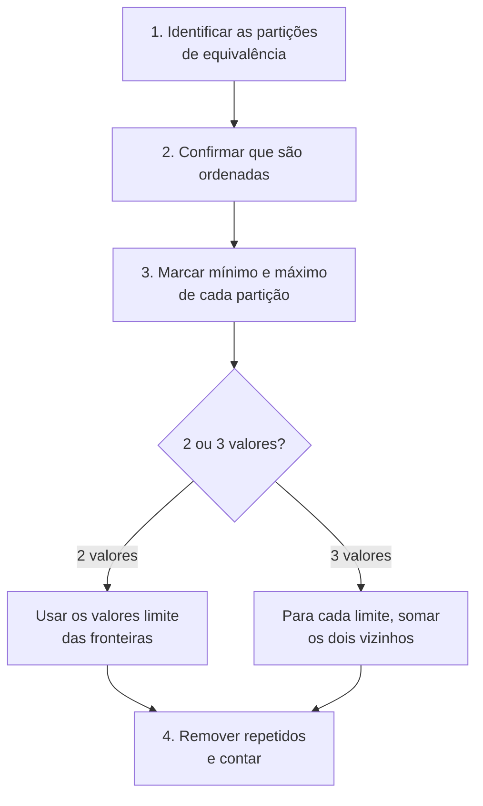

> **Seção 4.2.2 do syllabus.** Objetivo **K3**, um dos cálculos mais cobrados da prova.

## Objetivo de aprendizagem

| Código | Nível | O que você precisa saber fazer |
|---|---|---|
| FL-4.2.2 | K3 | Usar a análise de valor limite para derivar casos de teste |

## Palavras-chave

Definições do [Glossário ISTQB](https://glossary.istqb.org/pt-br/search/) em português, com uma leitura "em outras palavras" para fixar. Todas podem cair na prova em nível K1.

| Termo | Definição (Glossário ISTQB) | Em outras palavras |
|---|---|---|
| análise de valor limite | Uma técnica de teste caixa-preta na qual as condições de teste são valores limite. | Limites (+ vizinhos, em 2 ou 3 valores). |

> Apoio: **valor limite** = valor mínimo ou máximo de uma partição de equivalência **ordenada**.

## A ideia

A **análise de valor limite** (BVA, de *Boundary Value Analysis*) é uma técnica para exercitar os **limites das partições de equivalência**.

Por que limites? Porque é ali que os desenvolvedores mais erram. Escrever `<` no lugar de `<=`, ou `> 18` no lugar de `>= 18`, é um erro clássico. Os defeitos típicos que a BVA encontra são limites **implementados no lugar errado** (acima ou abaixo de onde deveriam estar) ou **omitidos**.

## Pré-requisitos

- A BVA **só funciona para partições ordenadas** (números, datas, tamanhos). Não dá para aplicar BVA em "forma de pagamento".
- Os **valores limite** de uma partição são o seu **mínimo** e o seu **máximo**.
- Se dois elementos pertencem à mesma partição, todos os elementos entre eles também pertencem a ela.

## Encontrando os valores limite

Exemplo: campo idade aceita **inteiros de 18 a 65**.

```text
  ... 16  17 | 18  19 ... 64  65 | 66  67 ...
   inválida  |      válida       |  inválida
         máx ↑ ↑ mín       máx ↑ ↑ mín
```

Cada partição tem mínimo e máximo. Os valores limite que interessam são os que ficam nas **fronteiras** entre partições:

- entre P1 e P2: **17** (máximo de P1) e **18** (mínimo de P2)
- entre P2 e P3: **65** (máximo de P2) e **66** (mínimo de P3)

A partição P1 não tem mínimo útil (vai até menos infinito, ou até o menor inteiro suportado) e P3 não tem máximo útil. Então os valores limite são **17, 18, 65 e 66**.

## BVA de 2 valores

Para **cada valor limite**, há **dois itens de cobertura**: o próprio limite e o **vizinho mais próximo na partição adjacente**.

Na prática, como o vizinho de um limite é o limite da partição vizinha, os itens de cobertura acabam sendo **os próprios valores limite**:

- limite 18 → 18 e 17
- limite 65 → 65 e 66
- limite 17 → 17 e 18
- limite 66 → 66 e 65

Juntando sem repetir: **17, 18, 65, 66** → **4 casos de teste**.

```text
cobertura BVA 2 valores = valores limite exercitados / total de valores limite × 100%
```

## BVA de 3 valores

Para **cada valor limite**, há **três itens de cobertura**: o limite e **os dois vizinhos** (um de cada lado). Por isso alguns itens de cobertura **não são valores limite**.

- limite 17 → 16, 17, 18
- limite 18 → 17, 18, 19
- limite 65 → 64, 65, 66
- limite 66 → 65, 66, 67

Juntando sem repetir: **16, 17, 18, 19, 64, 65, 66, 67** → **8 casos de teste**.

```text
cobertura BVA 3 valores = (limites + vizinhos) exercitados / total de (limites + vizinhos) × 100%
```

### Por que o BVA de 3 valores é mais rigoroso

Ele encontra defeitos que o de 2 valores deixa passar. O exemplo do próprio syllabus:

```js
// Especificação: se x <= 10, aplica a regra A
if (x == 10) { regraA(); }   // implementado errado: == no lugar de <=
```

| Técnica | Valores testados | Resultado |
|---|---|---|
| BVA 2 valores | 10 e 11 | 10 aplica a regra (correto), 11 não aplica (correto). **Defeito não aparece.** |
| BVA 3 valores | 9, 10 e 11 | 9 deveria aplicar a regra, mas não aplica. **Defeito encontrado.** |

## Passo a passo para questões de BVA



Cuidado com a **granularidade**: se o campo aceita valores com duas casas decimais, o vizinho de 100,00 é 99,99 e 100,01, e não 99 e 101.

## Exercícios resolvidos

### Exercício 1: frete com centavos

> Até R$ 99,99 o frete é R$ 20; de R$ 100,00 a R$ 299,99, R$ 10; a partir de R$ 300,00, grátis. Valores menores ou iguais a zero são rejeitados. Quais são os valores para BVA de 2 valores?

Partições: (≤ 0,00), (0,01 a 99,99), (100,00 a 299,99), (≥ 300,00).

Valores limite nas fronteiras: **0,00 e 0,01**; **99,99 e 100,00**; **299,99 e 300,00**. São **6 casos**.

### Exercício 2: senha

> Uma senha deve ter de 8 a 20 caracteres. Quais valores de comprimento são testados com BVA de 3 valores?

Partições: (0 a 7), (8 a 20), (≥ 21). Limites nas fronteiras: 7, 8, 20, 21.

- 7 → 6, 7, 8
- 8 → 7, 8, 9
- 20 → 19, 20, 21
- 21 → 20, 21, 22

Sem repetir: **6, 7, 8, 9, 19, 20, 21, 22** → **8 casos**.

### Exercício 3: cobertura

> No exercício da idade (18 a 65), com BVA de 2 valores, os testes usaram 17, 18 e 65. Qual é a cobertura?

São 4 itens (17, 18, 65, 66) e 3 foram exercitados: 3/4 = **75%**.

## Teste seu conhecimento

<details>
<summary>1. A BVA pode ser aplicada a um campo "estado civil" (solteiro, casado, divorciado, viúvo)?</summary>

Não. A BVA só serve para partições **ordenadas**, e estado civil não tem ordem.

</details>

<details>
<summary>2. Um campo aceita inteiros de 1 a 100. Quais valores são testados com BVA de 2 valores?</summary>

**0, 1, 100 e 101.**

</details>

<details>
<summary>3. O mesmo campo (1 a 100), com BVA de 3 valores. Quais valores?</summary>

Limites 0, 1, 100, 101. Com vizinhos: **-1, 0, 1, 2, 99, 100, 101, 102**, ou seja, 8 valores.

</details>

<details>
<summary>4. Qual defeito o BVA de 3 valores consegue encontrar e o de 2 valores não?</summary>

Por exemplo, uma condição "x ≤ 10" implementada como "x = 10". O valor 9 (vizinho interno, só testado no BVA de 3 valores) revela o defeito.

</details>

## Referências

- [Syllabus CTFL v4.0 em português](https://bstqb.online/ctfl) - BSTQB, português (seção 4.2.2)
- [Glossário ISTQB](https://glossary.istqb.org/pt-br/search/) - ISTQB, português (termos "análise de valor limite", "valor limite")
- *The Art of Software Testing*, 3ª ed. - Glenford Myers, Corey Sandler e Tom Badgett, Wiley, 2011 (citado no syllabus para o BVA de 2 valores), inglês
