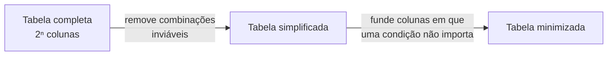

> **Seção 4.2.3 do syllabus.** Objetivo **K3**.

## Objetivo de aprendizagem

| Código | Nível | O que você precisa saber fazer |
|---|---|---|
| FL-4.2.3 | K3 | Usar o teste de tabela de decisão para derivar casos de teste |

## Palavras-chave

Definições do [Glossário ISTQB](https://glossary.istqb.org/pt-br/search/) em português, com uma leitura "em outras palavras" para fixar. Todas podem cair na prova em nível K1.

| Termo | Definição (Glossário ISTQB) | Em outras palavras |
|---|---|---|
| teste de tabela de decisão | Uma técnica de teste caixa preta na qual as condições de teste são as combinações de condições e as ações resultantes mostradas em uma tabela de decisão. | Colunas **viáveis**. |

## Quando usar

Tabelas de decisão servem para testar requisitos em que **combinações de condições levam a resultados diferentes**. São uma forma eficiente de registrar **lógica complexa**, como **regras de negócio**.

Sinal de que a técnica cabe: o requisito tem vários "se", "e", "ou" e "a menos que". Exemplo: "Se o cliente for VIP e a compra passar de R$ 100, dá 10% de desconto; se só for VIP, 5%; caso contrário, nada."

## Estrutura da tabela

| | Regra 1 | Regra 2 | Regra 3 | Regra 4 |
|---|---|---|---|---|
| **Condição 1** | ... | ... | ... | ... |
| **Condição 2** | ... | ... | ... | ... |
| **Ação 1** | ... | ... | ... | ... |
| **Ação 2** | ... | ... | ... | ... |

- **Linhas**: as **condições** (em cima) e as **ações** do sistema (embaixo).
- **Colunas**: as **regras de decisão**. Cada coluna é uma **combinação única** de condições, com as ações que ela gera.

### Entrada limitada e entrada estendida

- **Entrada limitada**: condições e ações só assumem valores **booleanos** (verdadeiro ou falso).
- **Entrada estendida**: algumas condições ou ações assumem **vários valores**, como faixas de números, partições de equivalência ou valores discretos. Exemplo: condição "faixa etária" com valores "&lt; 18", "18 a 60", "&gt; 60".

### Notação

| Símbolo | Onde | Significado |
|---|---|---|
| **V** | Condição | A condição é verdadeira (satisfeita) |
| **F** | Condição | A condição é falsa (não satisfeita) |
| **-** | Condição | O valor da condição é **irrelevante** para o resultado |
| **N/A** | Condição | A condição é **inviável** para essa regra |
| **X** | Ação | A ação **deve acontecer** |
| (em branco) | Ação | A ação **não deve acontecer** |

Outras notações também podem ser usadas (por exemplo, T/F ou 1/0).

## Tabela completa, simplificada e minimizada

- **Completa**: tem colunas para **todas as combinações** de condições. Com *n* condições booleanas, são **2ⁿ** colunas (2 condições = 4 colunas; 3 = 8; 4 = 16).
- **Simplificada**: removem-se as colunas com **combinações inviáveis** (que não podem acontecer na vida real).
- **Minimizada**: colunas em que alguma condição **não afeta o resultado** são **fundidas** numa só, usando "-". Os algoritmos de minimização estão **fora do escopo** da prova, mas você precisa reconhecer quando duas colunas podem virar uma.



## Cobertura

- **Itens de cobertura**: as **colunas com combinações viáveis** de condições.
- **100%**: todas essas colunas exercitadas.

```text
cobertura = colunas exercitadas / total de colunas viáveis × 100%
```

## Pontos fortes e fracos

| Pontos fortes | Pontos fracos |
|---|---|
| Abordagem **sistemática** para identificar **todas as combinações**, inclusive as que seriam esquecidas | O número de regras **cresce exponencialmente** com o número de condições |
| Ajuda a encontrar **lacunas e contradições** nos requisitos | Com muitas condições, executar todas as regras toma muito tempo |

Quando há condições demais, o syllabus sugere usar uma **tabela minimizada** ou uma **abordagem baseada em risco** para reduzir o número de regras a testar.

## Exercícios resolvidos

### Exercício 1: desconto

> Cliente VIP com compra acima de R$ 100 ganha 10% de desconto. Cliente VIP com compra até R$ 100 ganha 5%. Cliente não VIP não ganha desconto.

Tabela completa (2 condições = 4 colunas):

| | R1 | R2 | R3 | R4 |
|---|---|---|---|---|
| C1: cliente VIP? | V | V | F | F |
| C2: compra &gt; R$ 100? | V | F | V | F |
| A1: 10% de desconto | X | | | |
| A2: 5% de desconto | | X | | |
| A3: sem desconto | | | X | X |

Minimizando: em R3 e R4, C1 é falsa e a ação é a mesma, não importa C2. Elas viram uma coluna só:

| | R1 | R2 | R3' |
|---|---|---|---|
| C1: cliente VIP? | V | V | F |
| C2: compra &gt; R$ 100? | V | F | - |
| A1: 10% de desconto | X | | |
| A2: 5% de desconto | | X | |
| A3: sem desconto | | | X |

**3 casos** cobrem 100% da tabela minimizada.

### Exercício 2: empréstimo com combinação inviável

> Um banco avalia empréstimos. Condições: C1 "renda comprovada?", C2 "nome limpo?", C3 "cliente há mais de 2 anos?". Regras: sem renda comprovada, o pedido é recusado. Com renda e nome sujo, o pedido vai para análise manual. Com renda, nome limpo e mais de 2 anos de casa, aprovação automática com taxa reduzida. Com renda, nome limpo e menos de 2 anos, aprovação automática com taxa padrão.

Tabela completa: 2³ = 8 colunas.

| | R1 | R2 | R3 | R4 | R5 | R6 | R7 | R8 |
|---|---|---|---|---|---|---|---|---|
| C1: renda comprovada? | V | V | V | V | F | F | F | F |
| C2: nome limpo? | V | V | F | F | V | V | F | F |
| C3: cliente há mais de 2 anos? | V | F | V | F | V | F | V | F |
| Aprovar com taxa reduzida | X | | | | | | | |
| Aprovar com taxa padrão | | X | | | | | | |
| Análise manual | | | X | X | | | | |
| Recusar | | | | | X | X | X | X |

Minimizada: R3 e R4 viram uma coluna (C3 irrelevante); R5 a R8 viram uma coluna (C2 e C3 irrelevantes).

| | R1 | R2 | R3' | R5' |
|---|---|---|---|---|
| C1: renda comprovada? | V | V | V | F |
| C2: nome limpo? | V | V | F | - |
| C3: cliente há mais de 2 anos? | V | F | - | - |
| Aprovar com taxa reduzida | X | | | |
| Aprovar com taxa padrão | | X | | |
| Análise manual | | | X | |
| Recusar | | | | X |

**4 casos** para 100% de cobertura da tabela minimizada.

Repare num benefício que a técnica traz de graça: ao montar a tabela, surge a pergunta "e um cliente com renda, nome sujo e muitos anos de casa vai mesmo para análise manual, ou deveria ter algum benefício?". Isso é encontrar uma **lacuna no requisito**.

### Exercício 3: quantas colunas?

> Uma regra tem 4 condições booleanas. Quantas colunas tem a tabela completa? Se 3 combinações forem inviáveis, quantos casos de teste são necessários para 100% de cobertura (sem minimizar)?

2⁴ = **16 colunas**. Tirando as 3 inviáveis: **13 casos**.

## Teste seu conhecimento

<details>
<summary>1. Numa tabela de decisão, o que significa "-" numa condição?</summary>

Que o valor da condição é **irrelevante** para o resultado daquela regra.

</details>

<details>
<summary>2. O que são os itens de cobertura no teste de tabela de decisão?</summary>

As **colunas com combinações viáveis** de condições.

</details>

<details>
<summary>3. Uma tabela tem 8 colunas viáveis e os testes executaram 6. Qual é a cobertura?</summary>

6 / 8 = **75%**.

</details>

<details>
<summary>4. Qual é a diferença entre "N/A" e "-" numa condição?</summary>

"-" quer dizer que a condição **não importa** para o resultado. "N/A" quer dizer que a condição é **inviável** naquela regra (aquela combinação não pode acontecer).

</details>

## Referências

- [Syllabus CTFL v4.0 em português](https://bstqb.online/ctfl) - BSTQB, português (seção 4.2.3)
- [Glossário ISTQB](https://glossary.istqb.org/pt-br/search/) - ISTQB, português (termos "tabela de decisão", "teste de tabela de decisão")
- *Software Testing: A Craftsman's Approach*, 4ª ed. - Paul Jorgensen, CRC Press, 2014 (citado no syllabus), inglês
