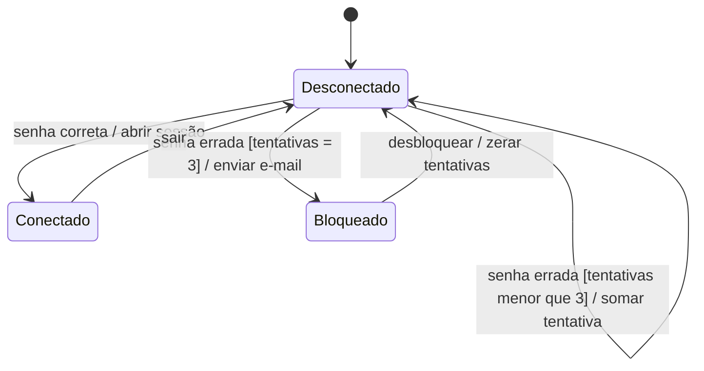
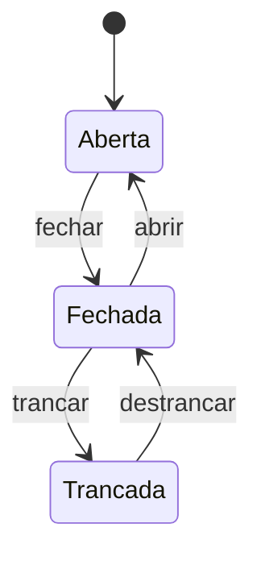
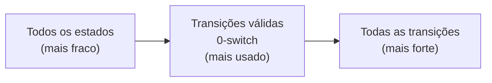

> **Seção 4.2.4 do syllabus.** Objetivo **K3**.

## Objetivo de aprendizagem

| Código | Nível | O que você precisa saber fazer |
|---|---|---|
| FL-4.2.4 | K3 | Usar o teste de transição de estado para derivar casos de teste |

## Palavras-chave

Definições do [Glossário ISTQB](https://glossary.istqb.org/pt-br/search/) em português, com uma leitura "em outras palavras" para fixar. Todas podem cair na prova em nível K1.

| Termo | Definição (Glossário ISTQB) | Em outras palavras |
|---|---|---|
| teste de transição de estado | Uma técnica de teste caixa-preta na qual as condições de teste são transições de estado ou sequências delas. | Estados, transições válidas ou todas as transições. |

## Quando usar

Quando o comportamento do sistema **depende do que aconteceu antes**. O mesmo evento produz resultados diferentes conforme o estado atual. Exemplos: um pedido (criado, pago, enviado, entregue, cancelado), um caixa eletrônico, uma conta que bloqueia depois de três senhas erradas, um semáforo.

## Diagrama de transição de estados

Um **diagrama de transição de estados** modela o comportamento mostrando os **estados** possíveis e as **transições válidas** entre eles.

- Uma **transição** é disparada por um **evento**.
- O evento pode ter uma **condição de guarda** (*guard condition*): a transição só acontece se a condição for verdadeira.
- As transições são consideradas **instantâneas** e podem gerar **ações** do software.

A sintaxe do rótulo de uma transição é:

```text
evento [condição de guarda] / ação
```

Guarda e ação podem ser omitidas quando não existem ou não interessam ao testador.

### Exemplo: login com bloqueio



Leia a transição "senha errada [tentativas = 3] / enviar e-mail" assim: quando chega o **evento** "senha errada", **se** a guarda "tentativas = 3" for verdadeira, o sistema vai para Bloqueado e executa a **ação** "enviar e-mail".

## Tabela de estados

A **tabela de estados** é um modelo **equivalente** ao diagrama:

- **linhas** = estados
- **colunas** = eventos (com as guardas, se houver)
- **células** = transições, com o **estado de destino** e as **ações**

A grande diferença: a tabela **mostra explicitamente as transições inválidas**, como **células vazias**. O diagrama só mostra as válidas.

### Exemplo: porta com fechadura



| Estado \ Evento | abrir | fechar | trancar | destrancar |
|---|---|---|---|---|
| **Aberta** | | Fechada | | |
| **Fechada** | Aberta | | Trancada | |
| **Trancada** | | | | Fechada |

- 3 estados x 4 eventos = **12 células**
- **4 transições válidas** (células preenchidas)
- **8 transições inválidas** (células vazias), por exemplo "trancar uma porta aberta"

## Casos de teste

Um caso de teste de transição de estado normalmente é uma **sequência de eventos**, que gera uma sequência de mudanças de estado (e ações). Um caso de teste pode cobrir, e normalmente cobre, **várias transições**.

## Os três critérios de cobertura

| Critério | Itens de cobertura | 100% significa | Força |
|---|---|---|---|
| **Todos os estados** | Os **estados** | Visitar todos os estados | O **mais fraco**: costuma dar para atingir sem exercitar todas as transições |
| **Transições válidas** (cobertura **0-switch**) | As **transições válidas** | Exercitar todas as transições válidas | O **mais usado** |
| **Todas as transições** | **Todas** as transições da tabela de estados, válidas e inválidas | Exercitar todas as válidas **e tentar** todas as inválidas | O **mais forte**: garante os outros dois. Deve ser o **mínimo** para software de **missão crítica** e **segurança crítica** |



As fórmulas seguem o padrão:

```text
todos os estados      = estados visitados / total de estados × 100%
transições válidas    = transições válidas exercitadas / total de transições válidas × 100%
todas as transições   = (válidas exercitadas + inválidas tentadas) / (total de válidas + inválidas) × 100%
```

### Uma transição inválida por caso de teste

Ao testar transições inválidas, teste **uma por caso de teste**. Isso evita o **mascaramento de falhas**: uma situação em que um defeito impede a detecção de outro. Se o primeiro evento inválido já derruba o teste, você nunca descobre o que o segundo faria.

## Exercícios resolvidos (porta com fechadura)

### Quantos casos para 100% de todos os estados?

**1 caso**: Aberta → fechar → Fechada → trancar → Trancada. Os três estados foram visitados (e só 2 das 4 transições válidas foram exercitadas, o que mostra por que esse critério é o mais fraco).

### Quantos casos para 100% de transições válidas?

**1 caso** pode cobrir tudo, se a sequência for bem escolhida:

```text
Aberta --fechar--> Fechada --trancar--> Trancada --destrancar--> Fechada --abrir--> Aberta
```

As 4 transições válidas foram exercitadas.

### Quantos casos para 100% de todas as transições?

O caso acima (4 válidas) **mais 8 casos**, um para cada transição inválida. Total: **9 casos**.

Exemplo de caso para uma transição inválida: partindo de Aberta, tentar "trancar" e verificar que a porta continua Aberta (e que o sistema trata o evento como esperado, por exemplo exibindo uma mensagem).

### Exercício extra: login com bloqueio

> No diagrama de login acima (3 estados, 5 transições válidas), qual é a cobertura de transições válidas de um teste que faz: Desconectado → senha correta → Conectado → sair → Desconectado?

Foram exercitadas 2 das 5 transições válidas: 2/5 = **40%**. A cobertura de todos os estados é 2/3 ≈ **67%** (Bloqueado não foi visitado).

## Teste seu conhecimento

<details>
<summary>1. O que a tabela de estados mostra que o diagrama de transição de estados não mostra?</summary>

As **transições inválidas**, representadas como células vazias.

</details>

<details>
<summary>2. Qual critério é também chamado de cobertura 0-switch?</summary>

**Cobertura de transições válidas.**

</details>

<details>
<summary>3. Por que testar só uma transição inválida por caso de teste?</summary>

Para evitar o **mascaramento de falhas**, em que um defeito impede a detecção de outro.

</details>

<details>
<summary>4. Qual critério deve ser o requisito mínimo para software de segurança crítica?</summary>

**Todas as transições.**

</details>

<details>
<summary>5. Um sistema tem 5 estados e 7 eventos possíveis. A tabela de estados mostra 9 transições válidas. Quantas transições inválidas existem?</summary>

5 x 7 = 35 células. 35 - 9 = **26 transições inválidas**.

</details>

## Referências

- [Syllabus CTFL v4.0 em português](https://bstqb.online/ctfl) - BSTQB, português (seção 4.2.4)
- [Glossário ISTQB](https://glossary.istqb.org/pt-br/search/) - ISTQB, português (termos "teste de transição de estado", "diagrama de estados", "tabela de estados")
- [State diagrams](https://mermaid.js.org/syntax/stateDiagram.html) - Mermaid, inglês (para desenhar seus próprios diagramas enquanto estuda)
