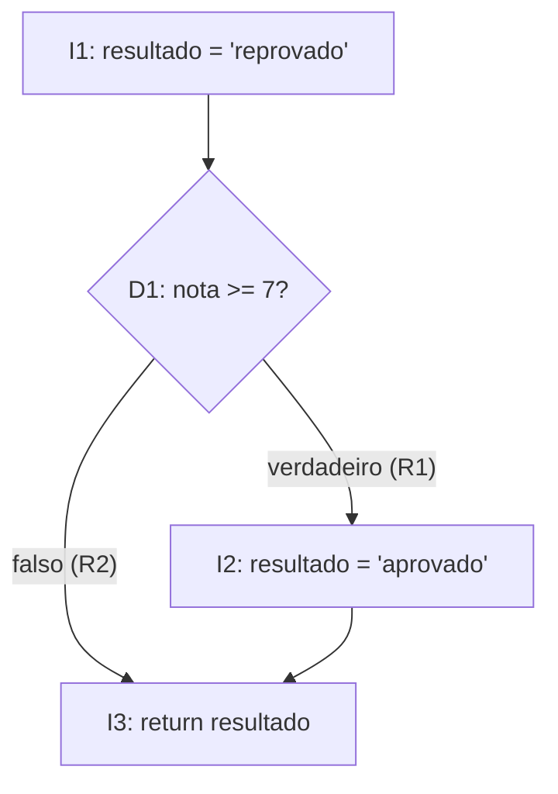
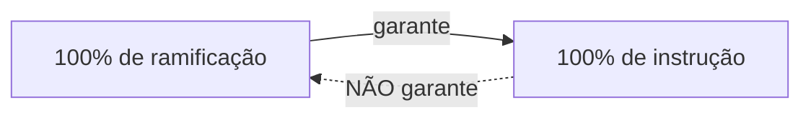

> **Seção 4.3 do syllabus.** Os objetivos são K2 (explicar), mas a prova costuma trazer um trecho de código e perguntar a cobertura.

## Objetivos de aprendizagem

| Código | Nível | O que você precisa saber fazer |
|---|---|---|
| FL-4.3.1 | K2 | Explicar o teste de instrução |
| FL-4.3.2 | K2 | Explicar o teste de ramificação |
| FL-4.3.3 | K2 | Explicar o valor do teste caixa-branca |

## Palavras-chave

Definições do [Glossário ISTQB](https://glossary.istqb.org/pt-br/search/) em português, com uma leitura "em outras palavras" para fixar. Todas podem cair na prova em nível K1.

| Termo | Definição (Glossário ISTQB) | Em outras palavras |
|---|---|---|
| cobertura de instrução | A cobertura das instruções de código-fonte executáveis. | Cada linha executável rodou ao menos uma vez? |
| cobertura de ramificação | A cobertura de ramificações em um gráfico de fluxo de controle. | Cada caminho de cada decisão (if/else, case, loop) foi seguido? 100% ramos ⇒ 100% instruções. |

## Escopo do syllabus

Por serem populares e simples, o syllabus foca em **duas técnicas caixa-branca baseadas em código**:

- teste de instrução
- teste de ramificação

Ficam **fora** da prova: técnicas mais rigorosas usadas em ambientes de segurança crítica ou alta integridade (como MC/DC), técnicas caixa-branca de níveis mais altos (como teste de API) e coberturas que não são de código (como **cobertura de neurônios** em redes neurais).

## Grafo de fluxo de controle

As duas técnicas usam a ideia de **grafo de fluxo de controle**: um desenho que mostra as possíveis sequências em que as instruções do código podem ser executadas. Os nós são blocos de instruções e as setas são as **ramificações** (transferências de controle).

Exemplo de código:

```js
function classificar(nota) {
  let resultado = 'reprovado';      // I1
  if (nota >= 7) {                  // D1 (decisão)
    resultado = 'aprovado';         // I2
  }
  return resultado;                 // I3
}
```



## Teste de instrução (FL-4.3.1)

- **Itens de cobertura**: as **instruções executáveis**.
- Objetivo: projetar casos de teste que executem as instruções até atingir um nível aceitável de cobertura.

```text
cobertura de instrução = instruções executadas / total de instruções executáveis × 100%
```

No exemplo, com **nota = 8**: executa I1, D1 (verdadeiro), I2 e I3. Todas as instruções foram executadas: **100% de cobertura de instrução com um único teste**.

### O que 100% de instrução garante e o que não garante

Garante que **toda instrução executável rodou pelo menos uma vez**. Isso significa que toda instrução com defeito foi executada, o que **pode** causar uma falha que revele o defeito.

Não garante:

- encontrar defeitos que **dependem de dados**. Exemplo do syllabus: uma divisão por zero que só falha quando o denominador é zero. A instrução roda com outro valor e passa.
- testar **toda a lógica de decisão**. No exemplo acima, o teste com nota = 8 nunca exercitou o caminho em que a condição é **falsa**.

## Teste de ramificação (FL-4.3.2)

Uma **ramificação** é uma transferência de controle entre dois nós do grafo. Ela pode ser:

- **incondicional**: código em linha reta, de uma instrução para a próxima
- **condicional**: resultado de uma decisão, como o verdadeiro e o falso de um `if`, cada saída de um `switch/case`, ou a decisão de sair ou continuar num `loop`

```text
cobertura de ramificação = ramificações exercitadas / total de ramificações × 100%
```

No exemplo, as ramificações condicionais são R1 (nota >= 7 verdadeiro) e R2 (falso). Com só **nota = 8**, exercitamos R1 mas não R2. Para 100% de cobertura de ramificação, precisamos de **dois testes**: nota = 8 e nota = 5.

### O que 100% de ramificação garante e o que não garante

Garante que **todas as ramificações**, condicionais e incondicionais, foram exercitadas.

Não garante encontrar defeitos que só aparecem num **caminho específico** pelo código (uma combinação particular de ramificações).

### Ramificação "engloba" instrução

> **Cobertura de ramificação engloba cobertura de instrução.** Qualquer conjunto de testes que atinge 100% de ramificação também atinge 100% de instrução. **O contrário não vale.**



Esse é o ponto mais cobrado da seção 4.3.

## Exercícios resolvidos

### Exercício 1

```js
function frete(valor, premium) {
  let taxa = 20;                  // 1
  if (valor > 200) {              // 2  decisão A
    taxa = 0;                     // 3
  }
  if (premium) {                  // 4  decisão B
    taxa = taxa / 2;              // 5
  }
  return taxa;                    // 6
}
```

**a) Qual o menor número de testes para 100% de instrução?**

**1 teste**: `valor = 300, premium = true`. Executa 1, 2, 3, 4, 5, 6.

**b) E para 100% de ramificação?**

São 4 ramificações condicionais: A verdadeiro, A falso, B verdadeiro, B falso. Cada teste passa por uma saída de A e uma de B. Então **2 testes** bastam:

| Teste | valor | premium | A | B |
|---|---|---|---|---|
| T1 | 300 | true | verdadeiro | verdadeiro |
| T2 | 100 | false | falso | falso |

**c) Com só o T2, qual a cobertura de ramificação considerando só as ramificações condicionais?**

T2 exercita A falso e B falso: 2 de 4 = **50%**.

### Exercício 2: um laço

```js
function soma(lista) {
  let total = 0;
  for (const item of lista) {   // decisão: continuar ou sair do laço
    total += item;
  }
  return total;
}
```

Um teste com `lista = [1, 2]` entra no laço e depois sai dele: exercita as duas saídas da decisão do laço. Já `lista = []` nunca entra no corpo do laço, então não atinge 100% de instrução (`total += item` não roda).

## O valor do teste caixa-branca (FL-4.3.3)

| Ponto forte | Ponto fraco |
|---|---|
| Considera **toda a implementação**, o que ajuda a encontrar defeitos mesmo quando a especificação é **vaga, desatualizada ou incompleta** | Se o software **deixou de implementar** um requisito, o teste caixa-branca pode não perceber: não dá para cobrir código que não existe (Watson, 1996) |

Outros valores citados no syllabus:

- Técnicas caixa-branca podem ser usadas em **teste estático**, por exemplo em **execuções a seco** (*dry runs*) do código. Servem para revisar código que **ainda não está pronto para rodar**, além de **pseudocódigo** e outras lógicas de alto nível que podem ser modeladas num grafo de fluxo de controle.
- Fazer **só teste caixa-preta não dá uma medida real da cobertura de código**. As medidas de cobertura caixa-branca dão uma **medição objetiva**, mostram onde faltam testes e permitem criar testes adicionais para aumentar a cobertura e a confiança no código.

## Teste seu conhecimento

<details>
<summary>1. Um conjunto de testes atinge 100% de cobertura de instrução. Ele necessariamente atinge 100% de ramificação?</summary>

**Não.** O contrário é que vale: 100% de ramificação garante 100% de instrução.

</details>

<details>
<summary>2. Por que 100% de cobertura de instrução pode não encontrar uma divisão por zero?</summary>

Porque o defeito depende de dados. A instrução pode ser executada com um denominador diferente de zero, e aí não falha.

</details>

<details>
<summary>3. Qual é o ponto fraco principal das técnicas caixa-branca?</summary>

Não detectam requisitos que **não foram implementados**, porque só cobrem o código que existe.

</details>

<details>
<summary>4. Um código tem um único if sem else. Quantos testes são necessários para 100% de ramificação?</summary>

**2**: um em que a condição é verdadeira e outro em que é falsa (mesmo que o falso não execute nenhuma instrução extra).

</details>

## Referências

- [Syllabus CTFL v4.0 em português](https://bstqb.online/ctfl) - BSTQB, português (seção 4.3)
- [Test Coverage](https://martinfowler.com/bliki/TestCoverage.html) - Martin Fowler, inglês
- [Glossário ISTQB](https://glossary.istqb.org/pt-br/search/) - ISTQB, português (termos "cobertura de instrução", "cobertura de ramificação")
