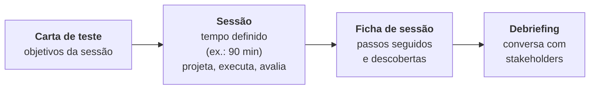

> **Seção 4.4 do syllabus.**

## Objetivos de aprendizagem

| Código | Nível | O que você precisa saber fazer |
|---|---|---|
| FL-4.4.1 | K2 | Explicar a suposição de erro |
| FL-4.4.2 | K2 | Explicar o teste exploratório |
| FL-4.4.3 | K2 | Explicar o teste baseado em lista de verificação |

As três técnicas usam o **conhecimento e a experiência** de quem testa. Elas encontram defeitos que as técnicas caixa-preta e caixa-branca deixam passar e, por isso, **complementam** essas técnicas.

## Palavras-chave

Definições do [Glossário ISTQB](https://glossary.istqb.org/pt-br/search/) em português, com uma leitura "em outras palavras" para fixar. Todas podem cair na prova em nível K1.

| Termo | Definição (Glossário ISTQB) | Em outras palavras |
|---|---|---|
| suposição de erro | Uma técnica de teste na qual as condições de teste são baseadas no conhecimento do testador sobre falhas passadas ou modos de falha. | No glossário atual aparece como **adivinhação de erros**. Ataques de falha são uma forma metódica dela. |
| teste exploratório | Uma abordagem de teste na qual os testes são modelados e executados dinamicamente com base no conhecimento do testador, na exploração de um item de teste e nos resultados de testes anteriores. | Modelar, executar e aprender **ao mesmo tempo**; pode ser em sessões com **carta de teste**. |
| teste baseado em lista de verificação | Uma técnica de teste baseada em experiência na qual os casos de teste são modelados para executar os itens de uma lista de verificação. | Checklist em forma de **perguntas**, sem itens verificáveis automaticamente. |

## Suposição de erro (FL-4.4.1)

**Suposição de erro** (*error guessing*) é prever onde vão aparecer erros, defeitos e falhas, com base no que o testador sabe sobre:

- como a aplicação **funcionou no passado**
- os **tipos de erro** que os desenvolvedores costumam cometer e os defeitos que resultam deles
- as **falhas que aconteceram em aplicações parecidas**

### Onde costumam estar os problemas

O syllabus agrupa erros, defeitos e falhas em categorias. Ao lado, perguntas que um testador experiente faria:

| Categoria | Exemplos do syllabus | Perguntas para testar |
|---|---|---|
| **Entrada** | Entrada correta não aceita, parâmetros errados ou faltando | Aceita nome com acento? E-mail com "+"? Campo vazio? Espaço no fim? |
| **Saída** | Formato errado, resultado errado | A data sai em dd/mm/aaaa? O valor tem duas casas decimais? |
| **Lógica** | Casos faltando, operador errado | E se o cliente for VIP e inadimplente ao mesmo tempo? |
| **Cálculo** | Operando errado, cálculo errado | Arredondamento de centavos fecha a conta? |
| **Interfaces** | Parâmetros incompatíveis, tipos incompatíveis | A API manda o CPF com ou sem pontuação? |
| **Dados** | Inicialização errada, tipo errado | Primeira compra de um cliente sem histórico funciona? |

### Ataques a falhas

**Ataques a falhas** (*fault attacks*) são uma forma **metódica** de aplicar suposição de erro:

1. O testador **cria ou obtém uma lista** de possíveis erros, defeitos e falhas.
2. Projeta testes para **identificar** os defeitos ligados aos erros, **expor** os defeitos ou **provocar** as falhas.

Essas listas podem vir da experiência, de **dados de defeitos e falhas** ou do **conhecimento comum** sobre por que software falha. Os livros de James Whittaker (*How to Break Software*) são a referência clássica.

## Teste exploratório (FL-4.4.2)

No **teste exploratório**, os testes são **projetados, executados e avaliados ao mesmo tempo**, enquanto o testador aprende sobre o objeto de teste. Ele serve para:

- aprender mais sobre o objeto de teste
- explorá-lo mais a fundo com testes focados
- criar testes para áreas ainda não testadas

### Teste baseado em sessões

Às vezes o teste exploratório é estruturado em **sessões**:



- A sessão acontece dentro de um **período definido** (*timebox*).
- O testador usa uma **carta de teste** (*test charter*) com os **objetivos** da sessão para se orientar.
- Os objetivos da carta funcionam como **condições de teste de alto nível**. Os **itens de cobertura são identificados e exercitados durante a sessão**.
- O testador pode usar **fichas de sessão** para registrar os passos e as descobertas.
- Depois da sessão costuma haver uma **reunião de debriefing** com os stakeholders interessados nos resultados.

Exemplo de carta de teste:

> **Explorar** o checkout **com** cupons de desconto combinados (cupom de frete + cupom de produto) **para descobrir** erros de cálculo e mensagens confusas. Tempo: 60 minutos.

### Quando o teste exploratório é útil

- quando há **poucas especificações** ou especificações **ruins**
- quando há **muita pressão de tempo** sobre os testes
- para **complementar** técnicas mais formais

Ele é mais eficaz quando o testador é **experiente**, conhece o **domínio** e tem boas **habilidades essenciais**, como capacidade analítica, curiosidade e criatividade.

E um detalhe que cai: o teste exploratório **pode usar outras técnicas** dentro dele, como particionamento de equivalência. Exploratório não é sinônimo de "testar sem método".

## Teste baseado em lista de verificação (FL-4.4.3)

No **teste baseado em lista de verificação** (*checklist-based testing*), o testador projeta, implementa e executa testes para cobrir as **condições de teste de uma lista**.

### De onde vêm as listas

- da **experiência**
- do conhecimento sobre o que é **importante para o usuário**
- do entendimento de **por que e como o software falha**

### Como deve ser um bom item

- Normalmente é escrito como uma **pergunta**.
- Deve ser possível verificar cada item **separadamente e diretamente**.
- Pode se referir a requisitos, propriedades da interface gráfica, características de qualidade ou outros tipos de condição de teste.

O que **não** deve entrar na lista:

- itens que podem ser verificados **automaticamente** (deixe para uma ferramenta)
- itens que funcionam melhor como **critérios de entrada ou saída**
- itens **gerais demais** ("o sistema funciona bem?")

Listas podem apoiar testes **funcionais e não funcionais**. O exemplo clássico do syllabus são as **10 heurísticas de usabilidade de Nielsen**.

```text
Lista de verificação: formulário de cadastro
[ ] Os campos obrigatórios estão sinalizados antes de enviar?
[ ] A mensagem de erro diz qual campo está errado e como corrigir?
[ ] É possível navegar por todos os campos usando só o teclado?
[ ] O formulário mantém o que foi digitado depois de um erro?
[ ] O botão de enviar fica desabilitado enquanto a requisição está em andamento?
```

### Manutenção das listas

- Alguns itens **perdem eficácia com o tempo**, porque os desenvolvedores aprendem a evitar aqueles erros (lembra do princípio "os testes se degradam"?).
- Pode ser preciso **adicionar itens** para refletir defeitos graves encontrados recentemente.
- Por isso, as listas devem ser **atualizadas regularmente** com base na análise de defeitos, tomando cuidado para elas não ficarem **longas demais**.

### Consistência x variabilidade

Sem casos de teste detalhados, listas de verificação dão **diretrizes** e algum grau de **consistência**. Se a lista for de **alto nível**, cada pessoa vai testar de um jeito um pouco diferente: isso pode dar **mais cobertura**, mas **menos repetibilidade**.

## Comparando as três

| | Suposição de erro | Teste exploratório | Lista de verificação |
|---|---|---|---|
| Ideia central | Prever onde o software vai falhar | Aprender e testar ao mesmo tempo | Cobrir condições de uma lista |
| Artefato típico | Lista de ataques a falhas | Carta de teste, ficha de sessão | Checklist com perguntas |
| Quando brilha | Áreas com histórico de defeitos | Pouca especificação, pouco tempo | Precisa de consistência sem casos detalhados |
| Repetibilidade | Baixa a média | Baixa | Média (depende do nível de detalhe) |

## Teste seu conhecimento

<details>
<summary>1. Em que tipo de teste o projeto, a execução e a avaliação dos testes acontecem ao mesmo tempo?</summary>

**Teste exploratório.**

</details>

<details>
<summary>2. O que é uma carta de teste?</summary>

O documento que traz os **objetivos** de uma sessão de teste exploratório e orienta o testador durante a sessão.

</details>

<details>
<summary>3. Qual destes itens é adequado para uma lista de verificação? (a) "O sistema é bom?" (b) "O código compila sem warnings?" (c) "A mensagem de erro indica qual campo corrigir?" (d) "Todos os testes de regressão passaram?"</summary>

**(c).** (a) é geral demais; (b) pode ser verificado automaticamente; (d) funciona melhor como critério de saída.

</details>

<details>
<summary>4. Um testador monta uma lista com os 20 defeitos mais comuns em sistemas de pagamento e projeta testes para provocar cada um. Que técnica é essa?</summary>

**Suposição de erro**, na forma metódica de **ataques a falhas**.

</details>

## Referências

- [Syllabus CTFL v4.0 em português](https://bstqb.online/ctfl) - BSTQB, português (seção 4.4)
- [10 Usability Heuristics for User Interface Design](https://www.nngroup.com/articles/ten-usability-heuristics/) - Jakob Nielsen, Nielsen Norman Group, inglês
- *Explore It!* - Elisabeth Hendrickson, Pragmatic Bookshelf, 2013 (citado no syllabus), inglês
- *How to Break Software* - James Whittaker, Addison-Wesley, 2002 (citado no syllabus), inglês
