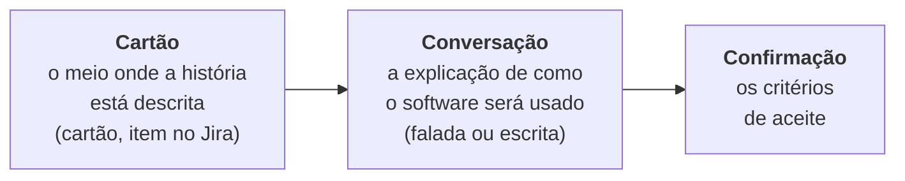
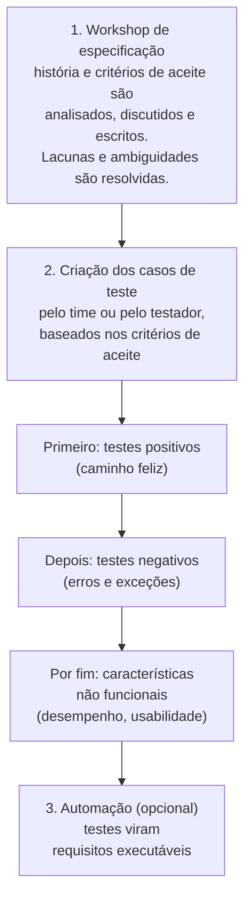

> **Seção 4.5 do syllabus.** O FL-4.5.3 é **K3**: você pode receber uma história e precisar escolher os casos de teste certos.

## Objetivos de aprendizagem

| Código | Nível | O que você precisa saber fazer |
|---|---|---|
| FL-4.5.1 | K2 | Explicar como escrever histórias de usuário em colaboração com desenvolvedores e representantes do negócio |
| FL-4.5.2 | K2 | Classificar as diferentes opções para escrever critérios de aceite |
| FL-4.5.3 | K3 | Usar o desenvolvimento orientado por teste de aceite (ATDD) para derivar casos de teste |

## Palavras-chave

Definições do [Glossário ISTQB](https://glossary.istqb.org/pt-br/search/) em português, com uma leitura "em outras palavras" para fixar. Todas podem cair na prova em nível K1.

| Termo | Definição (Glossário ISTQB) | Em outras palavras |
|---|---|---|
| abordagem de teste baseada na colaboração | Uma abordagem de teste que se concentra na prevenção de defeitos por meio da colaboração entre stakeholders. | Foco em **prevenir**, não em detectar. |
| critérios de aceite | Os critérios que um produto de trabalho deve satisfazer para ser aceito pelos stakeholders. | As condições que dizem "esta história está pronta". |
| desenvolvimento orientado por teste de aceite | Uma abordagem de teste baseada em colaboração que define testes de aceite na linguagem de domínio dos stakeholders. | ATDD: os testes de aceite são escritos **antes** do código. |

## Prevenir em vez de detectar

As técnicas das seções anteriores focam em **detectar** defeitos. As **abordagens baseadas em colaboração** focam também em **evitar** defeitos, por meio de **colaboração e comunicação**. Um mal-entendido resolvido numa conversa antes do código é um defeito que nunca vai existir.

## Escrita colaborativa de histórias de usuário (FL-4.5.1)

Uma **história de usuário** representa uma funcionalidade que tem **valor** para um usuário ou comprador do sistema.

### Os 3C

As histórias têm três aspectos críticos, chamados de **3C** (Jeffries, 2000):



### Formato mais comum

```text
Como [ator ou persona],
quero [objetivo a ser cumprido],
para que [valor de negócio resultante].
```

Seguido dos **critérios de aceite**.

Exemplo:

> Como **cliente da loja**, quero **salvar meu cartão de crédito**, para que **minhas próximas compras sejam mais rápidas**.

### Como a colaboração acontece

- Técnicas como **brainstorming** e **mapas mentais** ajudam na escrita.
- A colaboração dá à equipe uma **visão compartilhada** do que deve ser entregue, considerando **três perspectivas**: **negócio, desenvolvimento e teste** (às vezes chamado de "três amigos").

### INVEST

Boas histórias de usuário seguem o **INVEST**:

| Letra | Significa | Pergunta de checagem |
|---|---|---|
| **I** | Independente | Dá para entregar sem depender de outra história? |
| **N** | Negociável | Os detalhes ainda podem ser conversados? |
| **V** | Valiosa | Entrega valor para alguém? |
| **E** | Estimável | O time consegue estimar o esforço? |
| **S** | Pequena (*Small*) | Cabe numa iteração? |
| **T** | Testável | Dá para saber, de forma objetiva, se está pronta? |

Um alerta do syllabus: se um stakeholder **não sabe como testar** uma história, isso pode indicar que ela **não está clara**, que **não reflete algo valioso** para ele, ou que ele só **precisa de ajuda** para testar (Wake, 2003).

## Critérios de aceite (FL-4.5.2)

**Critérios de aceite** são as condições que a implementação de uma história precisa atender para ser **aceita pelos stakeholders**. Por isso, podem ser vistos como **as condições de teste** que os testes devem exercitar. Normalmente eles nascem da **Conversação**.

Para que servem:

- definir o **escopo** da história
- chegar a um **consenso** entre os stakeholders
- descrever cenários **positivos e negativos**
- servir de **base para o teste de aceite** da história
- permitir **planejamento e estimativa** precisos

### Os dois formatos mais comuns

| Formato | Como é | Exemplo |
|---|---|---|
| **Orientado a cenários** | Formato **Dado/Quando/Então** (*Given/When/Then*), usado no BDD | *Dado* que estou logado com um cartão salvo, *quando* finalizo uma compra, *então* o cartão aparece pré-selecionado |
| **Orientado a regras** | **Lista de verificação** em tópicos, ou **tabela** de entradas e saídas | "O cartão é salvo só com o consentimento do cliente." "Só os 4 últimos dígitos aparecem na tela." "No máximo 3 cartões por cliente." |

A maioria dos critérios cabe num desses dois formatos, mas a equipe pode usar **outro formato**, desde que os critérios sejam **bem definidos e sem ambiguidade**.

## ATDD na prática (FL-4.5.3)

O **ATDD** (desenvolvimento orientado por teste de aceite) é uma abordagem *test-first* (nota [TDD, ATDD e BDD](../02-testes-no-ciclo-de-vida/02-abordagens-test-first.md)): os casos de teste são criados **antes** de implementar a história, por pessoas com **perspectivas diferentes** (clientes, desenvolvedores, testadores). Podem ser executados de forma **manual ou automatizada**.



Regras que o syllabus dá para os casos de teste no ATDD:

- São vistos como **exemplos** de como o software funciona. "Exemplo" e "teste" são usados como **sinônimos**.
- Técnicas de teste das seções 4.2, 4.3 e 4.4 **podem ser aplicadas** na criação.
- A ordem é: **positivos primeiro**, depois **negativos**, por fim **não funcionais**.
- Devem ser **compreensíveis para os stakeholders**: frases em linguagem natural com **pré-condições** (se houver), **entradas** e **pós-condições**.
- Devem cobrir **todas as características da história** e **não ir além dela**.
- **Dois casos de teste não devem descrever a mesma característica.**
- Se escritos num formato compatível com um framework de automação, os desenvolvedores podem automatizá-los enquanto implementam a funcionalidade. Os testes de aceite viram **requisitos executáveis**.

### Exemplo completo

> **História:** Como cliente, quero aplicar um cupom de desconto no carrinho, para pagar menos.
>
> **Critérios de aceite:**
> 1. Cupom válido aplica o desconto percentual sobre o subtotal.
> 2. Cupom expirado é recusado com a mensagem "Cupom expirado".
> 3. Só um cupom por pedido.
> 4. O desconto não se aplica ao frete.

Casos de teste derivados, na ordem do ATDD:

| # | Tipo | Pré-condição | Entrada | Resultado esperado (pós-condição) |
|---|---|---|---|---|
| 1 | Positivo | Carrinho com R$ 200 em produtos e frete de R$ 20 | Cupom DEZ (10%, válido) | Subtotal R$ 180; frete continua R$ 20; total R$ 200 |
| 2 | Negativo | Carrinho com R$ 200 | Cupom VERAO (expirado ontem) | Mensagem "Cupom expirado"; subtotal continua R$ 200 |
| 3 | Negativo | Carrinho com cupom DEZ já aplicado | Cupom CINCO (válido) | Segundo cupom recusado; só DEZ continua aplicado |
| 4 | Não funcional | Carrinho com 50 itens | Cupom DEZ | Desconto aplicado em até 1 segundo |

Repare:

- cada critério de aceite tem pelo menos um caso
- o caso 1 já cobre o critério 4 (frete não muda), sem repetir característica em outro caso
- nenhum caso testa algo fora da história (por exemplo, "cadastrar novo cupom no painel" ficaria de fora)

## Teste seu conhecimento

<details>
<summary>1. O que significa cada C dos 3C?</summary>

**Cartão** (o meio onde a história é descrita), **Conversação** (a explicação de como o software será usado) e **Confirmação** (os critérios de aceite).

</details>

<details>
<summary>2. Critérios escritos como "Dado que... Quando... Então..." estão em qual formato?</summary>

**Orientado a cenários.**

</details>

<details>
<summary>3. No ATDD, em que ordem os casos de teste costumam ser criados?</summary>

Primeiro os **positivos**, depois os **negativos** e por fim os das características **não funcionais**.

</details>

<details>
<summary>4. Um testador escreve, para a história do cupom, um caso de teste que verifica o relatório mensal de cupons usados. Isso segue as regras do ATDD?</summary>

Não. Os casos de teste devem cobrir a história e **não ir além dela**. O relatório mensal não faz parte da história do cupom.

</details>

<details>
<summary>5. O que a letra T do INVEST significa e por que importa para o testador?</summary>

**Testável.** Se ninguém sabe como testar a história, ela provavelmente está mal definida, não tem valor claro, ou o stakeholder precisa de ajuda para testar.

</details>

## Referências

- [Syllabus CTFL v4.0 em português](https://bstqb.online/ctfl) - BSTQB, português (seção 4.5)
- [INVEST in Good Stories, and SMART Tasks](https://xp123.com/articles/invest-in-good-stories-and-smart-tasks/) - Bill Wake, inglês
- [Essential XP: Card, Conversation, Confirmation](https://ronjeffries.com/xprog/articles/expcardconversationconfirmation/) - Ron Jeffries, inglês
- *Bridging the Communication Gap* - Gojko Adzic, Neuri, 2009 (citado no syllabus para ATDD), inglês
- *Specification by Example* - Gojko Adzic, Manning, 2011, inglês
