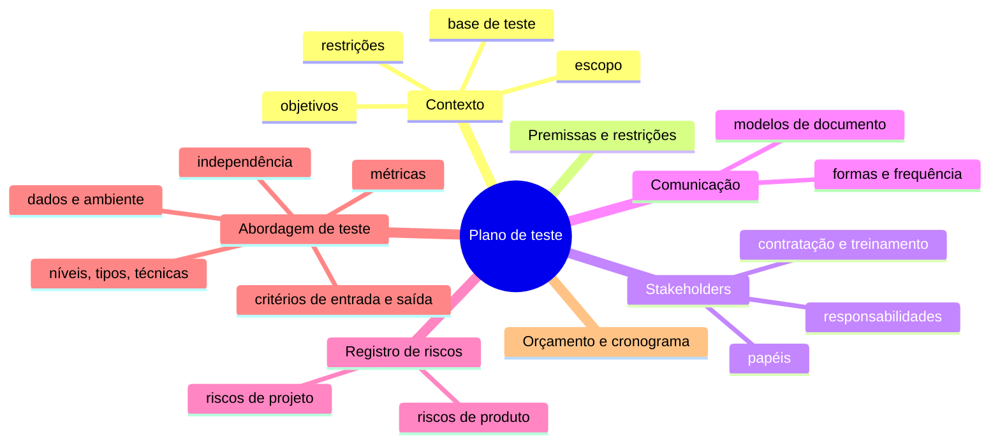

> **Seções 5.1.1, 5.1.2 e 5.1.3 do syllabus.** Capítulo 5 vale **9 questões** na prova.

## Objetivos de aprendizagem

| Código | Nível | O que você precisa saber fazer |
|---|---|---|
| FL-5.1.1 | K2 | Exemplificar a finalidade e o conteúdo de um plano de teste |
| FL-5.1.2 | K1 | Reconhecer como o testador agrega valor ao planejamento de iteração e de liberação |
| FL-5.1.3 | K2 | Comparar e contrastar critérios de entrada e de saída |

## Palavras-chave

Definições do [Glossário ISTQB](https://glossary.istqb.org/pt-br/search/) em português, com uma leitura "em outras palavras" para fixar. Todas podem cair na prova em nível K1.

| Termo | Definição (Glossário ISTQB) | Em outras palavras |
|---|---|---|
| planejamento de teste | Atividade de criação ou atualização de um plano de teste. | É contínuo: o plano é revisto ao longo do projeto. |
| plano de teste | Documentação que descreve os objetivos, os meios e o cronograma dos testes para garantir a coordenação dos mesmos. | O "contrato" do teste: escopo, abordagem, recursos, riscos. |
| abordagem de teste | A forma de realizar as tarefas de teste. | Níveis, tipos, técnicas, entregáveis, critérios... |
| critérios de entrada | O conjunto de condições para iniciar oficialmente uma tarefa definida. | Em ágil, parecido com a **Definition of Ready**. |
| critérios de saída | Um conjunto de condições para a conclusão oficial de uma tarefa definida. | Em ágil, parecido com a **Definition of Done**. |

## Plano de teste (FL-5.1.1)

Um **plano de teste** descreve os **objetivos**, os **recursos** e os **processos** de um projeto de teste.

### Para que serve

- **Documenta** os meios e o **cronograma** para atingir os objetivos do teste.
- Ajuda a garantir que as atividades de teste vão **atender aos critérios estabelecidos**.
- É um **meio de comunicação** com a equipe e os outros stakeholders.
- Demonstra que o teste vai **seguir a política e a estratégia de teste** existentes, ou explica **por que vai se desviar** delas.

E tem um valor que vai além do documento: **planejar faz pensar**. O processo de escrever o plano força os testadores a encarar de frente os desafios de riscos, prazos, pessoas, ferramentas, custos e esforço. Muitas vezes o maior benefício é a conversa, não o arquivo.

### Conteúdo típico

O item mais detalhado é a **abordagem de teste**: níveis, tipos e técnicas de teste, entregáveis, **critérios de entrada e saída**, grau de **independência**, **métricas** a coletar, requisitos de **dados** e de **ambiente** de teste, e eventuais **desvios** da política e da estratégia de teste da organização.

> A norma ISO/IEC/IEEE 29119-3 traz modelos detalhados de plano de teste, mas ela não é examinável.

## O testador no planejamento ágil (FL-5.1.2)

Em SDLCs iterativos, existem dois tipos de planejamento:

| | Planejamento de liberação (*release*) | Planejamento de iteração |
|---|---|---|
| Horizonte | Uma versão do produto | Uma única iteração (sprint) |
| Trabalha sobre | O **backlog do produto** (define e redefine; quebra histórias grandes em menores) | O **backlog da iteração** |
| Base para | A abordagem e o plano de teste de **todas** as iterações | O trabalho da iteração |

O que o testador faz em cada um:

| No planejamento de liberação, o testador... | No planejamento de iteração, o testador... |
|---|---|
| participa da escrita de **histórias e critérios de aceite testáveis** | participa da **análise de risco detalhada** das histórias |
| participa das **análises de risco** de projeto e de qualidade | determina a **testabilidade** das histórias |
| **estima o esforço** de teste das histórias | **divide as histórias em tarefas**, especialmente as de teste |
| define a **abordagem de teste** | **estima o esforço** de todas as tarefas de teste |
| **planeja o teste** da versão | identifica e refina os **aspectos funcionais e não funcionais** do objeto de teste |

## Critérios de entrada e de saída (FL-5.1.3)

- **Critérios de entrada** definem as **pré-condições** para começar uma atividade. Se não forem atendidos, a atividade tende a ser **mais difícil, demorada, cara e arriscada**.
- **Critérios de saída** definem o que precisa ser alcançado para declarar a atividade **concluída**.
- Os dois devem ser definidos **para cada nível de teste** e variam conforme os **objetivos do teste**.

### Exemplos típicos

| Critérios de entrada | Critérios de saída |
|---|---|
| **Recursos disponíveis**: pessoas, ferramentas, ambientes, dados de teste, orçamento, tempo | **Medidas de rigor**: nível de cobertura alcançado, número de defeitos não resolvidos, densidade de defeitos, número de casos de teste que falharam |
| **Testware disponível**: base de teste, requisitos testáveis, histórias de usuário, casos de teste | **Critérios de conclusão**: testes planejados executados, testes estáticos feitos, todos os defeitos encontrados relatados, todos os testes de regressão automatizados |
| **Qualidade inicial do objeto de teste**: por exemplo, todos os **smoke tests** passaram | |

### Tempo ou dinheiro acabou

**Esgotar o tempo ou o orçamento** também pode ser um critério de saída válido. Dá para encerrar os testes mesmo sem atingir os outros critérios, **desde que os stakeholders tenham analisado e aceitado o risco** de ir para produção sem mais testes.

### DoR e DoD no ágil

| Termo ágil | Equivale a | O que define |
|---|---|---|
| **Definição de Preparado** (*Definition of Ready*, **DoR**) | Critérios de **entrada** | O que uma história precisa ter para começar o desenvolvimento e/ou o teste |
| **Definição de Pronto** (*Definition of Done*, **DoD**) | Critérios de **saída** | As métricas objetivas do time para considerar um item liberável |

> **Cuidado com a tradução.** A versão BSTQB do syllabus chama a DoD de "Definição de **Feito**" e a DoR de "Definição de **Pronto**". No dia a dia brasileiro, "Definição de Pronto" costuma ser a DoD. Na prova, guie-se pela sigla em inglês: **DoR = entrada**, **DoD = saída**.

## Teste seu conhecimento

1. "Todos os smoke tests passaram" é um critério de entrada ou de saída?

**Entrada.** Indica o nível de qualidade inicial do objeto de teste antes de começar a atividade.

2. "Cobertura de ramificação de pelo menos 80%" é critério de entrada ou de saída?

**Saída.** É uma medida de rigor que indica quando a atividade pode ser considerada concluída.

3. O prazo acabou, os critérios de cobertura não foram atingidos e o PO decide lançar assumindo o risco. Os testes podem ser encerrados?

Sim. Esgotar tempo ou orçamento pode ser um critério de saída válido, desde que os stakeholders analisem e aceitem o risco.

4. Em qual tipo de planejamento o testador divide histórias em tarefas de teste e estima cada uma?

No **planejamento de iteração**.

5. Em que parte do plano de teste ficam os critérios de entrada e saída?

Na **abordagem de teste**.

## Referências

- [Syllabus CTFL v4.0 em português](https://bstqb.online/ctfl) - BSTQB, português (seções 5.1.1 a 5.1.3)
- [Guia do Scrum 2020](https://scrumguides.org/docs/scrumguide/v2020/2020-Scrum-Guide-PortugueseBR-3.0.pdf) - Ken Schwaber e Jeff Sutherland, português (Definição de Pronto)
- [Glossário ISTQB](https://glossary.istqb.org/pt-br/search/) - ISTQB, português (termos "plano de teste", "critérios de entrada", "critérios de saída")
