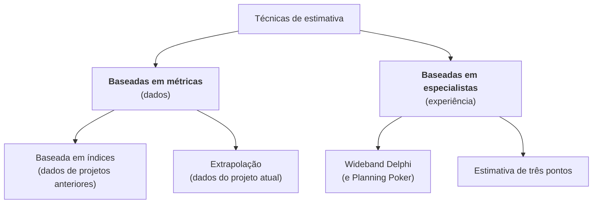
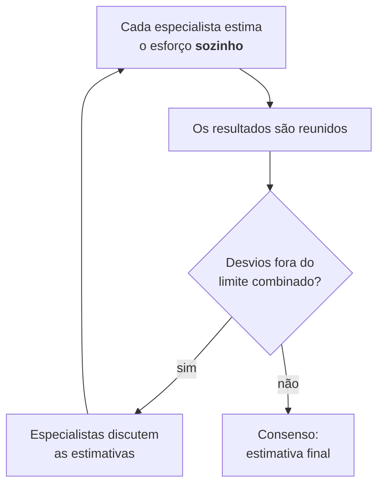

> **Seção 5.1.4 do syllabus.** Objetivo **K3**: espere pelo menos uma conta na prova.

## Objetivo de aprendizagem

| Código | Nível | O que você precisa saber fazer |
|---|---|---|
| FL-5.1.4 | K3 | Usar técnicas de estimativa para calcular o esforço de teste necessário |

## Antes das técnicas

**Estimar o esforço de teste** é prever quanto trabalho de teste será necessário para atingir os objetivos do projeto de teste. Três avisos do syllabus:

- Deixe claro para os stakeholders que a estimativa se baseia em **suposições** e está **sempre sujeita a erro**.
- Estimativas de **tarefas pequenas** costumam ser **mais precisas** que as de tarefas grandes.
- Por isso, uma tarefa grande pode ser **decomposta** em tarefas menores, que são estimadas uma a uma.

## As quatro técnicas



### 1. Estimativa baseada em índices (métrica)

- Usa números de **projetos anteriores da organização** para derivar **proporções padrão** para projetos parecidos.
- As proporções da **própria organização** (dados históricos) costumam ser a **melhor fonte**.

**Exemplo do syllabus:** no projeto anterior, a proporção entre esforço de desenvolvimento e de teste foi **3:2**. No projeto atual, o desenvolvimento deve levar **600 horas-pessoa**. O teste é estimado em:

```text
600 × (2 / 3) = 400 horas-pessoa
```

### 2. Extrapolação (métrica)

- Faz medições **o mais cedo possível no projeto atual** para coletar dados.
- Com observações suficientes, o esforço do trabalho restante é aproximado **extrapolando** esses dados, normalmente com um modelo matemático.
- É muito adequada para **SDLCs iterativos**.

**Exemplo:** a equipe estima o esforço de teste da próxima iteração como a **média das três últimas**. Se as três últimas iterações gastaram 40, 46 e 46 horas de teste:

```text
(40 + 46 + 46) / 3 = 44 horas
```

### 3. Wideband Delphi (especialistas)

Técnica **iterativa** baseada em especialistas:



O **Planning Poker** é uma variante do Wideband Delphi muito usada no ágil. As estimativas são feitas com **cartas numeradas** que representam o tamanho do esforço (muitas vezes em sequência de Fibonacci: 1, 2, 3, 5, 8, 13...).

### 4. Estimativa de três pontos (especialistas)

Os especialistas dão **três estimativas**:

- **o**: a mais **otimista**
- **m**: a mais **provável**
- **p**: a mais **pessimista**

A estimativa final **E** é uma **média ponderada**. Na versão mais popular:

```text
E  = (o + 4m + p) / 6
DP = (p - o) / 6
```

A vantagem é que ela permite calcular o **erro de medição**, o desvio padrão (DP). O resultado se lê como **E ± DP**.

**Exemplo do syllabus:** o = 6, m = 9, p = 18 (horas-pessoa).

```text
E  = (6 + 4×9 + 18) / 6 = (6 + 36 + 18) / 6 = 60 / 6 = 10
DP = (18 - 6) / 6 = 12 / 6 = 2
```

Estimativa final: **10 ± 2 horas-pessoa**, ou seja, entre **8 e 12**.

## Exercícios resolvidos

### Exercício 1: três pontos

> Para testar o novo módulo de relatórios, a equipe estima: otimista 12 dias, mais provável 15 dias, pessimista 24 dias. Qual a estimativa e o intervalo?

```text
E  = (12 + 4×15 + 24) / 6 = (12 + 60 + 24) / 6 = 96 / 6 = 16 dias
DP = (24 - 12) / 6 = 2 dias
```

**16 ± 2 dias**, entre 14 e 18.

### Exercício 2: baseada em índices

> Em projetos anteriores, o teste consumiu 25% do esforço total do projeto. O projeto novo tem esforço total estimado em 2.000 horas. Qual a estimativa de teste?

```text
2.000 × 0,25 = 500 horas
```

Cuidado com a variação da pergunta: se o enunciado disser que **teste é 25% do esforço de desenvolvimento** e o desenvolvimento é 2.000 horas, a conta é a mesma (500), mas se disser que **desenvolvimento e teste estão na proporção 3:1** e o desenvolvimento é 2.000 horas, o teste é 2.000 / 3 ≈ 667 horas. Leia qual é a base da proporção.

### Exercício 3: identificar a técnica

> Cada membro do time mostra ao mesmo tempo uma carta com sua estimativa. Quem deu os valores mais alto e mais baixo explica o raciocínio, e todos votam de novo até convergir. Que técnica é essa?

**Planning Poker**, uma variante do **Wideband Delphi**.

## Resumo das técnicas

| Técnica | Tipo | Fonte dos dados | Quando usar |
|---|---|---|---|
| Baseada em índices | Métrica | Projetos **anteriores** da organização | Há histórico de projetos parecidos |
| Extrapolação | Métrica | O **projeto atual**, medido cedo | SDLCs iterativos |
| Wideband Delphi | Especialistas | Estimativas individuais, discutidas até o consenso | Pouco dado histórico, especialistas disponíveis |
| Três pontos | Especialistas | Otimista, provável e pessimista | Quando se quer um intervalo de erro |

## Teste seu conhecimento

<details>
<summary>1. Com o = 4, m = 7 e p = 16, qual é a estimativa de três pontos e o desvio?</summary>

E = (4 + 28 + 16) / 6 = 48 / 6 = **8**. DP = (16 - 4) / 6 = **2**. Resultado: 8 ± 2.

</details>

<details>
<summary>2. Qual técnica usa a média das últimas iterações para estimar a próxima?</summary>

**Extrapolação.**

</details>

<details>
<summary>3. O Planning Poker é variante de qual técnica?</summary>

**Wideband Delphi.**

</details>

<details>
<summary>4. Por que decompor uma tarefa grande antes de estimar?</summary>

Porque estimativas de tarefas pequenas costumam ser mais precisas do que as de tarefas grandes.

</details>

## Referências

- [Syllabus CTFL v4.0 em português](https://bstqb.online/ctfl) - BSTQB, português (seção 5.1.4)
- [Planning Poker](https://www.mountaingoatsoftware.com/agile/planning-poker) - Mike Cohn, Mountain Goat Software, inglês
- [Glossário ISTQB](https://glossary.istqb.org/pt-br/search/) - ISTQB, português (termos "Wideband Delphi", "estimativa de três pontos")
