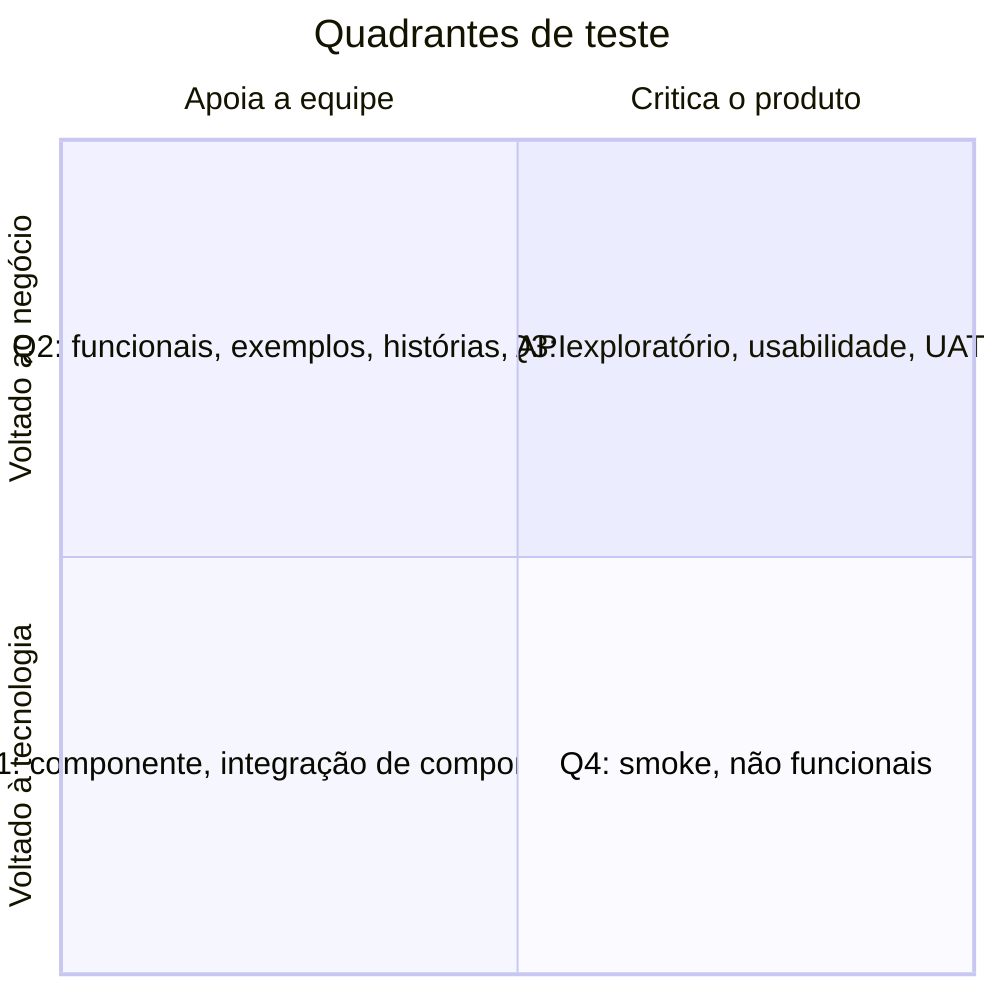

> **Seções 5.1.5, 5.1.6 e 5.1.7 do syllabus.** O FL-5.1.5 é **K3**: espere uma questão de "qual é a ordem de execução".

## Objetivos de aprendizagem

| Código | Nível | O que você precisa saber fazer |
|---|---|---|
| FL-5.1.5 | K3 | Aplicar a priorização de casos de teste |
| FL-5.1.6 | K1 | Relembrar os conceitos da pirâmide de teste |
| FL-5.1.7 | K2 | Resumir os quadrantes de teste e sua relação com níveis e tipos de teste |

## Palavras-chave

Definições do [Glossário ISTQB](https://glossary.istqb.org/pt-br/search/) em português, com uma leitura "em outras palavras" para fixar. Todas podem cair na prova em nível K1.

| Termo | Definição (Glossário ISTQB) | Em outras palavras |
|---|---|---|
| pirâmide de teste | Um modelo gráfico representando a relação da quantidade de testes por nível, com um número maior na base do que no ponto mais elevado. | Base: muitos testes pequenos, rápidos e isolados; topo: poucos testes E2E lentos. |
| quadrantes de teste | Um modelo de classificação de tipos/níveis de teste em quatro quadrantes, relacionando-os em duas dimensões de objetivos de teste: apoio à equipe versus crítica ao produto, e orientado para a tecnologia versus orientado ao negócio. | Modelo de Brian Marick (Q1 a Q4). |

## Priorização de casos de teste (FL-5.1.5)

Depois que casos e procedimentos de teste estão prontos e agrupados em suítes, eles são organizados num **cronograma de execução**, que define **em que ordem** rodar. As estratégias mais comuns:

| Estratégia | Ordem de execução | Executa primeiro |
|---|---|---|
| **Baseada em risco** | Pelos resultados da **análise de risco** | Os testes que cobrem os **riscos mais importantes** |
| **Baseada em cobertura** | Pela **cobertura** que cada teste atinge (ex.: de instrução) | Os testes com **maior cobertura** |
| **Cobertura adicional** (variante da anterior) | O primeiro é o de maior cobertura; cada próximo é o que traz **mais cobertura nova** | O de maior cobertura, depois o que mais **acrescenta** |
| **Baseada em requisitos** | Pela **prioridade dos requisitos** (definida pelos stakeholders) ligados a cada teste | Os testes dos **requisitos mais importantes** |

### Duas restrições que mudam a ordem

1. **Dependências.** Se um teste de prioridade **alta** depende de um teste de prioridade **baixa**, o de prioridade baixa precisa rodar **antes**.
2. **Disponibilidade de recursos.** Ferramentas, ambientes ou pessoas que só estão disponíveis em certos horários também afetam a ordem.

### Exercício resolvido: prioridade com dependências

> Prioridade 1 é a mais alta. Determine a ordem de execução.

| Caso | Prioridade | Depende de |
|---|---|---|
| CT1 | 3 | - |
| CT2 | 1 | CT4 |
| CT3 | 2 | - |
| CT4 | 4 | - |
| CT5 | 1 | - |

Raciocínio:

1. Os de prioridade 1 são CT2 e CT5. CT5 não depende de ninguém, então pode ir primeiro. CT2 depende de CT4, então **CT4 precisa vir antes de CT2**, mesmo tendo a prioridade mais baixa.
2. Depois vêm CT3 (prioridade 2) e CT1 (prioridade 3).

Ordem: **CT5 → CT4 → CT2 → CT3 → CT1** (CT4 → CT5 → CT2 → CT3 → CT1 também respeita as regras).

### Exercício resolvido: cobertura adicional

> Um sistema tem os requisitos R1 a R5. Os testes cobrem:
> T1: R1, R2, R3 | T2: R3, R4 | T3: R4, R5 | T4: R1

- Primeiro: **T1** (cobre 3, o maior).
- Faltam R4 e R5. T2 acrescenta só R4 (1 novo); T3 acrescenta R4 e R5 (2 novos); T4 acrescenta 0. Segundo: **T3**.
- Agora tudo está coberto. T2 e T4 não acrescentam nada; seguem depois, em qualquer ordem combinada.

Ordem por cobertura adicional: **T1 → T3 → T2/T4**. Repare que, pela cobertura simples (sem "adicional"), a ordem seria T1, depois T2 ou T3 (empatados com 2).

## Pirâmide de teste (FL-5.1.6)

A **pirâmide de teste** é um modelo que mostra que **testes diferentes têm granularidades diferentes**. Ela ajuda a equipe a decidir a **automação** e a **distribuição do esforço** de teste.

```text
                 /\
                /  \        Ponta a ponta / UI
               /    \       poucos, lentos, cobrem muita funcionalidade
              /------\
             /        \     Integração / serviço
            /          \
           /------------\
          /              \  Unidade / componente
         /                \ muitos, rápidos, isolados, cobrem um pedaço pequeno
        /------------------\
```

- **Camadas de baixo**: testes **pequenos, isolados e rápidos**, que verificam uma parte pequena da funcionalidade. Por isso, são necessários **muitos** para ter uma cobertura razoável.
- **Camadas de cima**: testes **complexos, de alto nível, ponta a ponta**. São **mais lentos** e cada um verifica uma parte grande da funcionalidade, então bastam **poucos**.
- Quanto mais alto, **menos isolado** e **mais lento** é o teste, e maior é o pedaço do sistema que ele cobre.

O **número e o nome das camadas variam**:

| Modelo | Camadas (de baixo para cima) |
|---|---|
| Original de Mike Cohn (2009) | Testes de unidade, testes de serviço, testes de interface do usuário |
| Outro modelo popular | Testes de unidade (componente), de integração (integração de componentes), ponta a ponta |

Outros níveis de teste também podem aparecer como camadas.

## Quadrantes de teste (FL-5.1.7)

Os **quadrantes de teste**, definidos por **Brian Marick** (e popularizados por Lisa Crispin e Janet Gregory), relacionam **níveis de teste** com **tipos de teste**, atividades, técnicas e produtos de trabalho no **desenvolvimento ágil**.

Para que servem:

- ajudam o gerenciamento a **visualizar** se todos os tipos e níveis de teste adequados estão no SDLC
- mostram que **alguns tipos de teste fazem mais sentido em certos níveis**
- dão um **vocabulário** para explicar os tipos de teste a todos os stakeholders (devs, testadores, negócio)

Os dois eixos:

- **Voltado ao negócio** x **voltado à tecnologia**
- **Apoia a equipe** (orienta o desenvolvimento) x **critica o produto** (mede o comportamento em relação às expectativas)



| Quadrante | Eixos | O que contém | Execução típica |
|---|---|---|---|
| **Q1** | Tecnologia + apoia a equipe | Testes de **componente** e de **integração de componentes** | **Automatizados**, incluídos na **CI** |
| **Q2** | Negócio + apoia a equipe | Testes **funcionais**, **exemplos**, testes de **histórias de usuário**, **protótipos** de experiência do usuário, testes de **API**, **simulações**. Verificam os **critérios de aceite** | **Manuais ou automatizados** |
| **Q3** | Negócio + critica o produto | Testes **exploratórios**, de **usabilidade** e de **aceite do usuário** (UAT). Orientados ao usuário | Normalmente **manuais** |
| **Q4** | Tecnologia + critica o produto | **Smoke tests** e testes **não funcionais** (exceto usabilidade) | Normalmente **automatizados** |

Pegadinhas comuns:

- **Usabilidade é Q3**, não Q4, mesmo sendo não funcional.
- **Teste de API é Q2** (apoia a equipe, voltado ao negócio).
- **Smoke test é Q4.**

## Teste seu conhecimento

<details>
<summary>1. Um teste de prioridade alta depende de um teste de prioridade baixa. Qual roda primeiro?</summary>

O de **prioridade baixa**, porque o de prioridade alta depende dele.

</details>

<details>
<summary>2. Em qual quadrante ficam os testes de desempenho?</summary>

**Q4** (voltado à tecnologia, critica o produto).

</details>

<details>
<summary>3. Em qual quadrante ficam os testes de usabilidade?</summary>

**Q3** (voltado ao negócio, critica o produto). É a exceção entre os não funcionais.

</details>

<details>
<summary>4. Por que a base da pirâmide tem mais testes que o topo?</summary>

Porque os testes de baixo são pequenos e isolados e cobrem pouca funcionalidade cada um, então são necessários muitos para uma cobertura razoável. Os de cima cobrem bastante funcionalidade cada um, mas são lentos.

</details>

<details>
<summary>5. Qual é a diferença entre priorização por cobertura e por cobertura adicional?</summary>

Na por cobertura, os testes são ordenados pela cobertura total de cada um. Na por cobertura adicional, depois do primeiro, o próximo é sempre o que acrescenta mais cobertura **nova** ao que já foi coberto.

</details>

## Referências

- [Syllabus CTFL v4.0 em português](https://bstqb.online/ctfl) - BSTQB, português (seções 5.1.5 a 5.1.7)
- [Test Pyramid](https://martinfowler.com/bliki/TestPyramid.html) - Martin Fowler, inglês
- [Agile Testing Directions: tests and examples](http://www.exampler.com/old-blog/2003/08/22/#agile-testing-project-2) - Brian Marick, inglês (origem dos quadrantes)
- *Agile Testing* - Lisa Crispin e Janet Gregory, Addison-Wesley, 2008 (citado no syllabus), inglês
