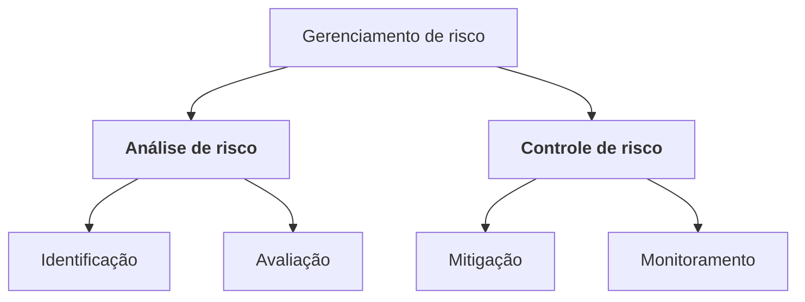

> **Seção 5.2 do syllabus.**

## Objetivos de aprendizagem

| Código | Nível | O que você precisa saber fazer |
|---|---|---|
| FL-5.2.1 | K1 | Identificar o nível de risco usando probabilidade e impacto |
| FL-5.2.2 | K2 | Distinguir riscos de projeto e riscos de produto |
| FL-5.2.3 | K2 | Explicar como a análise de risco do produto influencia o rigor e o escopo dos testes |
| FL-5.2.4 | K2 | Explicar quais medidas podem ser tomadas em resposta aos riscos de produto analisados |

## Palavras-chave

Definições do [Glossário ISTQB](https://glossary.istqb.org/pt-br/search/) em português, com uma leitura "em outras palavras" para fixar. Todas podem cair na prova em nível K1.

| Termo | Definição (Glossário ISTQB) | Em outras palavras |
|---|---|---|
| risco | Um fator que pode resultar em consequências negativas. | Tem **probabilidade** e **impacto**. |
| nível de risco | A medida de um risco definida pelo impacto e pela probabilidade de sua ocorrência. | Quantitativo: probabilidade × impacto. |
| risco de projeto | Um risco que afeta o sucesso do projeto. | Prazo, pessoas, fornecedores, ferramentas. |
| risco de produto | Um risco que afeta a qualidade de um produto. | Funcionalidade faltando, cálculo errado, lentidão... |
| gerenciamento de risco | O processo para lidar com os riscos. | = análise de risco + controle de risco. |
| análise de risco | O processo global de identificação e avaliação de riscos. | = identificação + avaliação. |
| identificação de risco | O processo de encontrar, reconhecer e descrever riscos. | Brainstorming, workshops, entrevistas, causa-efeito. |
| avaliação de risco | O processo para examinar e determinar o nível dos riscos identificados. | Categorizar, priorizar e propor tratamento. |
| controle de risco | O processo geral de mitigação e monitoramento de risco. | = mitigação + monitoramento. |
| mitigação de risco | O processo pelo qual as decisões são tomadas e medidas de proteção são implementadas para reduzir ou manter os riscos em níveis específicos. | Testar é uma forma de mitigar; também há aceitar, transferir, plano de contingência. |
| monitoramento de risco | A atividade que verifica e informa o status dos riscos conhecidos aos stakeholders. | Acompanhar se a mitigação funcionou e se surgiram riscos novos. |
| teste baseado em risco | Uma abordagem de teste na qual o gerenciamento, a seleção, a priorização e o uso de atividades e recursos de teste são baseados nos tipos e níveis de risco correspondentes. | Mais risco → mais (e antes) teste. |

## Por que gerenciar riscos

Toda organização lida com fatores internos e externos que tornam **incerto** se e quando ela vai atingir seus objetivos (ISO 31000). Gerenciar riscos **aumenta a chance de atingir os objetivos**, **melhora a qualidade** dos produtos e **aumenta a confiança** dos stakeholders.

As atividades principais:



Quando as atividades de teste são **selecionadas, priorizadas e gerenciadas com base na análise e no controle de riscos**, a abordagem se chama **teste baseado em risco**.

## Risco, probabilidade e impacto (FL-5.2.1)

**Risco** é um possível evento, perigo, ameaça ou situação cuja ocorrência causa um **efeito adverso**. Um risco tem dois fatores:

- **Probabilidade**: a chance de o risco acontecer. É sempre **maior que zero e menor que um**. Se fosse zero, não seria risco; se fosse um, já seria um problema certo.
- **Impacto** (dano): as consequências se ele acontecer.

Juntos, os dois expressam o **nível de risco**. Quanto maior o nível, mais importante é tratar o risco.

### Abordagem quantitativa

```text
nível de risco = probabilidade × impacto
```

Exemplo: probabilidade 0,4 e impacto estimado em R$ 50.000 → nível de risco de R$ 20.000.

### Abordagem qualitativa: matriz de risco

| Probabilidade \ Impacto | Baixo | Médio | Alto |
|---|---|---|---|
| **Alta** | Médio | Alto | **Crítico** |
| **Média** | Baixo | Médio | Alto |
| **Baixa** | Baixo | Baixo | Médio |

As duas abordagens podem ser combinadas.

## Riscos de projeto e riscos de produto (FL-5.2.2)

Essa distinção cai em toda prova. A pergunta-chave: **o risco ameaça o projeto (prazo, custo, escopo) ou a qualidade do produto?**

| | Risco de projeto | Risco de produto |
|---|---|---|
| Ligado a | **Gerenciamento e controle do projeto** | **Características de qualidade do produto** (ISO 25010) |
| Se acontecer, afeta | **Cronograma, orçamento ou escopo** | Usuários, receita, reputação, terceiros |
| Exemplos | Atrasos na entrega, estimativas ruins, cortes de custo, falta de pessoal, conflitos, ferramentas sem suporte, fornecedor que falha ou vai à falência | Funcionalidade faltando ou errada, cálculo incorreto, erro em tempo de execução, arquitetura ruim, algoritmo ineficiente, tempo de resposta ruim, má experiência de uso, vulnerabilidade de segurança |

### Riscos de projeto, por categoria

| Categoria | Exemplos |
|---|---|
| **Organizacionais** | Atraso na entrega de produtos de trabalho, estimativas imprecisas, corte de custos |
| **De pessoal** | Habilidades insuficientes, conflitos, problemas de comunicação, falta de gente |
| **Técnicos** | *Scope creep* (desvio de escopo), suporte ruim de ferramentas |
| **De fornecedores** | Terceiro que não entrega, empresa parceira que vai à falência |

### Consequências de riscos de produto

- insatisfação do usuário
- perda de receita, confiança e reputação
- danos a terceiros
- custos altos de manutenção e sobrecarga do suporte
- penalidades criminais
- em casos extremos, danos físicos, lesões ou morte

> **Pegadinha clássica:** "o ambiente de teste vai atrasar duas semanas" é risco de **projeto**, mesmo envolvendo teste. "O sistema pode calcular o imposto errado" é risco de **produto**.

## Análise de risco do produto (FL-5.2.3)

Do ponto de vista do teste, o objetivo é **ter consciência dos riscos de produto** para **concentrar o esforço de teste** de forma a **minimizar o risco residual**. O ideal é começar **cedo** no SDLC.

### Identificação de riscos

Gerar uma **lista abrangente** de riscos. Técnicas: **brainstorming**, **workshops**, **entrevistas**, **diagramas de causa e efeito** (espinha de peixe).

### Avaliação de riscos

- **categorizar** os riscos (riscos da mesma categoria costumam ser mitigados de forma parecida)
- determinar **probabilidade, impacto e nível** de cada um
- **priorizar**
- **propor formas de tratá-los**

### Como a análise influencia o teste

Os resultados da análise de risco do produto são usados para:

1. definir o **escopo** dos testes
2. definir os **níveis de teste** e propor os **tipos de teste**
3. definir as **técnicas de teste** e a **cobertura** a atingir
4. **estimar o esforço** de cada tarefa de teste
5. **priorizar** os testes para encontrar defeitos críticos o mais cedo possível
6. decidir se outras atividades, **além de teste**, podem reduzir o risco

Na prática: um módulo de pagamento com risco alto recebe mais técnicas, mais cobertura, testadores mais experientes e é testado primeiro. A tela "Sobre nós" recebe um teste rápido no fim.

## Controle de risco do produto (FL-5.2.4)

O **controle de risco** inclui todas as medidas tomadas em resposta aos riscos identificados e avaliados. São duas partes:

- **Mitigação**: implementar as ações propostas na avaliação para **reduzir o nível de risco**.
- **Monitoramento**: garantir que a mitigação está **funcionando**, obter informações para **melhorar a avaliação** e identificar **riscos novos**.

### Opções de resposta a um risco

| Resposta | O que é | Exemplo |
|---|---|---|
| **Mitigar por meio de teste** | Testar para reduzir a probabilidade ou o impacto | Teste de carga extenso antes da Black Friday |
| **Aceitar** | Assumir o risco conscientemente | Lançar com um defeito conhecido de baixo impacto |
| **Transferir** | Passar o risco para outra parte | Contratar seguro, ou terceirizar o processamento de cartões para um gateway certificado |
| **Plano de contingência** | Preparar o que fazer se o risco acontecer | Plano de rollback pronto caso a nova versão falhe em produção |

### Ações de mitigação por meio de teste

O syllabus lista seis:

1. escolher **testadores com experiência e habilidade adequadas** ao tipo de risco
2. aplicar um **nível adequado de independência** de teste
3. fazer **revisões** e **análise estática**
4. aplicar **técnicas de teste e níveis de cobertura** adequados
5. aplicar os **tipos de teste** que tratam as características de qualidade afetadas
6. fazer **teste dinâmico**, incluindo **teste de regressão**

## Teste seu conhecimento

<details>
<summary>1. "A única especialista em automação do time pode sair da empresa no meio do projeto." Risco de projeto ou de produto?</summary>

**Projeto** (problema de pessoal). Afeta prazo e capacidade do projeto, não diretamente a qualidade do produto.

</details>

<details>
<summary>2. "O app pode demorar mais de 5 segundos para abrir em celulares antigos." Risco de projeto ou de produto?</summary>

**Produto** (característica de qualidade: eficiência de desempenho).

</details>

<details>
<summary>3. Por que a probabilidade de um risco não pode ser 1?</summary>

Porque probabilidade 1 significa que o evento vai acontecer com certeza. Aí não é mais um risco, é um problema (ou um fato) a tratar.

</details>

<details>
<summary>4. A empresa contrata um seguro contra vazamento de dados. Qual resposta ao risco é essa?</summary>

**Transferência** do risco.

</details>

<details>
<summary>5. Quais são as duas atividades da análise de risco e as duas do controle de risco?</summary>

Análise: **identificação** e **avaliação**. Controle: **mitigação** e **monitoramento**.

</details>

## Referências

- [Syllabus CTFL v4.0 em português](https://bstqb.online/ctfl) - BSTQB, português (seção 5.2)
- [ISO 31000 - Risk management](https://www.iso.org/iso-31000-risk-management.html) - ISO, inglês
- [Glossário ISTQB](https://glossary.istqb.org/pt-br/search/) - ISTQB, português (termos "risco de produto", "risco de projeto", "teste baseado em risco")
