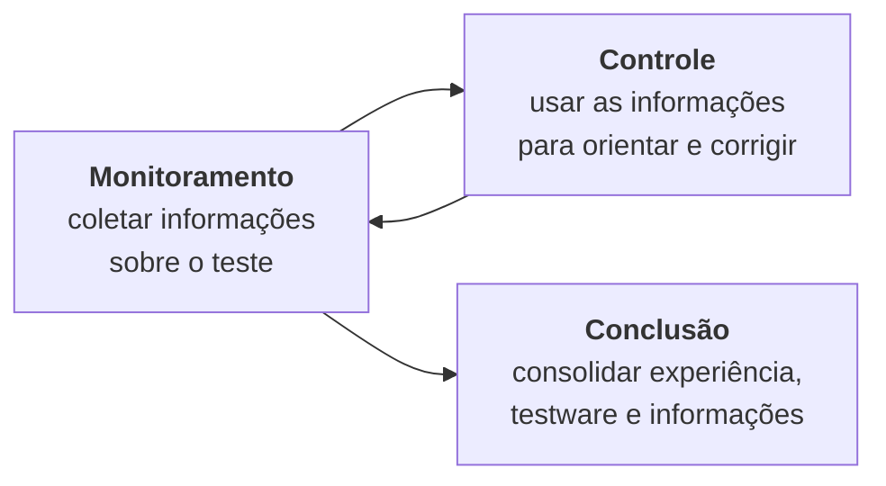

> **Seção 5.3 do syllabus.**

## Objetivos de aprendizagem

| Código | Nível | O que você precisa saber fazer |
|---|---|---|
| FL-5.3.1 | K1 | Relembrar métricas usadas em testes |
| FL-5.3.2 | K2 | Resumir a finalidade, o conteúdo e o público dos relatórios de teste |
| FL-5.3.3 | K2 | Exemplificar como comunicar o status do teste |

## Palavras-chave

Definições do [Glossário ISTQB](https://glossary.istqb.org/pt-br/search/) em português, com uma leitura "em outras palavras" para fixar. Todas podem cair na prova em nível K1.

| Termo | Definição (Glossário ISTQB) | Em outras palavras |
|---|---|---|
| monitoramento de teste | A atividade que verifica o status das atividades de teste, identifica quaisquer desvios do planejado ou esperado e relata o status aos stakeholders. | Coletar informação. |
| controle de teste | A atividade que desenvolve e aplica ações corretivas para colocar um projeto de teste no caminho certo quando ele se desvia do que foi planejado. | Usar a informação para agir. |
| relatório de progresso de teste | Um tipo de relatório de teste periódico que inclui o progresso das atividades de teste em relação a um baseline, aos riscos e as alternativas que exigem uma decisão. | **Durante** o teste, periódico. |
| relatório de conclusão de teste | Um tipo de relatório de teste produzido em marcos de conclusão que fornece uma avaliação dos itens de teste correspondentes em relação aos critérios de saída. | **No fim**; no glossário atual aparece como _relatório de resumo de teste_. |

## Monitoramento, controle e conclusão



### Monitoramento

Coleta **informações sobre o teste**. Elas servem para avaliar o **progresso** e para medir se os **critérios de saída** (ou as tarefas ligadas a eles) foram atendidos, como as metas de **cobertura** de riscos, requisitos ou critérios de aceite.

### Controle

Usa as informações do monitoramento para dar orientação e **ações corretivas**, na forma de **diretrizes de controle**, buscando testes mais eficazes e eficientes. Exemplos do syllabus:

- **repriorizar** os testes quando um risco identificado vira um problema
- **reavaliar** se um item de teste atende aos critérios de entrada ou saída por causa de retrabalho
- **ajustar o cronograma** de teste por causa de um atraso na entrega do ambiente
- **adicionar recursos** quando e onde for necessário

### Conclusão

Coleta dados das atividades de teste concluídas para **consolidar a experiência**, o **testware** e outras informações relevantes. Acontece nos **marcos**:

- um nível de teste termina
- uma iteração ágil termina
- um projeto de teste é concluído (ou **cancelado**)
- um sistema é lançado
- uma versão de manutenção é concluída

## Métricas de teste (FL-5.3.1)

As métricas mostram o **progresso** em relação ao cronograma e ao orçamento, a **qualidade atual** do objeto de teste e a **eficácia** das atividades de teste em relação aos objetivos.

| Categoria | Exemplos |
|---|---|
| **Progresso do projeto** | Conclusão de tarefas, uso de recursos, esforço de teste |
| **Progresso do teste** | Progresso da implementação dos casos, preparação do ambiente, casos executados/não executados, passaram/falharam, tempo de execução |
| **Qualidade do produto** | Disponibilidade, tempo de resposta, tempo médio até a falha (MTTF) |
| **Defeitos** | Número e prioridade dos defeitos encontrados/corrigidos, densidade de defeitos, percentual de detecção de defeitos |
| **Risco** | Nível de risco residual |
| **Cobertura** | Cobertura de requisitos, cobertura de código |
| **Custo** | Custo do teste, custo organizacional da qualidade |

Duas métricas que costumam aparecer com fórmula:

```text
densidade de defeitos = número de defeitos / tamanho (ex.: por mil linhas de código ou por ponto de função)

percentual de detecção de defeitos (DDP) =
    defeitos encontrados pelo teste / (defeitos encontrados pelo teste + defeitos encontrados depois, em produção) × 100%
```

Exemplo de DDP: o teste encontrou 90 defeitos e os usuários encontraram mais 10 em produção. DDP = 90 / 100 = 90%.

## Relatórios de teste (FL-5.3.2)

Relatórios **resumem e comunicam** as informações do teste **durante e depois** do teste.

| | Relatório de progresso | Relatório de conclusão |
|---|---|---|
| Quando | **Durante** o teste, com regularidade (diário, semanal) | **No fim** de um projeto, nível ou tipo de teste, de preferência quando os critérios de saída foram atendidos |
| Para que serve | Apoiar o **controle contínuo**; dar informação para mudar cronograma, recursos ou plano | **Resumir** um estágio do teste e informar testes futuros |
| Conteúdo típico | Período do teste; progresso (adiantado ou atrasado) e desvios notáveis; impedimentos e soluções; métricas; riscos novos ou alterados; testes planejados para o próximo período | Resumo do teste; avaliação da qualidade do produto com base no plano original (objetivos e critérios de saída); desvios do plano (cronograma, duração, esforço); impedimentos e contornos; métricas; riscos não mitigados e defeitos não corrigidos; lições aprendidas |
| Fonte | Dados do monitoramento | Relatórios de progresso e outros dados |

> Na ISO/IEC/IEEE 29119-3, o relatório de progresso é chamado de **relatório de status de teste**.

### O público muda o relatório

Públicos diferentes precisam de informações diferentes, e isso afeta a **formalidade** e a **frequência**:

- relatório de progresso **para o próprio time**: frequente e informal
- relatório de um **projeto concluído**: segue um modelo definido e acontece uma vez só

Um diretor quer saber "podemos lançar e com qual risco?". O time quer saber "quais testes falharam hoje e por quê?".

## Comunicando o status (FL-5.3.3)

O melhor meio depende das preocupações do gerenciamento, das estratégias de teste da organização, de normas regulatórias ou, em times auto-organizados, do próprio time. Opções:

| Meio | Exemplo |
|---|---|
| **Comunicação verbal** | Daily, conversa com o PO |
| **Painéis** | Painel de CI/CD, quadro de tarefas, gráfico de burndown |
| **Canais eletrônicos** | E-mail, chat |
| **Documentação on-line** | Página na wiki do time |
| **Relatórios formais** | Relatório de conclusão de teste |

Pontos que caem:

- Dá para usar **um ou mais** meios ao mesmo tempo.
- Comunicação **mais formal** costuma ser mais adequada para **times distribuídos**, em que o contato face a face nem sempre é possível por distância ou fuso horário.
- Stakeholders diferentes se interessam por informações diferentes, então a comunicação deve ser **adaptada** a cada um.

## Teste seu conhecimento

<details>
<summary>1. O ambiente de homologação atrasou e o líder de teste ajusta o cronograma. Isso é monitoramento ou controle?</summary>

**Controle.** Ajustar o cronograma por causa de atraso no ambiente é um exemplo de diretriz de controle do syllabus.

</details>

<details>
<summary>2. "Tempo médio até a falha" é uma métrica de qual categoria?</summary>

**Qualidade do produto.**

</details>

<details>
<summary>3. Lições aprendidas aparecem tipicamente em qual relatório?</summary>

No **relatório de conclusão** de teste.

</details>

<details>
<summary>4. O teste encontrou 45 defeitos e 5 foram encontrados em produção. Qual é o percentual de detecção de defeitos?</summary>

45 / (45 + 5) = 45 / 50 = **90%**.

</details>

<details>
<summary>5. Um time distribuído em três fusos horários quer comunicar o status dos testes. Que tipo de comunicação o syllabus sugere?</summary>

Uma comunicação **mais formal** (por exemplo, relatórios e documentação on-line), já que a conversa face a face nem sempre é possível.

</details>

## Referências

- [Syllabus CTFL v4.0 em português](https://bstqb.online/ctfl) - BSTQB, português (seção 5.3)
- [Glossário ISTQB](https://glossary.istqb.org/pt-br/search/) - ISTQB, português (termos "relatório de progresso de teste", "relatório de conclusão de teste", "percentual de detecção de defeitos")
- *Metrics and Models in Software Quality Engineering*, 2ª ed. - Stephen Kan, Addison-Wesley, 2003 (citado no syllabus), inglês
