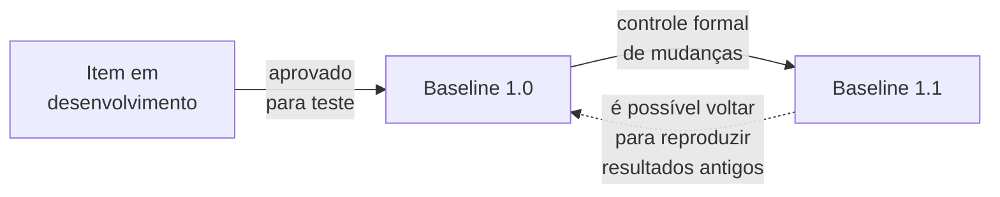

> **Seção 5.4 do syllabus.**

## Objetivo de aprendizagem

| Código | Nível | O que você precisa saber fazer |
|---|---|---|
| FL-5.4.1 | K2 | Resumir como o gerenciamento de configuração apoia os testes |

## O que é

No teste, o **gerenciamento de configuração** (CM, de *Configuration Management*) é a disciplina de **identificar, controlar e rastrear** os produtos de trabalho como **itens de configuração**. Exemplos de itens:

- planos de teste e estratégias de teste
- condições, casos e scripts de teste
- resultados, registros (logs) e relatórios de teste

Se você já usa Git, você já faz parte disso: cada commit identifica uma versão, o histórico rastreia as mudanças e uma tag marca uma versão aprovada.

## Itens complexos e linhas de base

Para um **item de configuração complexo**, como um **ambiente de teste**, o CM registra:

- os itens que o compõem (sistema operacional, banco de dados, versão da aplicação, bibliotecas, massa de dados)
- os **relacionamentos** entre eles
- as **versões** de cada um

Quando um item de configuração é **aprovado para teste**, ele vira uma **linha de base** (*baseline*). A partir daí, ele **só pode ser alterado por um processo formal de controle de mudanças**.

O CM mantém um **registro dos itens alterados** quando uma nova baseline é criada, e permite **voltar para uma baseline anterior** para **reproduzir resultados de testes anteriores**. Exemplo: um cliente relata um defeito na versão 3.2, que já foi substituída pela 3.5. Com CM, dá para remontar exatamente o ambiente e o código da 3.2 e reproduzir a falha.

## O que o CM garante para o teste

1. **Todos os itens de configuração**, inclusive os **itens de teste** (partes individuais do objeto de teste), são:
   - **identificados de forma única**
   - **controlados por versão**
   - **rastreados** quanto a mudanças
   - **relacionados** a outros itens, para manter a **rastreabilidade** durante todo o processo de teste
2. **Todos os documentos e itens de software** identificados são **referenciados sem ambiguidade** na documentação de teste. Um relatório de defeito diz "falha na build 3.2.147, ambiente HML-02", e não "falha na versão de ontem".

## CM e DevOps

Integração contínua, entrega contínua, implantação contínua e os testes associados normalmente são implementados num **pipeline de DevOps automatizado**, que costuma incluir **CM automatizado**. Cada execução do pipeline sabe exatamente qual commit, quais dependências e qual configuração de ambiente foram usados.

## Teste seu conhecimento

1. O que acontece com um item de configuração depois que ele é aprovado para teste?

Ele vira uma **linha de base** e só pode ser alterado por um **processo formal de controle de mudanças**.

2. Por que é útil poder voltar a uma baseline anterior?

Para **reproduzir resultados de testes anteriores**, por exemplo para investigar um defeito relatado numa versão antiga.

3. Qual destes NÃO é algo que o CM garante para o teste? (a) Itens identificados de forma única (b) Itens controlados por versão (c) Todos os defeitos corrigidos antes do lançamento (d) Referências sem ambiguidade na documentação de teste

**(c).** Corrigir defeitos não é papel do gerenciamento de configuração.

## Referências

- [Syllabus CTFL v4.0 em português](https://bstqb.online/ctfl) - BSTQB, português (seção 5.4)
- [Glossário ISTQB](https://glossary.istqb.org/pt-br/search/) - ISTQB, português (termos "gerenciamento de configuração", "item de configuração", "linha de base")
- [Pro Git, Primeiros passos: sobre controle de versão](https://git-scm.com/book/pt-br/v2/Primeiros-Passos-Sobre-Controle-de-Vers%c3%a3o) - Scott Chacon e Ben Straub, português
