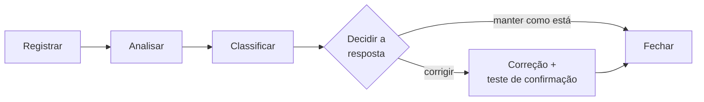
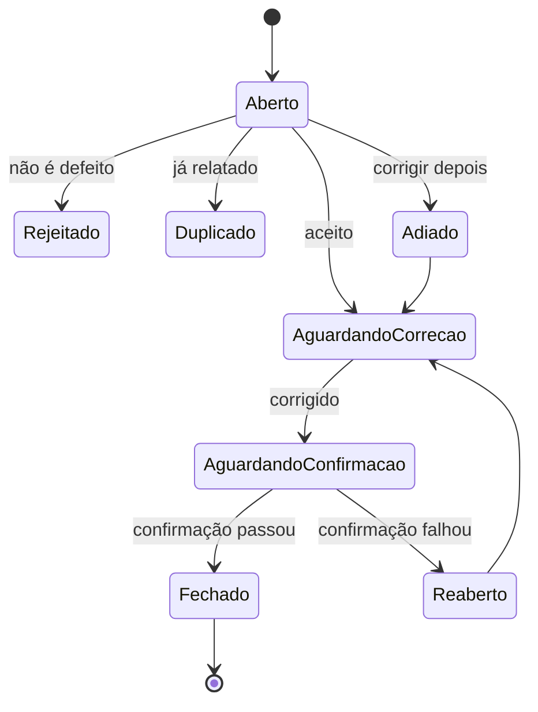

> **Seção 5.5 do syllabus.** Objetivo **K3**: você pode receber um cenário e precisar identificar o que falta num relatório de defeito.

## Objetivo de aprendizagem

| Código | Nível | O que você precisa saber fazer |
|---|---|---|
| FL-5.5.1 | K3 | Preparar um relatório de defeito |

## Palavras-chave

Definições do [Glossário ISTQB](https://glossary.istqb.org/pt-br/search/) em português, com uma leitura "em outras palavras" para fixar. Todas podem cair na prova em nível K1.

| Termo | Definição (Glossário ISTQB) | Em outras palavras |
|---|---|---|
| gerenciamento de defeitos | O processo de reconhecimento, registro, classificação, investigação, correção e descarte de defeitos. | O fluxo completo, da descoberta ao fechamento. |
| relatório de defeitos | Documentação da ocorrência, natureza e status de um defeito. | Precisa permitir **reproduzir** e **resolver**. |

> Pares úteis do glossário: **severidade** = o grau de impacto que um defeito tem no desenvolvimento, nos testes ou na operação; **prioridade** = o nível de importância atribuído a uma tarefa de acordo com critérios específicos. Severidade é **impacto**; prioridade é **urgência** de correção.

## O processo de gerenciamento de defeitos

Como encontrar defeitos é um dos principais objetivos do teste, ter um **processo de gerenciamento de defeitos** bem estabelecido é essencial.

Um detalhe importante: apesar do nome "defeito", o que se relata são **anomalias**. Durante o tratamento do relatório, descobre-se se a anomalia é mesmo um **defeito** ou **outra coisa**, como um **falso positivo** ou uma **solicitação de mudança**.

Anomalias podem ser relatadas em **qualquer fase** do SDLC, e a forma depende do SDLC. No mínimo, o processo inclui:

- um **fluxo de trabalho** para tratar cada anomalia, da **descoberta ao fechamento**
- **regras de classificação**



O processo deve ser seguido por **todos os stakeholders** envolvidos. E é recomendável tratar os defeitos encontrados em **teste estático** (principalmente análise estática) **do mesmo jeito**.

### Estados típicos de um defeito

O syllabus cita como exemplos de status: **aberto, adiado, duplicado, aguardando correção, aguardando teste de confirmação, reaberto, fechado, rejeitado**. Um fluxo possível:



## Para que serve um relatório de defeito

1. Dar a quem vai **tratar e resolver** o defeito **informação suficiente** para resolver o problema.
2. Fornecer um meio de **acompanhar a qualidade** do produto de trabalho.
3. Dar **ideias para melhorar** os processos de desenvolvimento e teste.

## O que um relatório de defeito contém

Para um defeito encontrado em **teste dinâmico**:

| Campo | Para que serve |
|---|---|
| **Identificador único** | Referenciar o defeito sem ambiguidade |
| **Título** com um resumo curto da anomalia | Entender o problema numa olhada |
| **Data** da observação, **organização** e **autor** (com cargo/função) | Contexto de quem e quando |
| **Identificação do objeto de teste e do ambiente** | Saber exatamente qual versão e onde |
| **Contexto do defeito** | Caso de teste em execução, atividade de teste, fase do SDLC, técnica, checklist ou dados de teste usados |
| **Descrição da falha** | Permitir **reproduzir e resolver**: passos, logs, dumps de banco, prints, gravações |
| **Resultado esperado e resultado real** | Deixar claro o que deveria ter acontecido |
| **Severidade** | Grau de **impacto** nos interesses dos stakeholders ou nos requisitos |
| **Prioridade** | **Urgência** da correção |
| **Status** | Onde o defeito está no fluxo (aberto, adiado, fechado...) |
| **Referências** | Ligação com o caso de teste, requisito, história |

Ferramentas de gerenciamento de defeitos costumam preencher alguns campos sozinhas (identificador, data, autor, status inicial).

> A ISO/IEC/IEEE 29119-3 chama o relatório de defeito de **relatório de incidente**.

### Severidade x prioridade

São campos **diferentes**, e a prova adora explorar isso:

| | Severidade | Prioridade |
|---|---|---|
| Mede | O **impacto** do defeito | A **urgência** da correção |
| Quem costuma definir | Quem testa (pelo efeito observado) | O negócio / PO / gerência |

| Exemplo | Severidade | Prioridade |
|---|---|---|
| Logo da empresa errado na página inicial, no dia do lançamento | Baixa | **Alta** |
| Sistema trava ao gerar um relatório anual usado uma vez por ano, daqui a 10 meses | **Alta** | Baixa |
| Pagamento com cartão não funciona para nenhum cliente | Alta | Alta |
| Erro de digitação num texto de ajuda pouco acessado | Baixa | Baixa |

## Exemplo completo

```text
ID:            DEF-1042
Título:        Desconto de cupom é aplicado também ao frete
Data:          2026-11-09
Autor:         Ana Souza (Analista de Teste), Loja Exemplo
Objeto:        loja-web build 3.2.147
Ambiente:      Homologação HML-02, Chrome 131, Windows 11
Contexto:      Execução do caso CT-CUP-001 (história LOJA-88), teste de sistema,
               sprint 24. Dados: usuário teste01, cupom DEZ (10%).
Passos:        1. Entrar com teste01
               2. Adicionar ao carrinho produtos que somem R$ 200,00
               3. Selecionar frete Sedex (R$ 20,00)
               4. Aplicar o cupom DEZ
Esperado:      Subtotal R$ 180,00; frete R$ 20,00; total R$ 200,00
               (critério de aceite 4: desconto não se aplica ao frete)
Real:          Subtotal R$ 180,00; frete R$ 18,00; total R$ 198,00
Evidências:    print-carrinho.png, log-api-checkout.txt
Severidade:    Média (perda de receita de 10% do frete em pedidos com cupom)
Prioridade:    Alta (campanha de cupons começa na sexta-feira)
Status:        Aberto
Referências:   CT-CUP-001, LOJA-88 (critério de aceite 4)
```

Dicas para um bom relatório:

- **Um defeito por relatório.**
- **Passos mínimos e reproduzíveis**: alguém que nunca viu o sistema deve conseguir reproduzir.
- **Fatos, não opiniões**: descreva o comportamento, não a pessoa (veja a parte de comunicação construtiva na nota [Habilidades, equipe completa e independência](../01-fundamentos-de-teste/06-habilidades-e-independencia.md)).
- **Esperado x real** sempre explícitos, de preferência citando o requisito ou o critério de aceite.

## Teste seu conhecimento

<details>
<summary>1. Uma anomalia relatada pode acabar não sendo um defeito?</summary>

Sim. Durante o tratamento, ela pode se revelar um **falso positivo**, uma **solicitação de mudança** ou outra coisa.

</details>

<details>
<summary>2. Um relatório tem título, passos, resultado esperado e real, mas não diz em qual versão nem em qual ambiente o problema ocorreu. O que falta e por que importa?</summary>

Falta a **identificação do objeto de teste e do ambiente**. Sem isso, o desenvolvedor pode não conseguir reproduzir a falha (talvez ela só aconteça naquela build ou naquele navegador).

</details>

<details>
<summary>3. Qual a diferença entre severidade e prioridade?</summary>

**Severidade** é o grau de impacto do defeito. **Prioridade** é a urgência da correção. Um defeito pode ter severidade baixa e prioridade alta, e vice-versa.

</details>

<details>
<summary>4. Defeitos encontrados por análise estática devem seguir o processo de gerenciamento de defeitos?</summary>

O syllabus recomenda tratá-los de maneira **semelhante** aos defeitos do teste dinâmico.

</details>

<details>
<summary>5. Quais são os três objetivos de um relatório de defeito?</summary>

Dar informação suficiente para resolver o problema; permitir acompanhar a qualidade do produto; e dar ideias para melhorar os processos de desenvolvimento e teste.

</details>

## Referências

- [Syllabus CTFL v4.0 em português](https://bstqb.online/ctfl) - BSTQB, português (seção 5.5)
- [Glossário ISTQB](https://glossary.istqb.org/pt-br/search/) - ISTQB, português (termos "relatório de defeito", "severidade", "prioridade")
- [Bug Writing Guidelines](https://bugzilla.mozilla.org/page.cgi?id=bug-writing.html) - Mozilla, inglês
