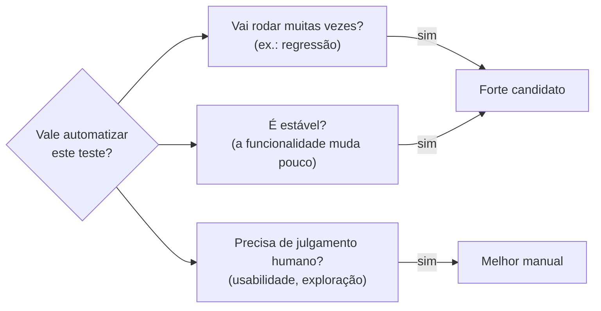

> **Seções 6.1 e 6.2 do syllabus.** Capítulo 6 vale **2 questões**, mas são questões "fáceis" se você souber as listas.

## Objetivos de aprendizagem

| Código | Nível | O que você precisa saber fazer |
|---|---|---|
| FL-6.1.1 | K2 | Explicar como os diferentes tipos de ferramentas de teste apoiam o teste |
| FL-6.2.1 | K1 | Relembrar os benefícios e os riscos da automação de testes |

## Palavras-chave

Definições do [Glossário ISTQB](https://glossary.istqb.org/pt-br/search/) em português, com uma leitura "em outras palavras" para fixar. Todas podem cair na prova em nível K1.

| Termo | Definição (Glossário ISTQB) | Em outras palavras |
|---|---|---|
| automação de testes | A conversão das atividades de teste para operação automatizada. | Não é só "rodar scripts": qualquer atividade de teste pode ser automatizada. |

## Tipos de ferramentas (FL-6.1.1)

Ferramentas apoiam e facilitam muitas atividades de teste. A lista do syllabus (que não é exaustiva):

| Tipo | Como apoia o teste | Exemplos de mercado |
|---|---|---|
| **Gerenciamento** | Aumentam a eficiência do processo, facilitando a gestão do SDLC, de requisitos, testes, defeitos e configuração | Jira, Azure DevOps, TestRail, Git |
| **Teste estático** | Apoiam revisões e análise estática | SonarQube, ESLint, ferramentas de revisão de código |
| **Projeto e implementação de testes** | Facilitam a geração de casos de teste, dados de teste e procedimentos | Geradores de dados (Faker), ferramentas de teste baseado em modelos |
| **Execução de testes e cobertura** | Facilitam a execução automatizada e a medição de cobertura | JUnit, pytest, Jest, Playwright, Cypress, JaCoCo |
| **Teste não funcional** | Permitem testes difíceis ou impossíveis de fazer manualmente | JMeter, k6, OWASP ZAP |
| **DevOps** | Apoiam o pipeline de entrega, o fluxo de trabalho, builds automatizados e CI/CD | GitHub Actions, Jenkins, GitLab CI |
| **Colaboração** | Facilitam a comunicação | Slack, Teams, Confluence |
| **Escalabilidade e padronização da implantação** | Máquinas virtuais, contêineres | Docker, Kubernetes, Vagrant |
| **Qualquer outra que ajude no teste** | | Uma **planilha** é uma ferramenta de teste, no contexto de teste |

A coluna de exemplos é só para dar concretude: **a prova não cobra nomes de ferramentas**, só os tipos e o que cada tipo faz.

O exemplo da planilha costuma aparecer em questões do tipo "qual destas é uma ferramenta de teste?". A resposta é: qualquer ferramenta usada para apoiar o teste.

## Benefícios e riscos da automação (FL-6.2.1)

Um aviso de partida do syllabus: **comprar uma ferramenta não garante sucesso**. Toda ferramenta nova exige esforço para trazer benefícios reais e duradouros (introdução, manutenção, treinamento) e tem riscos que precisam ser analisados e mitigados.

### Benefícios

| Benefício | Exemplos |
|---|---|
| **Economia de tempo** reduzindo trabalho manual repetitivo | Rodar regressão, redigitar os mesmos dados, comparar esperado x real, verificar padrões de código |
| **Menos erros humanos simples**, com mais consistência e repetibilidade | Testes derivados dos requisitos de forma consistente, dados criados de forma sistemática, testes executados na mesma ordem e frequência |
| **Avaliação mais objetiva** e medidas complicadas demais para pessoas | Cobertura de código |
| **Acesso mais fácil a informações** de teste para gestão e relatórios | Estatísticas, gráficos, dados agregados de progresso, taxas de defeito, duração das execuções |
| **Execução mais rápida** | Detecção antecipada de defeitos, feedback mais rápido, menor *time-to-market* |
| **Mais tempo para os testadores** | Criar testes novos, mais profundos e mais eficazes |

### Riscos

| Risco | Como aparece na vida real |
|---|---|
| **Expectativas irreais** sobre a ferramenta (funcionalidades, facilidade de uso) | "Com essa ferramenta, não precisamos mais de testadores" |
| **Estimativas imprecisas** de tempo, custo e esforço para introduzir a ferramenta, manter os scripts e mudar o processo manual | A automação que era para levar 1 mês leva 6 |
| **Usar ferramenta quando o teste manual é mais adequado** | Automatizar um teste de usabilidade ou uma tela que muda toda semana |
| **Confiar demais na ferramenta**, deixando de lado o pensamento crítico humano | "O pipeline está verde, pode lançar" sem ninguém olhar o produto |
| **Dependência do fornecedor**, que pode fechar, aposentar ou vender a ferramenta, ou dar suporte ruim | A ferramenta comercial é descontinuada e os scripts ficam presos nela |
| **Software de código aberto abandonado**, sem atualizações, ou com componentes que exigem atualizações frequentes | A biblioteca de automação para de receber correções de segurança |
| **Incompatibilidade** com a plataforma de desenvolvimento | A ferramenta não suporta o framework de front-end usado no projeto |
| **Ferramenta inadequada** que não cumpre requisitos **normativos** ou de **segurança** | Ferramenta sem certificação exigida em software médico |

### Uma forma de pensar

Esse diagrama não é do syllabus, mas ajuda a responder questões que pedem "em qual situação a automação é mais adequada".

## Teste seu conhecimento

1. Uma planilha usada para controlar a execução dos casos de teste é uma ferramenta de teste?

**Sim.** O syllabus cita a planilha como exemplo de ferramenta de teste no contexto de teste.

2. Qual tipo de ferramenta ajuda a fazer testes que seriam difíceis ou impossíveis manualmente, como simular 10.000 usuários?

**Ferramentas de teste não funcional.**

3. Qual destes é um RISCO da automação? (a) Feedback mais rápido (b) Medidas objetivas de cobertura (c) Confiar demais na ferramenta (d) Mais tempo para criar testes novos

**(c).** As outras três são benefícios.

4. Docker e máquinas virtuais entram em qual categoria de ferramenta?

Ferramentas de **escalabilidade e padronização da implantação**.

## Referências

- [Syllabus CTFL v4.0 em português](https://bstqb.online/ctfl) - BSTQB, português (capítulo 6)
- [Test Automation Engineering (CTAL-TAE)](https://istqb.org/certifications/certified-tester-advanced-level-test-automation-engineering-ctal-tae-v2-0/) - ISTQB, inglês (próximo passo para quem quer se aprofundar em automação)
- [Glossário ISTQB](https://glossary.istqb.org/pt-br/search/) - ISTQB, português (termo "automação de teste")
